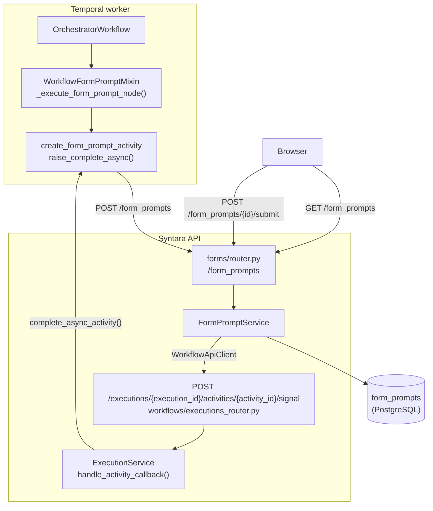
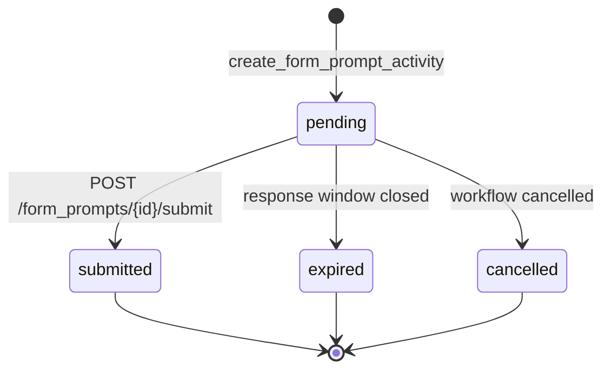
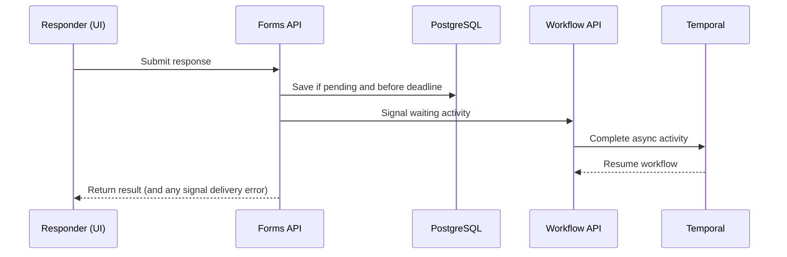
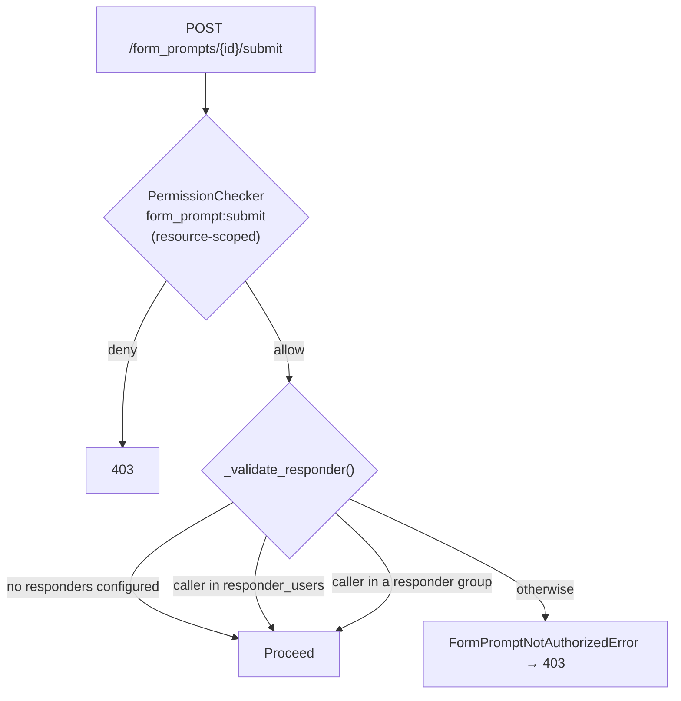

# Form Prompt Overview

A form prompt pauses a workflow and collects typed answers. A valid response resumes the
workflow through `submitted`; if the prompt times out, the workflow follows its configured
outcome. Other branches can continue and finish while the prompt is pending. Unlike an
approval, which collects a yes/no decision, a form prompt collects structured answers.

> This overview describes the feature's architecture and behavior. See
> [Form Definitions and Fields](#form-definitions-and-fields) for field types and
> [API Surface](#api-surface) for API shapes.

The sections follow the feature's own lifecycle: what an author defines, what the engine
creates when the step runs, what comes back when someone answers, and what happens when
nobody does.

## System Architecture

The worker creates a prompt and pauses; the browser submits a response that resumes the
workflow.

Key properties:

- **`forms/` owns prompts; `workflows/` owns the step.** The forms domain owns prompt
  records, field definitions, validation, authorization, and audit events. The workflows
  domain owns the step and its execution.
- The worker creates prompts through the Forms API, which signals the workflow after
  submission.
- **Prompts are one-shot snapshots.** Each prompt accepts one response and saves the form,
  resolved options, and presentation shown to the responder. Later workflow edits do not
  change an in-flight prompt.
- **Forms collect structured values only.** File uploads and encrypted-secret fields are not
  supported; `masked_text` masks display but is not encrypted at rest.
- Temporal tracks whether the step is waiting; Postgres stores the prompt and its response.
  Signal delivery and cleanup are best-effort; see [Current Limitations](#current-limitations).

## Form Definitions and Fields

A `FormDefinition` is an ordered list of fields with unique `value_name`s. Downstream steps
use those names to reference submitted field values. Definitions reject unknown properties and enforce limits
on field, label, and option counts.

Nine field types exist: `text`, `textarea`, `masked_text`, `email`, `number`, `checkbox`,
`date`, `dropdown`, and `multi_select`. One note on the shape of that list:

- **`date`** is one field type with toggles for date, time, and timezone. The enabled
  components are submitted together as one object under a single `value_name`, so downstream
  steps reference them through one field. If time is enabled, timezone is required.

### Options

Workflow authors can give `dropdown` and `multi_select` fields a fixed list or a dynamic
expression based on earlier workflow steps. The engine evaluates each dynamic expression
when the step starts and saves the resulting options with the prompt. Responders see that
snapshot, and submissions are checked against it, so the choices shown and accepted stay in
sync.

## The Form Prompt Step

A `form_prompt` step has two output ports, `submitted` and `fallback`. The `fallback` port is only reachable when the step's
`continue_on_failure` setting is enabled.

### Responders

`responder_users` and `responder_groups` limit who can answer. They use usernames and group
names so references survive workflow export and import. The names are resolved when the
step starts; unresolved names are ignored. Every submitter must also have
`form_prompt:submit` permission in the prompt's project; responder lists only narrow who
may submit. If both lists are empty, any user with that permission may submit. See
[Authorization](#authorization) for the full checks.

### The response window

The step's `response_window` parameter, or the
`workflow_engine.form_prompt_response_window_seconds` runtime setting (default 24 hours)
when the parameter is absent, sets how long a responder has. It becomes an absolute instant,
`timeout_at`, when the step starts — fixed from that moment, so changing the runtime setting
mid-flight does not move a running prompt's deadline.

Human-in-the-loop steps use dedicated parameters — `response_window` here,
`decision_window` for approvals — because `settings.timeout` is reserved for bounding
machine execution. See [Node Settings](../workflow-engine/node-settings.md) and
[Runtime Settings](../runtime-settings.md).

### Save-time validation

Defaults are checked using the same rules as submitted answers. The workflow validator also
checks constraints JSON Schema cannot express, such as valid calendar dates and defaults
that match the selected date components or an option list. Drafts can save with validation
issues; `/workflows/validate` returns `422`, and publishing returns `409`.

## Creating the Prompt

There is no separate form resource. Authors define `form_definition` in a workflow step,
which is the source of truth. At runtime, each prompt stores a snapshot of that definition
and its presentation fields alongside the response. Workflow edits do not change the form an
in-flight responder sees.

Status moves from `pending` to `submitted`, `expired`, or `cancelled`. The latter three are
terminal states:

### One prompt per step, per loop iteration

Each workflow execution creates one prompt per step instance, with a separate prompt for
each loop iteration. The Forms API's uniqueness constraint prevents a second row for the same
execution, step, and iteration. If the Forms API saves a prompt but the worker times out
before receiving the success response, an HTTP retry gets `409 Conflict` because the prompt
already exists. The client treats that as an error rather than reusing the existing prompt.
The form-prompt activity has no Temporal retries, so the constraint prevents duplicate rows
but does not recover the failed request. See [Current Limitations](#current-limitations).

### The pause

Prompts can wait for days, so the worker creates the prompt and completes the activity
asynchronously, freeing its worker slot. Temporal keeps the activity pending until a
response, timeout, or cancellation. Approvals, agentic steps, and wait steps use the same
signal-based pattern; see [Why Async Completion via Signals](../workflow-engine/workflow-engine-overview.md#why-async-completion-via-signals-approval-form-prompt-agentic-wait)
and [Approval Execution Pattern](../approvals/approval-execution-pattern.md).

The activity timeout follows the response window with a small buffer. It ends unanswered
waits and drives [timeout handling](#timeout-and-cleanup); the buffer does not extend the
submission window.

### Dispatch

`WorkflowFormPromptMixin` prepares the prompt by checking its route, resolving options and
responders, setting the deadline, and removing credentials from the message. Activity IDs
include loop indices so each loop iteration has a unique ID. See
[Dispatching to Activities](../workflow-engine/workflow-engine-overview.md#dispatching-to-activities)
for replay requirements.

## Responding

A prompt can be submitted once. `pending` is the only nonterminal status;
`submitted`, `expired`, and `cancelled` are terminal. The batch endpoint can expire or cancel
prompts, but cannot submit on a user's behalf.

Responses are validated against the prompt's saved form. Each field's `required` setting
and defaults determine whether its value is acceptable; dropdown and multi-select answers
must match the saved options. Validation returns all field errors together, and unanswered
optional fields are omitted from `response_data`.

### Resume

The Forms API saves a response only while the prompt is pending and before its deadline.
The conditional update accepts only one submission when responses arrive concurrently or a
submission races the deadline.

After saving, the API makes immediate retries for transient signal-delivery failures. If
delivery still fails, it returns a delivery error but keeps the response committed. There is
no durable retry or recovery path, so the response cannot be resubmitted and the workflow
can remain paused until its timeout. See [Current Limitations](#current-limitations).

Only submitted responses arrive by signal. Timeout and cancellation use their own workflow
paths. Downstream steps reference submitted values with
`${<step_id>.response_data.<value_name>}`.

## Timeout and Cleanup

Temporal's activity timeout handles unanswered prompts. The workflow marks the prompt
expired on a best-effort basis, then applies `continue_on_failure` and `fallback_decision`:

| `continue_on_failure` | `fallback_decision` | Result |
|---|---|---|
| `false` | — | The step fails and the workflow fails |
| `true` | `fallback` (default) | Continue the workflow on the `fallback` branch |
| `true` | `submit` | Continue on the `submitted` branch with empty output |

### Cancellation and detachment

When a workflow is cancelled or finishes while prompts remain pending, the engine best-effort
updates those prompts and resolves their waiting activities. Cleanup errors do not fail the
workflow. If an uncaught workflow error occurs while prompts are pending, or Temporal
force-terminates the workflow, these cleanup paths do not run; see
[Current Limitations](#current-limitations).

## API Surface

Browsers use `/form_prompts` to list, read, and submit prompts under RBAC. The Temporal
worker uses service-authenticated operations to create prompts and update their status in
batches. After submission, the Forms API calls the workflows-owned
`POST /executions/{execution_id}/activities/{activity_id}/signal` endpoint to resume the
waiting activity.

The API returns a creation receipt to the worker, a full prompt to the responder, and a
compact row for task lists. See the [Forms API specification](../../src/syntara/schemas/forms/openapi.yaml)
and [OpenAPI Spec Management](../standards/openapi-spec-management.md).

## Authorization

Submitting a response passes two independent checks, and both must succeed.

**Tier 1 — RBAC.** For a GET or submit request on one prompt, the API checks the matching
permission: `form_prompt:read` for GET and `form_prompt:submit` for submit. System roles
grant these permissions globally; project roles grant them within the prompt's project. For
a list request, the API returns only prompts from projects the caller is allowed to access.

| Action | System roles | Project roles |
|---|---|---|
| `form_prompt:create` | admin | — (service-to-service only) |
| `form_prompt:read` | admin, auditor | project-admin, project-user, project-auditor |
| `form_prompt:submit` | admin | project-admin, project-user |

**Tier 2 — the responder list**, checked inside the service where the relationships are
loaded. Naming responders **narrows** tier 1, never widens it: a listed user still needs
`form_prompt:submit`.

The worker calls create and batch as an mTLS service principal, bypassing tier 1 entirely;
when S2S TLS is disabled for local development those endpoints fall back to admin-only. See
[S2S Certificate Authentication](../s2s-cert-authentication.md).

One authorization carve-out is specific to this feature: the builder's responder picker
needs to list who *could* answer a prompt, which is an authz introspection query a workflow
author may not otherwise be allowed to run. `authz/router.py` gates it narrowly — someone
who can edit workflows in a project may ask who can submit form prompts there — rather than
granting general introspection. Approvals have the equivalent carve-out.

## Observability

Three audit events live in `forms/audit/form_prompt.py`, all workflow-category events keyed
on a form prompt URN:

| Event | Severity | Actor | Payload |
|---|---|---|---|
| `form_prompt_created` | INFO | SYSTEM | Dispatched **inside the create transaction** via the transactional outbox, so prompt and audit row commit atomically |
| `form_prompt_submitted` | INFO | Resolved from the principal | `outcome`, `submitted_at`, `wait_time_ms`, `field_count` |
| `form_prompt_expired` | WARNING | SYSTEM | `expired_at`, `timeout_at` |

Submission audit events contain metadata, not submitted field values. Values are stored with
the prompt and protected by normal form-prompt read permissions. `masked_text` is masked in
the UI but is not encrypted at rest.

Telemetry errors are swallowed so they cannot affect a submission.

Handoff latency uses a monotonic clock within one process; resume latency uses Temporal
history timestamps. Neither metric compares clocks across hosts.

Errors use RFC 9457 problem details. See [Audit](../audit.md) and
[Observability](../standards/observability.md).

## Adding a New Field Type

Files to touch:

1. **`forms/models/form_fields.py`** — define the field model and add it to the
   `FormField` discriminated union.
2. **`forms/validators/submission.py`** — add its submission coercion and default behavior.
   If it has options, update option resolution and membership validation in
   `forms/validators/options.py` as well.
3. **Tests** — cover the field definition and submitted values, including defaults and
   options when applicable.

## Current Limitations

- **Ambiguous prompt creation has no recovery path.** If the API saves a prompt but the
  worker times out before receiving the success response, the retry gets `409 Conflict` and
  the activity fails rather than reusing the prompt. The row may remain pending even though
  the workflow is no longer waiting for it. See
  [One prompt per step, per loop iteration](#one-prompt-per-step-per-loop-iteration).
- **Signal delivery has no durable recovery.** The response is saved before signaling the
  workflow. Transient failures are retried immediately; if delivery still fails, the response
  cannot be resubmitted and the workflow may remain paused until timeout. See [Resume](#resume).
- **There is no prompt sweeper.** If a workflow ends outside the normal timeout or
  cancellation paths, its prompt row can remain `pending` indefinitely. Late submissions are
  still rejected. See [Cancellation and detachment](#cancellation-and-detachment).

## Related Documentation

- [Form Trigger Milestone Proposal](form-trigger-milestone-proposal.md) — the planned
  pre-execution sibling; records what is reusable from the shared form layer and why file
  upload and secret storage are out of scope
- [Workflow Engine Architecture](../workflow-engine/workflow-engine-overview.md) — graph
  execution, async completion, and live-status sync shared by every step type
- [Approval Overview](../approvals/approval-overview.md) — the sibling human-in-the-loop step
- [Approval Execution Pattern](../approvals/approval-execution-pattern.md) — the
  async-completion/signal pattern in detail
- [Node Settings](../workflow-engine/node-settings.md) — settings tiers, timeout, and
  continue-on-failure resolution
- [Runtime Settings](../runtime-settings.md) — the settings catalog and resolution order
- [Expression System](../workflow-engine/expression-system.md) — the `${...}` namespace
- [Authorization](../authorization.md) — RBAC, PermissionChecker, VisibilityFilter
- [Audit](../audit.md) — audit event pipeline and transactional outbox
- [Forms API Specification](../../src/syntara/schemas/forms/openapi.yaml)
