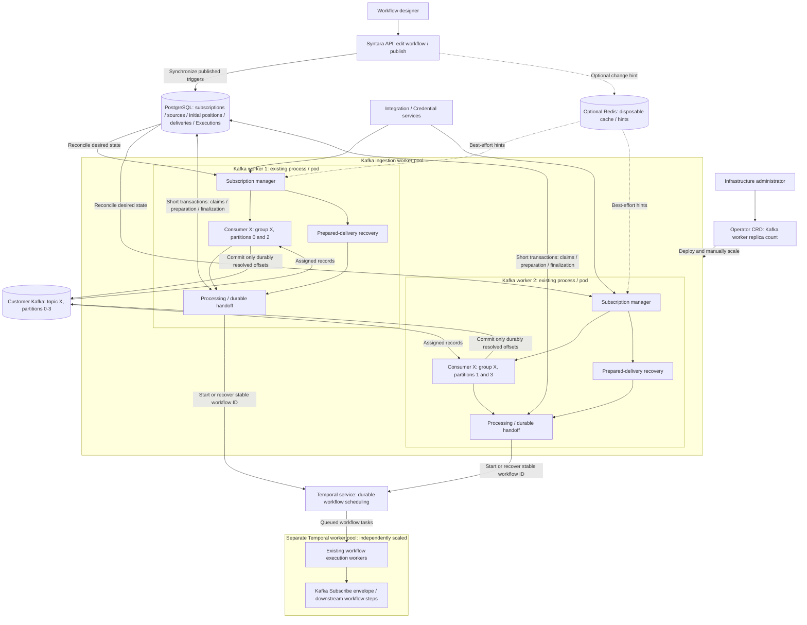
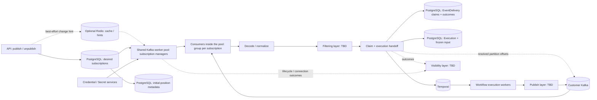
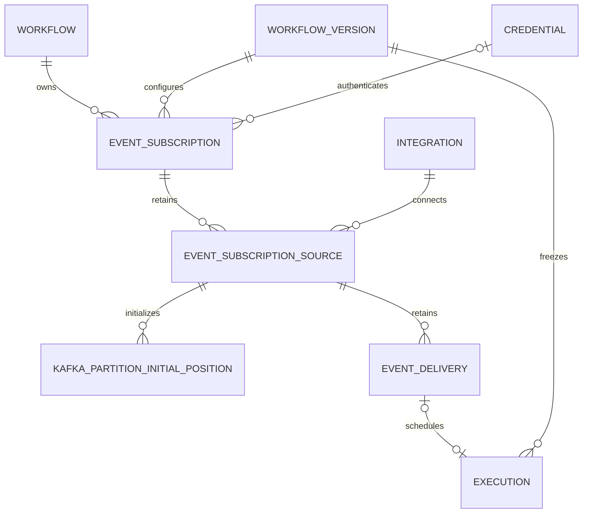
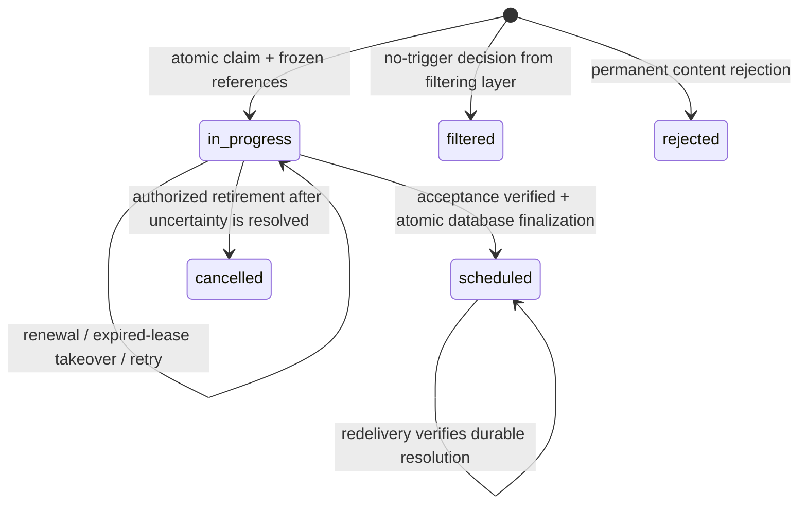
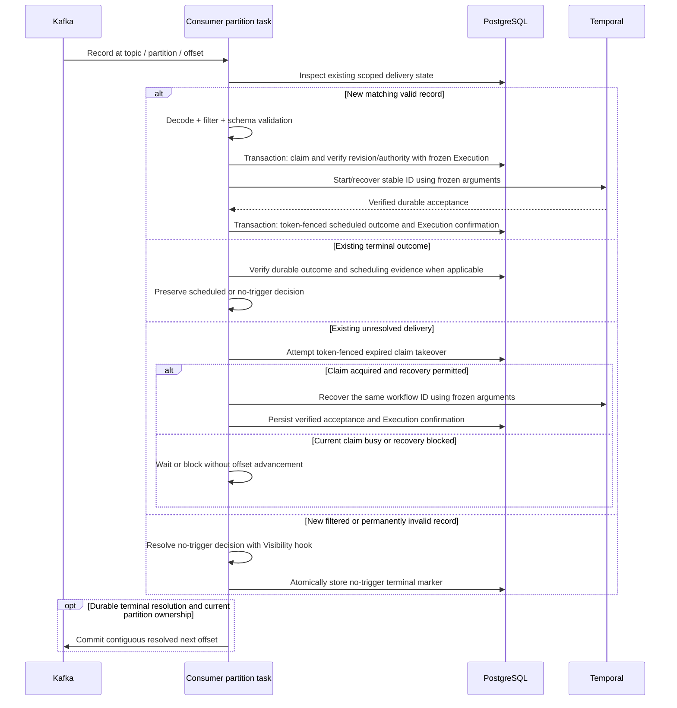

# Kafka Subscribe and Publish

> **Design proposal** - A managed Kafka trigger, a Kafka publish action, and a shared pool of `aiokafka` consumer workers. Publish remains a deferred layer. This document defines the architecture, persistent models, runtime contracts and delivery behavior we plan to implement.

## Contents

- [Overview and design context](#overview)
- [Code architecture and service contracts](#architecture)
- [Integration, credentials, and authorization](#integration-credentials-and-authorization)
- [Persistent models and lifecycle](#subscription-persistence-and-lifecycle)
- [Step schemas and APIs](#step-schemas-and-api-surface)
- [Worker operation](#consumer-worker-operation)
- [Durable delivery and recovery](#delivery-and-durable-execution-handoff)
- [Message contract and filtering](#message-contract-decoding-and-size)
- [Publishing](#kafka-publish-action)
- [Visibility](#visibility) and [deployment](#deployment-and-configuration)
- [Verification and migration](#performance-and-verification-plan)
- [Implementation sequence and review decisions](#implementation-sequence-and-review-decisions)

## Overview

Kafka Subscribe starts a workflow for each valid eligible Kafka message. Filtering sits before workflow handoff, outbound Publish connects workflow actions to Kafka. Subscribe references a Kafka Integration and runtime Credential; consumer connections live outside the API process.

The consumer worker uses `AIOKafkaConsumer` directly. Kafka manages partition assignment and group membership. Syntara manages subscriptions, configuration reconciliation, execution handoff and recovery across Kafka, PostgreSQL, and Temporal.

Our delivery contract is **at-least-once handoff to durable workflow scheduling**, with idempotent admission for redelivery of the same Kafka record. A workflow does not have to start or finish before the record is committed. This contract applies within the supported message contract and recoverable Kafka history; it cannot recover records removed by customer retention or compaction.

The important decisions are:

| Concern | Design decision |
|---|---|
| Transport | `aiokafka`, in a shared worker pool; execution-plane deployment is out of scope   |
| Connection resource | `IntegrationType.KAFKA`; reuse Integration CRUD, visibility, validation, and Credentials |
| Consumption unit | One exact topic per logical subscription; one stable group per subscription |
| Worker pool | Long-running workers share subscription workloads; the infrastructure administrator sets the replica count through the operator CRD |
| Workload distribution | Each worker hosts one consumer per active subscription; the built-in round-robin group assignor distributes each subscription's partitions |
| Resolution | Commit only after durable resolution; explicit lifecycle cancellation requires the retirement checks below |
| Duplicate protection | PostgreSQL delivery claims/outcomes keyed by Workflow ID + Subscription ID + TPO, scoped to connector/source; stable Temporal workflow ID |
| Initial position | PostgreSQL stores the first partition boundary; Kafka committed group offsets govern subsequent resumption |
| Execution identity | Platform service principal, matching scheduled triggers; selected service accounts deferred |

Filtering, Visibility, and Publish remain **TBD** for now (will revisit in Milestone 2) and appear only as layer boundaries below.

## Design context

This design builds on the existing Integration, Credential, workflow publication, execution, and audit domains. We are defining Kafka-specific consumption and recovery semantics while retaining reusable event decoding, filtering, and dispatch interfaces.

### Existing platform seams

- [Integration configuration](../src/syntara/integrations/models/integration_configuration.py) uses a discriminated SQLModel union. [Integration](../src/syntara/integrations/models/integration.py) stores its type in a PostgreSQL enum and separates `management_credential_id` from step runtime credentials. Adding Kafka requires a model, adapter registration, enum migration, and API contract updates.
- [WorkflowService](../src/syntara/workflows/services/workflow_service.py) locks a workflow on publish/unpublish. Webhook trigger rows are synced inside the transaction; Temporal schedules are synced after commit and reconciled separately. Kafka desired state belongs in the publication transaction; broker I/O belongs outside it.
- [ExecutionService](../src/syntara/workflows/services/execution_service.py) selects a version, validates trigger inputs, enforces the existing concurrency cap, starts Temporal, and then writes an Execution. It generates a fresh UUID and attempts cancellation after a database commit failure. Calling it unchanged on every Kafka retry would not deduplicate deliveries.
- [TemporalExecutionService](../src/syntara/workflows/workflow_engine/services/temporal_execution_service.py) accepts an execution ID but constructs the Temporal ID from the mutable workflow name. Kafka needs an explicit stable ID and duplicate-rejection policy.
- [Trigger activities](../src/syntara/workflows/workflow_engine/activities/webhook_trigger.py) pass input through the existing output-mapping mechanism. The Kafka consumer worker receives messages and supplies the event envelope to each workflow execution. The Kafka Subscribe trigger activity passes that envelope to downstream steps through the same output-mapping mechanism.
- [Credential resolution](../src/syntara/workflows/workflow_engine/activities/credential_resolution_activity.py) and [integration scope checks](../src/syntara/workflows/workflow_engine/activities/integration_scope_activity.py) provide useful patterns. Extract reusable service logic for the consumer process rather than invoking Temporal activities to maintain a subscription.

### Relationship to the event-bus SDP

We will keep the separate worker, database reconciliation, credential injection, and separation of desired state from runtime health. We will implement Subscribe transport access directly with aiokafka behind its consumer interface.

Each distinct Kafka Subscribe trigger configuration is a separate logical subscription, including trigger nodes/workflows that use the same integration and topic. Republishing the same logical trigger preserves its subscription identity under the lifecycle rules below; it does not create a new subscription for every configuration revision. Each subscription has its own stable consumer-group identity and reading position. Kafka can therefore deliver the same record independently to several subscriptions without an application-managed fan-out dispatcher.

We will treat fan-out as **available by construction but not committed**. Independent groups make this behavior possible, but fan-out is not a requirement for this delivery. Ordinary subscription, delivery-recovery, and worker-scaling tests remain required.

Consumer groups coordinate current partition ownership; they do not eliminate redelivery after a crash between workflow scheduling and offset commit. The durable admission path below closes that window.

## User flow and scope

1. An integration administrator creates a Kafka Integration, supplies bootstrap addresses and security settings, and tests it with a management credential.
2. A workflow designer adds a Kafka Subscribe trigger, selects the integration, runtime credential, exact topic, and optional input schema. Filtering configuration remains TBD.
3. Publishing validates these references and records desired subscriptions atomically with the published version. The response can say activation is pending; broker readiness is asynchronous.
4. Each matching message starts one execution. Downstream steps can read `${trigger.payload}` and `${trigger.metadata}` through the selected trigger's normal namespace.
5. Visibility receives subscription and processing outcomes.
6. An outbound Publish layer connects workflow actions to Kafka.

The concrete consumer design includes Kafka JSON messages, CloudEvents structured and binary binding, Subscribe, scoped authorization, and a shared worker pool. Exact topics avoid accidental broad subscription and unbounded topic discovery. Fan-out is documented as an emergent effect of independent subscriptions and is not a committed requirement, topology, capacity promise, or separate SLO.

Excluded: Avro/Protobuf/schema registries, broker provisioning, Kafka transactions spanning workflow execution, exactly-once business effects, at-most-once consumption, historical-start controls, DLQ/replay, CEP, event aggregation, other message buses, live payload preview, fan-out-specific topology/test coverage, autoscaling, and execution-plane or per-subscription worker deployments. Customer brokers and their ACLs remain customer managed.

## Architecture

### Deployment architecture

The deployment view below shows two Kafka workers serving one subscription, X, whose topic has four partitions. The partition assignment is illustrative and can change after a rebalance. Each additional active subscription has its own consumer in every Kafka worker and its own Kafka consumer group.



Kafka assigns partitions within group X; PostgreSQL coordinates delivery claims and recovery. Prepared-delivery recovery continues for paused, unpublished or retired subscriptions without creating a Kafka consumer for them. Redis owns no coordination state. Kafka workers submit executions using the platform service principal; existing Temporal workers execute them. Creating a subscription or receiving an event does not create a pod. Filtering, Visibility and Publish remain TBD at the processing boundaries shown in the next view.

### Event processing architecture



The Kafka worker pool holds persistent connections and runs application service code with short database sessions. Subscriptions are managed within those existing processes. Temporal receives finite workflow executions and its existing worker pool executes them asynchronously. Kafka ingestion workers and Temporal execution workers have separate deployments and replica controls.

### Subscription, consumer, and worker boundaries

| Term | Meaning |
|---|---|
| Event | One received message; for Kafka, its transport identity is topic, partition and offset |
| Subscription | Persisted configuration linking one trigger to its source, credential, and target workflow |
| Consumer | An aiokafka client and processing tasks managed inside a Kafka worker process |
| Kafka worker | A long-running process/pod in the operator-managed pool that serves subscription workloads |
| Kafka worker pool | The deployed Kafka worker processes collectively serving all active subscriptions |
| Workflow execution | A finite run submitted to Temporal and handled by existing Temporal workers |

Creating or activating a subscription creates configuration and consumer runtime state, not a new worker process or pod. Receiving a message creates a workflow execution after durable handoff; it does not create a Kafka or Temporal worker. A worker can host consumers for several subscriptions, and consumers serving the same subscription across workers use that subscription's group ID. The worker-pool size is independent of the number of subscriptions and events.

We will retain transport-neutral interfaces where they describe real common behavior: raw event, decoder, filter, handler result, and launcher. We will keep group management, offsets, partition ownership, and retention recovery in the Kafka adapter. Kafka security configuration is Kafka-specific even if carried by the existing `BrokerConnection` value object. Future adapters must define their own acknowledgement guarantees.

### Code organization

We will organize the implementation as follows. The new modules listed here are planned additions to the application. We will keep domain persistence/services separate from the transport client and avoid creating a second workflow execution engine.

```text
src/syntara/
  eventstreams/
    consumer_entrypoint.py          # dependency composition and process bootstrap
    consumer_lifecycle.py           # signals and bounded shutdown; visibility hooks TBD
    consumer_service.py             # worker manager and per-subscription supervision
    router.py                       # runtime subscription inspection/control APIs
    models/
      subscription.py               # transport-neutral EventSubscription
      source.py                     # EventSubscriptionSource + typed source configuration
      delivery.py                   # EventDelivery durable identity, claim and outcome
      kafka/initial_position.py     # Kafka partition boundary and explicit gap recovery
      responses.py                  # SQLModel read/control/list response schemas
    services/
      subscription_service.py       # transactional desired-state reconciliation
      connection_provider.py        # Integration/Credential resolution and revisions
      admission_service.py          # PostgreSQL claim + idempotent Execution handoff
      deduplication_store.py         # transactional PostgreSQL claim/renew/takeover/resolution
      initial_position_service.py   # initial boundary, confirmation, gap metadata
      recovery_service.py           # recover prepared starts and acknowledge gaps
    core/
      connection.py                 # resolved connection and consumer configuration
      envelope.py                   # lossless raw event and versioned trigger envelope
      consumer.py                   # consumer lifecycle protocol
      handler.py                    # processing outcome and launcher interfaces
      deduplication.py              # typed delivery state and token-fenced claim values
      pipeline.py                   # size check, decode, filter, validate, resolve
      serialization.py              # strict JSON and CloudEvents normalization
      filter.py                     # filtering layer boundary; implementation TBD
      exceptions.py                 # content, dependency, and configuration errors
    visibility/                     # outcome/reporting layer; implementation TBD
    publish/                        # outbound Kafka layer; implementation TBD
    adapters/
      kafka.py                      # aiokafka fetch/commit, rebalance, partition task owner
    handlers/
      workflow_launcher.py          # bridge to shared workflow preparation/Temporal services
  integrations/
    models/integration_configuration.py  # KafkaConfiguration union member
    adapters/kafka.py                    # IntegrationAdapter validation/discovery
  workflows/
    services/workflow_service.py         # publication invokes subscription sync in transaction
    services/execution_service.py        # shared execution preparation and quota policy
    workflow_engine/
      activities/event_subscribe.py      # envelope pass-through/output mapping
      activities/registry.py             # registrations for main workflow worker
      models/workflow_definition.py      # trigger/action parameter and output types
      services/temporal_execution_service.py  # explicit stable ID and reuse/conflict policies
  core/tls/kafka.py                      # verified SSL context and private material cleanup
```

The `core` event modules do not import SQL persistence, FastAPI routers, workflow services, or aiokafka. Kafka adapters depend on these core contracts, not on WorkflowService. Application services compose repositories, authorization, and the workflow launcher. Integration validation reuses connection/TLS construction without depending on the running consumer manager.

Workflow publication depends on `subscription_service` only for desired-state synchronization. That service reads a supplied workflow definition and session; it does not import WorkflowService or start a consumer. `admission_service` calls shared execution preparation and a launcher without making subscription persistence part of the workflow engine. We will use explicit module imports and thin `__init__.py` exports to prevent a cycle through domain service packages.

### Ownership and interfaces

| Component | Owns | Does not own |
|---|---|---|
| `EventWorkerManager` | Desired-state snapshots, supervisor tasks, reconciliation, health aggregation, shutdown ordering | Kafka partition assignment or durable record outcomes |
| `SubscriptionSupervisor` | Local consumer runtime within an existing worker, applied revisions and restart/circuit policy | Creating a worker/pod per subscription, consumer-group leadership or workflow execution |
| `KafkaEventConsumer` | AIOKafkaConsumer, rebalance listener, bounded per-partition queues/tasks, explicit commit/seek/pause | Filter language, principals, database transaction policy |
| `EventProcessingPipeline` | Safe envelope construction, decode/filter/schema decisions, calls into durable resolution | Direct Kafka commits or transient failure deletion |
| `EventAdmissionService` | PostgreSQL claim orchestration, frozen Execution preparation, scheduling and ordinary Execution confirmation | Kafka fetch positions or partition assignment |
| `EventDeliveryStore` | PostgreSQL unique identity, token-fenced claims, lease renewal/takeover, terminal outcomes and retention | Kafka consumer assignment or full message storage |
| `KafkaInitialPositionService` | Persisted first boundary, initial-commit confirmation, explicit recovery-gap metadata | Ongoing Kafka checkpoints or delivery deduplication |
| `WorkflowLauncher` | Start/describe the stable Temporal workflow and classify acceptance/ambiguity | New execution identities on retry or offset acknowledgement |
| Filtering layer | Position between decoding and handoff; details TBD | Consumer commits |
| Visibility layer | Outcome reporting boundary; details TBD | Deduplication or Kafka checkpoints |
| Publish layer | Workflow-to-Kafka outbound boundary; details TBD | Subscribe consumer lifecycle |

Service methods will accept explicit identity/context objects. `prepare_delivery` owns one short transaction combining claim acquisition, lifecycle checks and deterministic Execution preparation; it returns a frozen Execution and its claim together. We will use the following contracts:

```python
# Types shown here are SQLModel value/API schemas; implementations are async services.
async def sync_from_published_definition(
    session: AsyncSession,
    workflow: Workflow,
    version: WorkflowVersion,
    actor: PrincipalContext,
    *,
    enabled: bool,
) -> SubscriptionChangeSet: ...

async def resolve_connection(
    snapshot: SubscriptionSnapshot,
) -> ResolvedKafkaConnection: ...

async def prepare_delivery(
    snapshot: SubscriptionSnapshot,
    record: EventRecordIdentity,
    envelope: WorkflowEventEnvelope,
) -> PreparedDelivery | ExistingTerminalOutcome | ClaimBusy | RevisionChanged: ...

async def start_or_recover(
    execution: PreparedExecution,
    claim: DeliveryClaim,
) -> ConfirmedTemporalAcceptance | AmbiguousStart: ...

async def finalize_delivery(
    claim: DeliveryClaim,
    execution: PreparedExecution,
    acceptance: ConfirmedTemporalAcceptance,
) -> ResolvedDelivery | ClaimLost: ...

async def resolve_without_execution(
    snapshot: SubscriptionSnapshot,
    record: EventRecordIdentity,
    outcome: Filtered | Rejected,
) -> ResolvedDelivery | RevisionChanged | ExistingClaim: ...
```

`EventRecordIdentity` combines common source/transport identity with a typed adapter-supplied record identity. Kafka supplies topic, partition and offset; future adapters define their own identity without inheriting those fields. `ResolvedDelivery` proves a durable terminal delivery outcome and, for scheduled outcomes, ordinary Execution confirmation, and carries that record identity. The Kafka adapter derives contiguous commit positions from its assignment-local completion queue and verifies current ownership/local epoch. `Retry` and `Blocked` never authorize advancement; the common result contract preserves resolution evidence and the blocked reason without prescribing another transport's acknowledgement operation.

`SubscriptionSnapshot` contains published version, source generation, configuration revision, trigger parameters, and principal references. It is immutable for a processing attempt. `ResolvedKafkaConnection` carries secret values only in protected memory and has a redacted representation. It must not be returned by a public API or placed in runtime observations. A separate non-secret connection revision hashes configuration/credential change identifiers, not secret contents.

### Dependency composition and database sessions

The entrypoint initializes settings, the encryption service, signed Temporal client, database session factory, PostgreSQL delivery store, connection provider, and worker manager. We will inject these dependencies into services. The standalone process uses a factory derived from application database configuration; tests supply a test factory directly. Request handlers continue to use `get_db()` and its dependency overrides. We will not share an AsyncSession between concurrent partition tasks or hold a transaction across Kafka/Temporal network calls.

We will keep one Temporal client per process, a bounded database connection pool, and separately bounded preparation/finalization concurrency. Queue capacity is counted in bytes as well as records. The API validation adapter opens only short-lived clients.

Startup performs a database reconciliation before readiness. Recover prepared admissions before processing later records from their partitions. Consumer startup for an unavailable integration must not prevent other subscriptions or delivery recovery from starting. Shutdown first disables new reconciliation and recovery claims, then closes admission, drains/stops consumers, settles ordinary Execution state, closes clients, and invokes the shutdown boundary. A supervisor crash restarts that subscription with its persisted retry state; only a manager invariant failure ends the process.

## Integration, credentials, and authorization

### Integration configuration

We will add `KafkaConfiguration` to the existing Integration union:

| Field | Meaning |
|---|---|
| `integration_type: "kafka"` | Discriminator |
| `bootstrap_servers: list[str]` | Validated non-empty `host:port` addresses, including supported IPv6 syntax |
| `security_protocol` | `PLAINTEXT`, `SSL`, or `SASL_SSL` under the support matrix below |
| `sasl_mechanism` | Optional PLAIN / SCRAM choice, required for SASL |
| `allow_plaintext: bool = false` | Explicit administrator opt-in for unauthenticated plaintext |

We will reject secret material in this configuration. Topics and group IDs belong to subscription sources; filtering remains TBD. Execution identity is derived by the runtime rather than selected on the Integration or Subscribe step. Allowing several bootstrap servers must not be modeled as an HTTP URL; Kafka also connects to metadata-advertised broker addresses. We will extend the platform's destination policy for both bootstrap and advertised endpoints, including validation and runtime DNS changes. Reusing only the existing HTTP URL check is insufficient.

### Supported security

| Transport/authentication | Milestone 1 |
|---|---|
| Unauthenticated PLAINTEXT | Explicit administrator opt-in; encrypted transport is the default expectation |
| SSL with server verification | Supported, using system trust or a credential CA bundle |
| SSL with mTLS | Supported, including system trust plus a client certificate |
| SASL_SSL + PLAIN | Supported |
| SASL_SSL + SCRAM-SHA-256 / SCRAM-SHA-512 | Supported |
| SASL_PLAINTEXT | Rejected (no transport encryption; SASL/PLAIN can expose credentials) |
| GSSAPI / OAUTHBEARER | Deferred pending customer demand and a credential/provider design |

We will seed a managed Kafka credential type with optional username/password, CA PEM, client certificate chain PEM, private key PEM, and key passphrase. We will validate the required combinations against the integration security mode. API key/secret pairs map to username/password where the customer's broker uses those mechanisms. All credential contents stay in the Credentials/SecretService path; logs, workflow definitions, and subscription rows contain only references.

The consumer resolves the selected **runtime** credential. Connector validation resolves `management_credential_id`; success with an administrative credential does not prove that a step credential can read a topic or join its group. We will add an authorized subscription test using the selected runtime credential to check topic metadata and group permissions without consuming or committing customer records. Metadata validation must use a non-creating request path; we will verify client/broker auto-topic-creation behavior rather than assume a metadata lookup is harmless. We will report permissions that cannot be checked without side effects as unverified.

For SSL and SASL_SSL, we will create verified SSL contexts regardless of whether a custom CA exists. For mTLS, materialize private PEM files in a private temporary directory with restrictive permissions, load the certificate/key/passphrase, and clean up after use. We will not share the platform's internal service-to-service certificate as a customer Kafka identity. A connection revision includes credential changes; a disabled, revoked, or changed credential drains/restarts the affected clients and preserves offsets. A failed new credential blocks consumption until corrected.

The Kafka Integration adapter implements `validate()` with bounded metadata/connectivity I/O and `discover()` with a connection result and no resource creation. We will map failures to the existing health error types using sanitized codes. Topic errors belong to subscription health even when the overall connector is reachable.

### Execution identity and permission gates

Kafka will initially use the **platform service principal**, matching scheduled triggers. Execution preparation derives `service_principal_id(settings.service_identity)` and assigns it to Execution `created_by` and `updated_by`. Designers do not select an execution service account; Subscribe parameters contain no execution-account field. Customer Kafka authentication remains separate and uses the configured runtime credential.

Publish/republish requires `workflow:update`, with no additional `execution:run` gate introduced for Kafka. Activation, resume and retry follow the applicable workflow control permissions and validate publication, integration/project scope and runtime credential availability. Actor-facing integration/credential selection and unsaved tests retain Integration visibility and `credential:use` checks. These resource-access checks do not establish standing execution grants. Kafka does not re-authorize the designer or workflow creator for `execution:run` on each event.

Normal pause, retry, safe retirement following listener removal or source replacement, and safe workflow deletion remain subject to the applicable workflow permissions. Exceptional gap recovery that selects a new reading boundary requires `event_subscription:recover`; exceptional retirement that explicitly resolves outstanding unscheduled work requires `event_subscription:retire`. These administrative grants belong to system admins and project-scoped project admins, and do not follow from publish/republish authority. Authorization does not itself drain work, resolve an ambiguous start, authorize offset advancement or message discard, or cancel an already scheduled execution. Publication and operational-control stories own lifecycle enforcement.

At new admission, we will verify published subscription lifecycle/configuration, integration enablement and runtime credential availability, and enforce the existing concurrency limit. Before a start attempt, we will recheck the credential and integration availability for the frozen binding. An already prepared Execution does not reserve another concurrency slot or fail the new-admission capacity check against its own pending row. A disabled or revoked Kafka credential blocks consumption without discarding messages. There are no selected-account revocation or standing execution-permission checks in this phase. Already scheduled executions follow ordinary execution cancellation policy.

Workflow-context metadata follows the scheduled launcher's existing attribution convention: `created_by` and `created_by_user_id` describe the workflow's original creator, while the database Execution identifies the platform service principal. Creator metadata is descriptive; it does not imply that the creator's current permissions were checked. Separate event metadata records the enabling actor, subscription, trigger node, source position and published version. Event contents cannot select the execution principal, integration, credential or workflow.

See [scheduled Execution preparation](../src/syntara/workflows/workflow_engine/scheduled_launcher.py), [schedule synchronization](../src/syntara/workflows/services/scheduled_trigger_service.py), and the [workflow publish endpoint](../src/syntara/workflows/router.py). Kafka follows the scheduled principal/attribution model while retaining its own deterministic Execution/Temporal identity and durable handoff; it does not adopt the scheduled launcher's child-workflow mechanism.

**Deferred:** designer-selected service accounts, account-binding permissions and per-event standing execution-permission checks. These are outside the initial schema, API and validation requirements and need a separately agreed identity/authorization design.

## Subscription persistence and lifecycle

### Data models

All tables and API schemas use SQLModel; schema changes use Alembic. We will add the persistent schemas and service contracts described below.

| Model | Essential fields and constraints |
|---|---|
| `EventSubscription` | Logical workflow/trigger identity, project, current published version/configuration, runtime credential, desired enabled state, active source generation, enabling actor |
| `EventSubscriptionSource` | Transport-neutral source generation: integration/source identity, transport discriminator, typed source configuration and creation/retirement boundary |
| `EventDelivery` | Unique canonical identity digest; source/subscription/workflow identity, typed record identity, state, lease/token, frozen binding, optional Execution reference, retry and resolution metadata |
| `KafkaPartitionInitialPosition` | Unique `(source_id, partition)`; first reading boundary, initial-commit confirmation and administrative gap/recovery metadata |

`EventSubscription` and `EventSubscriptionSource` are shared event-domain resources. Workflow/trigger ownership, principal/credential references, desired state and source lifecycle do not depend on Kafka. Kafka topics, groups and offsets belong to the Kafka source configuration and adapter-specific initialization model. Only Kafka is delivered in the current scope; the neutral resource names do not imply support for additional transports.

We will use explicit table names `event_subscriptions`, `event_subscription_sources` and `event_deliveries`. The Kafka initialization table remains `kafka_partition_initial_positions`, with its source FK pointing to the common source table. Existing workflow/credential and lifecycle constraints continue to apply to the neutral resources.

PostgreSQL `EventDelivery` holds the durable claim, frozen binding references and terminal outcome, including records that do not create an Execution. We will create or recover a deterministic pending Execution containing the frozen trigger input and scheduling metadata in the same preparation transaction before calling Temporal. A prepared Execution is not reported as successfully scheduled; status synchronization defers uncertain starts to delivery recovery.

We will use a partial unique index for the current logical trigger `(workflow_id, trigger_node_id) WHERE retired = false` and explicit source generations rather than deriving identity from a version number or node position. Retired rows can coexist with a newly created subscription for the same trigger ID while historical recovery finishes. Removing a subscription must not delete its executions. Workflow deletion is different: the current service hard-deletes versions and executions after rejecting non-terminal executions. We will extend its guard to unresolved Kafka admission and preserve terminal EventDelivery identity/outcome evidence independently of execution cascades for the supported recovery window. Visibility integration for these internal operations is TBD.

A source generation changes when the selected transport, integration or transport-specific source identity changes. For Kafka, this includes the topic or verified topic/cluster incarnation. Topic deletion/recreation can reuse offsets, so TPO alone is not permanent identity. Detect identity changes where metadata exposes them; otherwise stop on suspected recreation and require an explicit source replacement. Other transports define their own source-change rules in their adapters.

### Entity relationships



`EventSubscription` is derived operational state for a stable workflow trigger. `EventSubscriptionSource` preserves each generation's transport/source identity and lifecycle. Transport-specific state references that common source: Kafka initial-position rows hold first reading boundaries, Kafka retains ongoing group offsets, and PostgreSQL retains delivery claims. Retiring a source stops new consumption while pending claims/Executions resolve. Replacing a Kafka source creates another source generation/group and never reuses another stream's positions.

### Subscription and source schemas

`EventSubscription` uses the existing BaseResource metadata and principal ownership conventions. It is not a NamedResource: the workflow and trigger node provide its name. Workflow definitions remain the source of trigger parameters; the operational row contains the published configuration projection needed by reconciliation.

| Column | Storage / nullability | Invariant |
|---|---|---|
| `id` | UUID PK | Persisted identity, independent of a workflow version |
| `workflow_id`, `project_id` | UUID FKs, required | Workflow belongs to this project; project is denormalized for scoped queries |
| `trigger_node_id` | Bounded text, required | Unique together with workflow ID among non-retired rows; removed/recreated triggers receive a new subscription ID |
| `published_version_id` | UUID FK, required | Last applied published configuration; retain it while unpublished rather than resolving a draft |
| `active_source_generation` | Integer, required | Positive; identifies the current source row when enabled |
| `configuration_revision` | BIGINT, required | Positive and monotonic; changes on published configuration or operational pause/resume |
| `runtime_credential_id` | UUID FK, nullable | Required combinations are validated by the selected transport's security configuration |
| `input_schema` | Bounded JSONB, nullable | Validated published input schema; filter configuration/schema is TBD |
| `desired_enabled`, `paused`, `retired` | Boolean, required | Effective desire is published, not paused, and not retired |
| `enabled_by` | Principal UUID FK, nullable | Actor that last authorized activation; snapshot the actor ID in firing metadata |
| `created_by`, `updated_by`, timestamps | Existing resource fields | User-visible changes follow normal metadata rules |

We will use `RESTRICT` for credential/version references while needed by live or recoverable state. Credential disable is preferable to destructive removal while bound. When a terminal source is retained only for deduplication, resource deletion may detach its historical integration reference while preserving the immutable integration UUID in source identity. Database cascades will not delete live recovery state. Integration deletion must reject active or prepared references, or require an explicit retirement workflow first.

| `EventSubscriptionSource` column | Storage / nullability | Invariant |
|---|---|---|
| `id`, `subscription_id` | UUID PK and FK, required | Source ID is stable across reconnects |
| `deployment_id` | UUID value, required | Persisted deployment namespace used for group/record identity; never generated per worker or startup |
| `generation` | Integer, required | Unique per subscription; positive and monotonically allocated |
| `integration_id` | UUID FK, nullable after retired detachment | Required for an active source |
| `integration_identity` | UUID value, required | Immutable canonical identity even if the Integration is later deleted |
| `transport` | Bounded discriminator, required | Matches the Integration adapter and typed configuration; currently `kafka` |
| `configuration` | Discriminated SQLModel JSONB, required | Typed transport-specific source fields; no secrets or event payloads |
| `initialized_at`, `retired_at` | TIMESTAMPTZ, nullable | Initialization state is distinct from retirement |
| `created_at` | TIMESTAMPTZ, required | Source creation time; UTC |

Uniqueness/indexes: partial subscription `(workflow_id, trigger_node_id) WHERE retired = false`; source `(subscription_id, generation)`; desired-state scan `(desired_enabled, retired, id)`; project/workflow scoped lookup; integration-to-source lookup. Kafka adds a transport-specific unique expression index on `configuration.group_id` restricted to Kafka sources. The subscription service validates active-source membership and matching transport/configuration inside the publication transaction. We will measure additional indexes rather than indexing every status column.

### Typed transport-specific source configuration

We will use a discriminated SQLModel configuration instead of an unvalidated bag of provider keys. The example below illustrates this boundary. We will add validators, limits and the complete table mapping during implementation:

```python
class KafkaSourceConfiguration(SQLModel):
    transport: Literal["kafka"] = "kafka"
    topic: str
    group_id: str
    cluster_id: str | None = None
    topic_id: str | None = None
```

For Kafka, topic and generated group ID are fixed within a source generation. Cluster/topic identifiers can be populated once during verified initialization where supported; an identity change creates another generation. Subscription filters remain TBD and do not belong to the source-address configuration.

The common source's `transport` must match its configuration discriminator. We will persist configuration using the repository's typed/discriminated JSONB pattern. Future transports add their own SQLModel configuration variant and adapter validation; they do not gain Kafka fields on the common table. We will store no decrypted credentials in configuration.

We will keep `KafkaPartitionInitialPosition.source_id` linked to `event_subscription_sources.id`. Its service verifies that the referenced source is Kafka before initializing partitions. Initialization, acknowledgement and recovery use adapter-specific interfaces/state; other transports are not required to implement a Kafka partition/offset model. No universal persistent checkpoint table is selected by this proposal.

There is no subscriber-level CRUD API that lets callers directly alter group IDs, offsets, or projected parameters. Those fields come from publication and controlled recovery. `paused` is the user-controlled subscription pause; it does not rewrite the immutable workflow version.

### Partition initial-position schema

`KafkaPartitionInitialPosition` records where a new source partition begins reading. It is not an ongoing consumption checkpoint or deduplication ledger. Kafka's committed consumer-group offsets are authoritative for normal resumption.

| Column | Storage / nullability | Purpose |
|---|---|---|
| `source_id`, `partition` | UUID FK and integer; composite PK | One initialization record per source partition |
| `initial_next_offset` | BIGINT, required | First durably selected visible-end boundary |
| `initialized_at` | TIMESTAMPTZ, required | Boundary selection time |
| `initial_commit_confirmed_at` | TIMESTAMPTZ, nullable | Initial Kafka commit verified before consumption is permitted |
| `recovery_revision` | BIGINT, required | Monotonic revision for explicit administrative recovery |
| `recovery_boundary`, `recovery_confirmed_at` | BIGINT/TIMESTAMPTZ, nullable | Most recent acknowledged recovery boundary and confirmation |
| `gap_detected_at`, `gap_reason` | TIMESTAMPTZ and bounded code, nullable | Established subscription requires explicit recovery |

Offsets use non-negative signed 64-bit storage and decimal-string JSON serialization. We will preserve the initial boundary for the source's lifetime; normal consumption never updates it.

The core SQLModel mapping below will include the remaining metadata described above during implementation:

```python
class KafkaPartitionInitialPosition(SQLModel, table=True):
    __tablename__ = "kafka_partition_initial_positions"

    source_id: UUID = Field(
        foreign_key="event_subscription_sources.id", ondelete="CASCADE", primary_key=True
    )
    partition: int = Field(primary_key=True)
    initial_next_offset: int = Field(sa_type=BigInteger)
    recovery_revision: int = Field(default=0, sa_type=BigInteger)

    __table_args__ = (
        CheckConstraint("partition >= 0", name="ck_kafka_initial_partition"),
        CheckConstraint("initial_next_offset >= 0", name="ck_kafka_initial_offset"),
        CheckConstraint("recovery_revision >= 0", name="ck_kafka_initial_recovery"),
    )
```

We will choose the Kafka visible end outside a database transaction, then insert the initialization row under its unique key. A concurrent insert reloads the winning boundary instead of selecting a later one. We will check current Kafka assignment before seeking/committing, and persist initial-commit confirmation before permitting that partition to process messages. A restart with initialization incomplete and no group commit can safely finish using the saved boundary, because processing was not yet allowed. A valid Kafka group commit takes precedence over initialization metadata.

For an established partition, a missing/expired group commit is a recovery condition. We will not fall back to the original initialization offset: it can be far behind the deduplication retention window. We will store explicit gap/recovery acknowledgements in this metadata with a TBD visibility hook; delivery rows record outcomes but do not replace Kafka group checkpoints.

### PostgreSQL delivery identity and state

PostgreSQL owns delivery claims and terminal outcomes in `event_deliveries`. Redis is an optional, disposable cache and hint channel; it owns no coordination state. PostgreSQL stores subscription/source configuration, initial-position metadata and the ordinary Execution's frozen input/version/scheduling data. Kafka stores ongoing committed group offsets. Visibility storage is TBD.

The transport-neutral deduplication identity is **Workflow ID + Subscription ID + transport record identity**, scoped by deployment, connector, source identity/generation and transport. The adapter supplies the record identity. For Kafka it is **TPO** (topic, partition, offset), preserving the agreed **Workflow ID + Subscription ID + TPO** behavior. Persisting source generation prevents a recreated topic or replaced cluster from reusing an old identity. Derive the delivery identity digest, optional cache key, deterministic execution UUID and Temporal workflow ID from the same canonical representation.

```text
delivery-id = sha256(canonical-identity-v1)
optional-cache-key = syntara:eventstreams:dedup:v1:{identity-digest}
identity = deployment + connector + source-id + source-generation + transport
           + workflow-id + subscription-id + adapter-record-identity
kafka-record-identity = topic + partition + offset
```

We will use an unambiguous canonical encoding before hashing. A unique constraint on the canonical identity digest arbitrates concurrent inserts. We retain the canonical identity fields alongside the digest for integrity checks and recovery. We will not deduplicate by message key or CloudEvents ID alone, and never share one marker across independent subscriptions.

| EventDelivery field | Purpose |
|---|---|
| `identity_digest`, canonical identity fields | Primary/unique identity digest plus immutable deployment, workflow, subscription, source/generation, transport and typed record identity; identity fields survive permitted historical-reference detachment |
| `state` | `in_progress`, `scheduled`, `filtered`, `rejected`, or `cancelled` |
| `claim_token`, `owner_worker_id`, `lease_until` | Token-fenced, expiring processing ownership |
| `workflow_version_id`, `configuration_revision`, `envelope_version` | Frozen processing version for the first authorized attempt |
| `runtime_credential_id`, source/connection revision references | Frozen resource references for admitted work; current credential availability is checked without changing the published binding or copying secrets |
| `execution_principal_id`, `enabled_by`, `received_at`, `prepared_at` | Platform execution principal derived at preparation and frozen for retry, actor/timing references; no credentials or message contents |
| `execution_id`, `temporal_workflow_id`, `temporal_run_id` | Stable execution linkage and confirmed run when known |
| `input_fingerprint` | Integrity digest verified against the frozen Execution input/context |
| `attempt_count`, `first_start_attempt_at`, `next_attempt_at`, `last_error_code` | Retry and ambiguous-start recovery state |
| `resolved_at` | Required for terminal states; scheduled resolution and Execution confirmation commit atomically |

Delivery constraints require an Execution reference for prepared/scheduled work and permit no Execution for no-trigger outcomes. Historical Execution references may become null only after the deletion safeguards below preserve immutable outcome evidence. We will index the unique digest, unresolved retry/lease lookup and terminal cleanup by source and resolution time. Kafka identity retains a typed partition and BIGINT offset for recovery and cleanup queries, without making these fields mandatory for other transports.

We will acquire claims through PostgreSQL insert-on-conflict and conditional updates in short transactions. Renewal, expired-lease takeover and finalization compare the current claim token, with lease times evaluated using database time. Every takeover replaces the token and preserves frozen fields. A lease expiry permits another worker to recover the delivery; it does not prove that the previous Temporal RPC failed. No database transaction remains open across a Temporal or Kafka call.

Preparation locks the workflow/subscription lifecycle rows before the delivery row, verifies revision/authority/capacity, and creates or recovers the deterministic Execution together with its delivery binding in one transaction. Other operations that need these rows follow the same lock order. Finalization updates the delivery outcome and ordinary Execution scheduling confirmation together under the claim token. No-trigger outcomes use the same identity uniqueness and lifecycle revision check without creating an Execution. A concurrent insert conflict reloads the existing outcome instead of overwriting it.

We will keep the short **claim lease** separate from the **deduplication record retention**. Expiring a lease must not delete the record's frozen binding or accepted-run evidence. We are proposing a 60-second lease with renewal at most every 20 seconds, subject to RPC/deployment validation. Pending records require renewal/recovery monitoring and must not expire silently while unresolved. Terminal delivery rows have a configured retention covering the supported redelivery window, including delayed commits and outages; select its value from supported broker retention and Temporal/history policies independently of the TBD visibility retention policy.



A scheduled delivery means Temporal acceptance has been verified and ordinary Execution scheduling confirmation committed in the same database transaction. Recovery of older or inconsistent evidence verifies acceptance and repairs confirmation without another workflow identity. No-trigger delivery outcomes preserve the original terminal decision across commit failure or republishing; publish changes must not turn an already resolved filtered record into a new firing within the supported recovery window.

We will inspect existing PostgreSQL delivery state before re-evaluating a redelivered record. For a new matching record, we will decode/filter/validate, then claim and verify the subscription revision under the publication lock before preparing its Execution. If the revision changed, we will re-evaluate before freezing a binding. No-trigger resolution likewise checks the revision and records the terminal delivery outcome in the same database transaction. It must never overwrite an existing in-progress/scheduled claim.

Delivery rows contain bounded references, timestamps, counters and safe codes. The full envelope is stored once in `Execution.input_data`, with frozen context in `execution_metadata`; delivery rows and optional cache entries contain no credentials or duplicate message payloads. `EventDelivery` is distinct from Execution because no-trigger outcomes also require durable deduplication.

### Redis cache behavior and PostgreSQL capacity

Redis requires neither persistence nor high availability for this feature. Cache eviction, restart, write rejection, timeout or complete data loss must not stop delivery or change its outcome. Cache calls have bounded timeouts and fail open to PostgreSQL. Configuration hints are best effort; startup and periodic database reconciliation remain authoritative.

If retained, the cache stores only immutable terminal-result references after their PostgreSQL transaction commits. Cache entries do not grant claims, freeze configuration, confirm Temporal acceptance or authorize Kafka commits. Workers verify authoritative delivery evidence in PostgreSQL before resolving a record, including on cache hits. Cache TTL is a performance setting and can be shorter than durable delivery retention. We will not cache mutable claim ownership or depend on cache invalidation for correctness.

PostgreSQL unavailability or a failed durable write pauses affected scheduling and offset advancement. We will retain unresolved work and apply bounded backpressure. Stable Temporal IDs protect ambiguous acceptance while the database is unavailable; recovery verifies the same execution identity before finalizing the delivery.

We will define a supported redelivery window and retain durable terminal outcomes throughout it; unresolved deliveries never expire automatically. At a sustained 500 deliveries/s across the deployment, the one-hour default retains approximately 1.8 million terminal delivery rows, plus unresolved work; 24 hours would retain 43.2 million. These counts exclude ordinary Execution storage and grow with aggregate subscription delivery volume. Rows protected by lagging/unverifiable commits or recovery dependencies can remain longer, so this is not a storage cap. We will benchmark indexed row size, write/renewal rates, cleanup, vacuum and backup impact with the expected worker count. Cleanup removes only terminal rows outside the supported window and confirmed behind Kafka's committed position; it must not remove unresolved work or evidence needed by an allowed recovery operation. Capacity pressure slows ingestion rather than silently shortening retention. Partitioning/batched cleanup can be selected from measurements, without introducing another coordination service.

Neither Temporal history nor deleted delivery evidence provides indefinite duplicate protection. Missing evidence outside the supported window requires explicit recovery. Redis loss alone never creates a recovery gap.

### Execution integration and deletion behavior

We will keep `ExecutionStatus.PENDING` for a prepared Kafka execution. We will store bounded Kafka scheduling metadata on the ordinary Execution: canonical identity/source/partition/offset, frozen version/revision/principal/timestamps, input fingerprint, stable Temporal ID, scheduling state, confirmed run ID, and safe recovery reason. The separate EventDelivery row owns delivery coordination; neither it nor Execution metadata is an ongoing partition checkpoint.

PostgreSQL provides the authoritative deduplication lookup and processing claim. Deterministic Execution and Temporal identities make preparation and uncertain-start recovery idempotent. Recovery reuses an existing Execution's frozen input/context rather than changing its version, creation time or quota reservation.

The status-sync service recognizes pending Kafka scheduling metadata and defers uncertain missing-run handling to delivery recovery. It may ingest real running/completion history while delivery finalization is pending. Finalization preserves a newer execution status. Authorized cancellation before start updates the delivery and pending Execution together after resolving ambiguous starts; cancelling an accepted run uses ordinary execution cancellation.

Deletion closes activation under the lifecycle lock and refuses unresolved deliveries, non-terminal executions or ambiguous starts. Retirement drains or explicitly resolves these rows before subscription/source deletion. Terminal delivery identity/outcome evidence must remain through its supported recovery window even if an Execution is deleted: use restricted lifecycle deletion or nullable historical references with immutable identity fields, rather than cascades that erase evidence. Initial-position/source rows can be removed only when the source is permanently inaccessible or its retained delivery evidence no longer needs them. Redis entries may be discarded at any time.

### Publication transactions

We will extend workflow trigger sync with a Kafka service sharing the publication session:

1. Lock the workflow and affected subscription rows in a consistent order.
2. We will validate decided Kafka parameters and authorization, without broker I/O inside the transaction.
3. Diff triggers in the target **published** definition. We will create, update, disable, or retire subscriptions and increment configuration revisions.
4. We will persist desired state atomically with publication; hand lifecycle outcomes to the visibility boundary.
5. After commit, send an optional Redis change hint. Workers reconcile even if this hint is lost.

Draft edits and restore do not modify live subscriptions. Broker unavailability delays activation, rather than rolling back a valid workflow publication. We will report published/activation-pending separately from running/healthy.

| User operation | Subscription and position behavior |
|---|---|
| First publish | Create identity/group; initialize positions before reporting active |
| Save/restore draft | No live change |
| Republish same trigger, integration, and topic | Preserve any operational pause; keep identity/group/progress; new unadmitted messages use the new published configuration |
| Change filter/schema/credential | Increment configuration revision, preserve progress, drain/reconfigure clients as necessary |
| Disable subscription | Prevent new admission; stop its consumers; keep identity/progress |
| Unpublish workflow | Disable desired consumption; stop clients; retain progress for republish |
| Re-enable/republish | Resume retained backlog; never reset automatically to latest |
| Remove trigger/change source | Retire old source, close admissions and drain accepted work; a replacement source gets fresh positions, while trigger removal creates no replacement |
| Delete workflow | Reject while executions/claims are unresolved; close activation under the lifecycle lock, drain claims, then apply lifecycle-safe deletion while retaining required terminal delivery evidence; Visibility handling is TBD |

The platform currently derives workflow enabled state from the published-version pointer. Subscription pause/resume is a separate proposed control; it must not introduce an independent workflow enable flag.

### Configuration race boundary

Admission locks the same subscription/workflow rows used by publication and verifies the expected revision. If publication wins the lock, evaluate under the new configuration before preparing an execution. If admission wins, its version, inputs, identity, and filter outcome remain frozen through retry. We will not re-resolve the latest published version after an ambiguous Temporal start.

An unpublish/disable response closes **new admission**. Work already durably admitted may finish scheduling after the response, and scheduled executions may continue running. The lifecycle remains draining until that work resolves; its Visibility presentation is TBD. Credential revocation is stricter: hold unscheduled admissions while the required credential is unavailable. Deletion must acquire the same lifecycle lock and refuse unresolved admissions. An explicit authorized retirement operation can resolve unscheduled work as `cancelled` with reason `cancelled_by_lifecycle` only when no prior start attempt can still be accepted. A lease expiry, RPC timeout, or one Temporal not-found response is insufficient proof; uncertain attempts remain unresolved. This deliberate cancellation is outside the valid-active-subscription guarantee. We will not delete the recovery rows first and hope that consumer shutdown has completed.

## Step schemas and API surface

### Workflow parameter contracts

`EventSubscribeParameters` is the common base containing literal integration, optional credential references, and an optional input schema. `KafkaSubscribeParameters` extends it with `transport: Literal["kafka"]` and one exact `topic`. These are flat parameter fields; there is no nested `source` block in the step parameters. We will validate the transport against the selected Integration type. Subscription projection persists the published values; consumer timing/queue tuning is a deployment setting. Filtering attaches at the processing boundary and its contract remains TBD.

Illustrative SQLModel inheritance; validators and complete field constraints are implementation work:

```python
class EventSubscribeParameters(SQLModel):
    model_config = ConfigDict(extra="forbid")

    integration_id: UUID
    credential_id: UUID | None = None
    input_schema: dict[str, Any] | None = None


class KafkaSubscribeParameters(EventSubscribeParameters):
    transport: Literal["kafka"]
    topic: str
```

Step/API boundaries validate against the concrete transport parameter variants, selected by the `transport` discriminator, rather than the base class alone. Currently only the Kafka subtype is supported; require an explicit transport in serialized requests. We will add future subclasses and a discriminated union when those transports are implemented. We will reject unknown fields and unsupported transports.

The step's flat parameter shape is independent of persistence. `EventSubscriptionSource` still holds typed transport-specific configuration. Its projector builds `KafkaSourceConfiguration` from the Kafka subtype and adds the generated group ID and verified source identity; callers cannot provide those system-managed fields. Other transports define their own addressing fields rather than inheriting `topic` from the common base.

Illustrative Subscribe configuration:

```json
{
  "id": "incoming_alert",
  "type": "event_subscribe",
  "parameters": {
    "integration_id": "00000000-0000-4000-8000-000000000001",
    "credential_id": "00000000-0000-4000-8000-000000000002",
    "transport": "kafka",
    "topic": "infra.alerts",
    "input_schema": {
      "type": "object",
      "required": ["severity"],
      "properties": {"severity": {"type": "string"}}
    }
  }
}
```

We will register `event_subscribe` and the concrete subclasses of `EventSubscribeParameters` in trigger/node validation, `dynamic_workflow.py`'s allowed-trigger set, credential/reference extraction, and the pass-through trigger boundary. Dispatch transport-specific setup from `parameters.transport` to the adapter. Adding an enum alone does not authorize or activate it. We will keep connection references literal because subscription setup precedes any execution context.

### Subscription inspection and operational control APIs

#### Workflow configuration versus runtime operations

Following ANSTRAT's model, designers configure Subscribe triggers within the workflow definition, using the existing workflow editing APIs. Publishing or republishing synchronizes those triggers into runtime subscriptions; unpublishing closes new admission through the workflow lifecycle. The published workflow definition remains the source of subscription configuration.

The event-subscription routes below expose runtime inspection, operational control and recovery (`pause`, `resume`, `retry`, `recover` and `retire`). They do not provide independent designer-facing subscription CRUD: there are no separate create, update or delete endpoints for configuring subscriptions outside the workflow. Operational actions do not rewrite the Subscribe trigger or bypass publication. The `GET` routes inspect the synchronized configuration, and `/test` validates unsaved trigger parameters without persisting or activating a runtime subscription; the designer can use that validation helper while editing a workflow.

#### Routes and authorization

New routes follow existing `/api/v1` conventions and workflow/project authorization. Subscription identity belongs to the workflow. Resource APIs do not accept secret values, arbitrary group IDs, or direct offset mutation.

We will use `/workflows/{id}/event-subscriptions` as the shared collection. `/test` accepts flat transport-specific parameters, currently `KafkaSubscribeParameters`, through the shared validation boundary. Requests include top-level `transport: "kafka"`; persisted-source responses retain their typed configuration, and list requests may filter with `?transport=kafka`. Operations on an existing `/{sid}` derive transport from its stored source, so callers do not repeat a transport parameter for pause/resume/retry/retire.

Recovery dispatches to the stored transport's adapter. The Kafka recovery body contains its partition/boundary policy; future transports can add typed recovery variants without making Kafka offset fields mandatory on the shared route. We will validate any request discriminator against the stored source before dispatch.

| Proposed route | Purpose / authorization |
|---|---|
| `GET /workflows/{id}/event-subscriptions` | Published subscription configuration/source references; workflow read and project scope |
| `GET /workflows/{id}/event-subscriptions/{sid}` | Desired configuration and source/initialization metadata; workflow read |
| `POST /workflows/{id}/event-subscriptions/test` | Unsaved Subscribe connectivity/reference test; workflow update, integration visibility, credential use and project scope; no consumption |
| `POST /workflows/{id}/event-subscriptions/{sid}/pause` | Close new processing and drain; scoped workflow control authorization |
| `POST /workflows/{id}/event-subscriptions/{sid}/resume` | Clear pause while published; workflow update, integration/project scope and runtime credential availability |
| `POST /workflows/{id}/event-subscriptions/{sid}/retry` | Re-open a blocked circuit after correction; same execution-causing checks as resume |
| `POST /workflows/{id}/event-subscriptions/{sid}/recover` | Acknowledge a known gap and chosen recovery boundary; recovery grant plus normal scope checks |
| `POST /workflows/{id}/event-subscriptions/{sid}/retire` | Safe retirement uses workflow update authority; explicitly resolving outstanding unscheduled work additionally requires scoped `event_subscription:retire`, with ambiguous-start checks |

Control bodies include expected configuration revision/source generation. We will verify workflow/subscription association and return a conflict on concurrent replacement. Recovery identifies affected partitions, the known recovery revision, boundary policy and acknowledgement reason. The server resolves effective offsets and checks conflicting claims; it does not accept arbitrary backward seeks as replay.

We will return committed desired state and pending/applied convergence information. Database success does not prove every consumer is already stopped/connected. An unpublished subscription cannot be resumed through a route bypassing publication. Retry does not reset offsets, create a source or replace frozen Execution inputs.

We will use existing list/SQLModel/RFC 9457 conventions for configuration/control resources. Diagnostic, audit, health, metric and other Visibility APIs/presentation are **TBD**. Filter and Publish contracts are **TBD**; no sample contract for either is implied by these Subscribe routes.

### Transaction and store boundaries

| Operation | PostgreSQL responsibility | Kafka / optional Redis responsibility |
|---|---|---|
| Publication | Workflow/version pointer, subscription/source desired state | Optional cache hint; consumers reconcile later |
| Partition initialization | Unique initial boundary and activation confirmation | Seek/commit initial Kafka position while assigned |
| Prepare delivery | Token-fenced delivery claim, revision/authority/capacity checks and frozen pending Execution in one transaction | No Temporal start before preparation commits |
| Finalize scheduling | Atomically confirm delivery outcome and ordinary Execution/run metadata without regressing status | Optional terminal cache update, then Kafka commit while assigned |
| No-trigger resolution | Revision validation and durable terminal delivery outcome; Visibility integration TBD | Advance eligible Kafka offsets after database commit |
| Gap recovery | Explicit acknowledged boundary/revision and resolution of conflicting delivery claims | Verify administrative Kafka commit |

PostgreSQL, Temporal and Kafka do not share a transaction. Each acceptance, database finalization and Kafka commit window has an idempotent repair path. We will not hold database locks across network calls. Database uniqueness, lifecycle locks and token comparisons coordinate Syntara operations; Kafka group assignment and local assignment epochs protect partition ownership and commits. Redis participates in no correctness boundary. Visibility hooks sit alongside these operations; their implementation is **TBD**.

Source retirement drains durably prepared work using frozen state. Explicit cancellation is a separate authorized disposition after uncertain starts are resolved. Publication/source replacement cannot erase evidence of an accepted workflow.

## Consumer worker operation

We will use this process entrypoint:

```text
python -m syntara.eventstreams.consumer_entrypoint
```

We will use subscription managers within a pool of long-running Kafka workers. They reconcile persisted desired state into consumers running inside the existing pool, using the distribution and reconciliation policy below. Each subscription is supervised independently so one connection failure does not cancel unrelated consumers.

The workers collectively share all active subscription workloads. Consumers serving the same subscription use its persisted group ID, for example `syntara.<deployment-id>.<subscription-id>.<source-generation>`, and Kafka divides assigned partitions among those group members. Different subscriptions use different IDs, even for the same integration/topic. Adding a worker does not create another logical subscription or reading window. We will not permit arbitrary group IDs that could collide with other applications.

### Workload distribution across workers

We will use **one consumer per active subscription in every Kafka worker**, with Kafka consumer groups distributing the actual partition workload. A consumer is an asyncio client inside an existing worker process, not another worker or pod. This gives us a concrete placement policy using the group coordination already available in Kafka and aiokafka.

For a pool of `R` workers and `S` active subscriptions:

1. Every worker reconciles all active subscriptions from PostgreSQL and maintains a local map keyed by subscription ID and applied revision.
2. Each worker starts exactly one `AIOKafkaConsumer` for each active subscription, using that subscription's persisted group ID and exact topic. Consumers for different subscriptions use different groups.
3. We will explicitly configure aiokafka's built-in `RoundRobinPartitionAssignor`. Consumers in a subscription's group have identical topic subscriptions, so the assignor spreads the topic's partitions across them. Kafka group coordination establishes the current assignment; Syntara does not assign partitions itself.
4. Each consumer processes only its assigned partitions. For `P` partitions and `R` healthy members, partition counts differ by at most one, and at most `min(P, R)` members do useful consumption. Members with no partitions remain idle in the group.
5. The worker stops that subscription's consumer when the subscription becomes inactive. It applies configuration revisions only to affected consumers, leaving unrelated subscriptions running. When replacement is necessary, it drains/stops the old local consumer before starting its replacement, so reconciliation cannot accumulate duplicate local members.

The adapter will use the existing library assignor rather than implement another assignment algorithm:

```python
from aiokafka.coordinator.assignors.roundrobin import RoundRobinPartitionAssignor

# Included alongside the connection, group and manual-commit configuration.
partition_assignment_strategy = (RoundRobinPartitionAssignor,)
```

For one subscription with six partitions and three workers, one valid assignment is:

| Worker | Local subscription consumer | Assigned partitions |
|---|---|---|
| Worker A | Consumer for subscription X, group X | 0, 3 |
| Worker B | Consumer for subscription X, group X | 1, 4 |
| Worker C | Consumer for subscription X, group X | 2, 5 |

All three consumers represent the same logical subscription and resume its existing group positions. Each partition has one current owner within the group. The assignment is not permanently tied to worker names; Kafka can change it after a rebalance. A single-partition subscription has one consuming member and idle members, regardless of the pool size.

### Reconciliation, restart and replica changes

We will reconcile at startup, on best-effort configuration hints, and every 30 seconds with jitter. Repeating reconciliation will not create another consumer for the same subscription in the same process. Consumer startup/restart concurrency will be bounded, and each subscription will have independent retry/backoff so an unavailable integration does not cancel the worker's other consumers.

Each worker also scans due unresolved EventDelivery rows, including those for paused, unpublished or retired sources. In short PostgreSQL transactions, workers claim bounded batches of unowned or expired-lease deliveries using the existing token/lease rules; concurrent scans cannot acquire the same current token. This recovery runs independently of active Kafka consumers and uses frozen Execution input/context. It finishes already admitted work without admitting new events, and does not require Kafka partition ownership to verify or finalize a Temporal handoff. Only the currently assigned Kafka consumer can advance offsets. With zero Kafka worker replicas, ingestion and recovery both wait for the pool to be restored.

When the administrator adds a worker, it loads the active subscriptions and joins each corresponding group. Kafka rebalances those groups to include the new members. When a worker leaves gracefully, its consumers drain and leave their groups; on a crash, Kafka detects lost membership and reassigns partitions to surviving members. These transitions can briefly interrupt consumption. Restarted workers rebuild their consumers from PostgreSQL and resume through Kafka's committed offsets and the existing PostgreSQL/Temporal recovery path.

We will rely on this built-in coordination and normal process supervision. Syntara will not add a custom subscription scheduler, consistent-hash ring, worker assignment table, application-managed leader election, or worker-ownership lease. PostgreSQL delivery claims continue to protect individual message handoffs; they do not select a worker or assign partitions. Rebalance-safe commits and idempotent handoff recovery remain necessary because group assignment does not remove redelivery windows.

### Capacity and deliberate limits

This policy creates `R × S` consumer instances across the pool, or `S` per worker. With 100 active subscriptions and three workers, there are 300 consumer instances; these are clients/tasks, not 300 pods. Each client can hold multiple network connections and background tasks, so we will measure actual connection/memory costs and bounded fetch buffers in the 100-subscription validation.

Round-robin balances partition counts **within each subscription's group**. It does not balance message rates, CPU or memory across independent groups, and it does not guarantee even placement of many single-partition subscriptions across the pool. A hot single partition cannot be split across workers. We accept these limits for this intermediate approach rather than add a global load scheduler. Administrators can adjust the pool's replica/resource settings, but extra replicas also add idle clients and group joins; scale-out is not an unlimited throughput guarantee.

New subscriptions and configuration changes create consumer runtime state inside existing workers. They do not create pods or change replica counts. Autoscaling remains outside scope. If the measured client cost exceeds the supported deployment budget, we will revisit the stated capacity/resource envelope before release rather than silently add distributed placement machinery.

The future execution-plane approach can replace this pool-wide consumer placement with dynamically provisioned workers per subscription. Keeping publication/configuration, consumer-group identity, processing and handoff contracts separate lets that deployment change without making a custom control-plane scheduler a prerequisite now.

Build with auto commit disabled and `isolation_level="read_committed"`. We will configure reset as `none` in the managed runtime and implement new-subscription `latest` initialization explicitly; this prevents an established subscription silently resetting after offset expiry. We will bound fetch records, bytes, partition queues, scheduling concurrency, and process-wide database/Temporal calls. Fetch limits are not a hard defense against a broker returning an oversized batch; enforce record limits after receipt and plan memory accordingly. The client reference defines these controls and background membership behavior. [aiokafka API](https://aiokafka.readthedocs.io/en/stable/api.html)

### Partition processing, rebalance, and shutdown

We will start with **one in-flight record per assigned partition**, with bounded concurrency across partitions and subscriptions. This isolates slow partitions while avoiding out-of-order completion within a partition. If later measurements require multiple in-flight records within a partition, add a received-record completion queue before increasing that limit.

We will commit explicit maps such as `commit({tp: resolved_offset + 1})`; never commit the consumer's full fetched position. Advancement means all previously delivered records have durable outcomes. It does not mean every numeric offset exists: compaction and transaction markers can leave gaps. Record 41 can be followed by 44; neither absence alone nor an arithmetic missing-offset check proves data loss. These offset and rebalance rules follow the [consumer documentation](https://aiokafka.readthedocs.io/en/stable/consumer.html).

We will register `ConsumerRebalanceListener`. On revocation, stop admitting work for revoked partitions, drain within a deadline, persist completed outcomes, and commit only their resolved positions while ownership permits. We will not hold a callback lock across `getmany()` or wait for the fetch loop from the callback. If ownership is lost, abandon the commit; the next owner recovers prepared/scheduled admissions. We will use an assignment epoch so callbacks from old tasks cannot seek or commit against a new assignment.

`aiokafka` maintains group membership in background tasks. We will keep the asyncio loop responsive during pause/backoff, and keep bounded fetch-loop iterations consistent with `max_poll_interval_ms`; Java `poll()` advice is not a literal implementation recipe for this worker. Pause full/blocked partitions and resume as capacity becomes available. [aiokafka consumer behavior](https://aiokafka.readthedocs.io/en/stable/consumer.html)

On SIGTERM/SIGINT, close admission, pause fetches, bound drain time, persist outcomes, attempt explicit commits, and stop every consumer in `finally`, including partially failed startup. After the deadline, cancel outstanding tasks without advancing unresolved positions. Kubernetes termination grace must exceed the drain deadline. Reconciliation cannot start replacements during shutdown.

## Delivery and durable execution handoff

### Store responsibilities

| Store | Responsibility | Lifetime |
|---|---|---|
| PostgreSQL subscription/source tables | Desired configuration, identity, publication and source generations | Logical subscription/source lifetime |
| PostgreSQL initial-position metadata | First partition reading boundary, activation confirmation, explicit recovery decisions | Source lifetime |
| PostgreSQL EventDelivery | Workflow ID + Subscription ID + TPO claims, frozen binding references, scheduled/no-trigger markers | Unresolved lifetime or supported terminal redelivery window |
| Kafka consumer-group offsets | Ongoing committed next position for each partition | Customer broker offset-retention policy |
| Ordinary PostgreSQL Execution | Frozen input/version/context, stable execution identity, scheduling confirmation | Existing execution/workflow retention policy |

The stable Temporal ID closes the acceptance-before-database-finalization window. EventDelivery is the durable delivery ledger; Kafka group offsets remain the ongoing consumption checkpoint. Redis may cache terminal-result references but is absent from the correctness path.

### Record identity

We will define a common canonical identity from deployment, integration/source identity and generation, transport, Workflow ID, Subscription ID and the adapter's record identity. The Kafka variant supplies topic, partition and offset. We will hash a versioned, unambiguous serialization to derive the delivery identity digest, optional cache key, deterministic execution UUID and name-independent Temporal ID such as `event-v1-<digest>`. We will keep identity encoding stable across reconnects and recovery. We will not substitute the CloudEvents ID, Kafka key, workflow version, worker ID or workflow name. Independent subscriptions intentionally schedule separate executions for the same source record.

### Processing sequence



For a new valid matching record, we will decode/filter/validate before acquiring its claim. We will check existing delivery state first so redelivery respects a frozen prior binding or terminal decision. While holding the publication lock, we will verify configuration revision, desired state, derived platform principal, and capacity, then prepare the deterministic pending Execution. No Temporal RPC occurs before preparation is committed. A revision mismatch rolls back claim/preparation together, and we will re-evaluate under the new revision. Existing prepared work keeps its frozen binding through takeover/retry.

We will refactor ExecutionService's reusable preparation, metadata, quota, and reference checks into an idempotent Kafka entry point. We will keep ordinary manual execution behavior unless separately changed. PostgreSQL is the delivery claim store; deterministic Execution uniqueness prevents duplicate preparation and supplies the normal run record. An existing prepared Execution does not reserve another quota slot. We will preserve the current concurrency gate and treat refusal as backpressure; stronger atomic global quota reservations must be shared with other execution paths before being advertised.

We will start Temporal with the existing signed client/queue rules, an explicit stable ID, `WorkflowIDReusePolicy.REJECT_DUPLICATE` and `WorkflowIDConflictPolicy.FAIL`. Both options exist in the installed Python SDK. Before each start attempt, the current claim holder records the attempt under its token in PostgreSQL; an uncertain database write must be reconciled before sending the RPC. For an already-started response or ambiguous timeout, we will recover the run and compare its execution identity/fingerprint with frozen Execution metadata. We will not resolve an arbitrary ID collision as success. [Temporal Python client](https://python.temporal.io/temporalio.client.Client.html#start_workflow), [Temporal workflow IDs](https://docs.temporal.io/workflow-execution/workflowid-runid)

Database tokens fence database mutations, not a Temporal request already in flight. After takeover, recovery uses the same workflow ID and frozen arguments, and the superseded worker cannot finalize or commit through a lost claim. Temporal duplicate rejection applies only while the prior execution is open or its closed history is retained. An unresolved delivery whose prior acceptance may have fallen outside that evidence window remains blocked for explicit recovery; a not-found response does not authorize a blind restart or lifecycle cancellation.

After verified Temporal acceptance, we will atomically mark EventDelivery `scheduled` and confirm ordinary Execution scheduling metadata in PostgreSQL, conditional on the current claim token. If the token was superseded or the transaction failed, hold the Kafka offset and recover the same Temporal identity. Repeating finalization is idempotent and preserves an Execution status already advanced by status synchronization. Only durable terminal resolution permits offset advancement.

If database persistence fails after Temporal acceptance, retry repair using the same identity; **do not cancel the workflow as compensation**. Cancellation can follow side effects and does not make redelivery safe. Recovery uses durable delivery bindings and pending Execution metadata; it can settle prepared work while a subscription is paused/retired, subject to lifecycle and credential checks. Recording an already accepted Temporal outcome remains permitted after credential revocation; issuing another start attempt waits for credential availability. Redis loss does not affect this recovery.

For outcomes supplied by the TBD filtering layer or permanent validation failures, verify the lifecycle revision and store a terminal delivery outcome in PostgreSQL before committing Kafka. A failed database write keeps the record unresolved. Redelivery preserves the terminal decision. Visibility receives the outcome through its TBD boundary. Missing handlers, authorization/configuration failures and unexpected exceptions fail closed rather than becoming content rejections.

### Commits and deduplication retention

We will default terminal delivery retention to **one hour**, configurable by the deployment administrator through `APP_EVENT_DELIVERY_RETENTION_SECONDS=3600`. This is a deployment setting, not a Subscribe step parameter. The default remains subject to capacity and outage/recovery validation; administrators can increase it to cover their supported redelivery window.

Settings validation requires a positive integer duration; zero and negative values cannot disable durable retention. Worker replicas must use the same deployment value. Changes take effect through the normal deployment configuration rollout.

Retention is a minimum duration measured from the persisted terminal `resolved_at` timestamp, not an exact deletion deadline. Cleanup can remove a row only after that duration has elapsed and Kafka's committed next offset has passed the record's offset, with no outstanding recovery dependency. If the committed position cannot be verified, cleanup retains the row. Unresolved or ambiguous deliveries never expire automatically. Reducing the setting changes terminal-row cleanup eligibility without discarding unresolved recovery evidence.

Retention expiry does not make the same Kafka record eligible for a fresh workflow execution. Recovery beyond retained evidence requires verification from other durable execution evidence or explicit operator recovery. Repeated metric values published at different Kafka offsets remain distinct events regardless of this setting; any business cooldown or suppression window belongs to the TBD processing/filtering design.

We will maintain a bounded assignment-local completion queue. We will advance only through delivered records with terminal resolution and commit an explicit next-offset map for the owned partitions. With one in-flight record per partition, this is the last resolved delivered offset plus one. Numeric gaps from compaction or transaction markers do not require invented records. Kafka stores the ongoing checkpoint; local completion state can disappear on restart because Kafka redelivers unresolved/uncommitted records and PostgreSQL recognizes resolved ones.

After a commit failure or rebalance, the next owner resumes from Kafka's committed offset, checks PostgreSQL delivery outcomes, repairs scheduling/Execution confirmation if needed, and commits the resolved range while assigned. A local assignment epoch rejects late commit/seek callbacks after ownership changes. It is not a PostgreSQL ownership lease or partition assignor.

We will keep durable delivery outcomes for the supported redelivery window and unresolved bindings until resolved. Visibility retention must not shorten PostgreSQL delivery retention. Temporal duplicate rejection is bounded by history retention; ordinary Execution evidence also follows its own retention/deletion rules. If neither PostgreSQL delivery state nor verified execution/Temporal evidence can establish the outcome of an old record, we will stop for explicit recovery. We will not promise indefinite duplicate suppression after deleting or expiring all evidence.

### Failure behavior

| Failure | Action | Offset |
|---|---|---|
| Filtering layer returns no match | PostgreSQL no-trigger outcome; Visibility boundary | Advance after terminal resolution |
| Invalid JSON, unsupported encoding, tombstone, size/schema violation | PostgreSQL rejection outcome; Visibility boundary | Advance after terminal resolution |
| Configuration or unexpected implementation error | Block affected subscription/partition; Visibility boundary  | Hold |
| PostgreSQL delivery write fails or claim is busy | Pause/retry; never bypass durable coordination | Hold |
| Redis unavailable, evicted, empty or rejecting writes | Bypass cache and use PostgreSQL | Normal durable resolution rules |
| Broker/DB/Temporal timeout or outage | Bounded attempts/backoff; recover ambiguous starts | Hold |
| Workflow concurrency capacity exhausted | Pause and retry capacity check without another reservation | Hold |
| Credential disabled, integration out of scope | Block until corrected | Hold |
| Temporal accepted, database finalization failed | Verify same stable ID; atomically repair delivery/Execution confirmation | Hold |
| Delivery finalization outcome is uncertain | Reload database state and verify the same Temporal identity before retrying atomic finalization | Hold |
| PostgreSQL terminal outcome update fails | Preserve existing processing evidence and repair marker | Hold |
| Kafka commit failure/rebalance after resolution | Redelivery reads PostgreSQL delivery state and preserves the original decision | Retry commit when owned |
| Execution workers unavailable | Temporal retains scheduled run; execution monitoring reports queue delay | Advance after complete handoff resolution |
| Workflow fails after scheduling | Ordinary execution error handling | Already resolved |
| Authoritative database evidence lost/restored or evidence expired | Close activation and reconcile evidence/operator recovery | Hold |

We are proposing five immediate attempts with exponential backoff/jitter capped at 30 seconds, then a blocked circuit. We will persist scheduling retry state in the EventDelivery row and pending Execution metadata so supervision does not endlessly reset it. Probe transient dependencies initially every 60 seconds; configuration/revocation errors require correction. Other healthy partitions continue for partition-specific failures. No failure path discards unresolved records.

Kafka Subscribe provides no public ordering guarantee for workflow scheduling, start, completion, or effects, including records sharing a key/partition. Serial partition processing is a commit-correctness simplification, not a workflow effect-ordering contract.

## Initial positions, backlog, and recovery gaps

For a brand-new assigned partition, resolve its visible end under `read_committed` and persist that boundary in `KafkaPartitionInitialPosition`. Seek/commit the chosen initial offset while assigned, then persist initial-commit confirmation before consuming or reporting active. An open producer transaction can make the visible end the last stable offset. Concurrent initialization reuses the first stored boundary; a crash before activation must not choose a newer end and skip intervening arrivals.

The boundary is **partition initialization**, not the publish HTTP request. Display starting/partially active until all known partitions initialize. New partitions receive independent saved boundaries using the same policy. There is no user start-position control in milestone 1.

On restart, re-enable or republish, we will resume the same group's valid committed offsets, including retained backlog. PostgreSQL initial-position metadata is used only to finish incomplete first activation or to explain an explicitly acknowledged recovery boundary. It is not a fallback for a lost established group checkpoint, and PostgreSQL delivery outcomes do not themselves establish a contiguous Kafka consumption position.

If an established group's offset is missing, expired, below its effective authorized lower boundary, or outside available topic bounds, enter `blocked: recovery_gap`. We will not silently invoke latest/earliest or replay from the original PostgreSQL initialization offset. We will use `auto_offset_reset="none"` after managed initialization so Kafka cannot mask this condition.

The effective authorized lower boundary is the stored first boundary until an explicit recovery is confirmed; thereafter it is the latest confirmed recovery boundary. This allows an acknowledged retained-beginning recovery to precede the original first boundary without immediately blocking again.

An authorized recovery action acknowledges affected partitions and chooses retained beginning or current end. We will record the choice, effective boundary and recovery revision in PostgreSQL; Visibility integration is TBD. We will close affected admission and cleanup eligibility under the lifecycle lock, drain conflicting claims, resolve ambiguous starts, fence local tasks, and commit/verify that administrative boundary in Kafka before resuming. Cleanup and recovery serialize on the same lifecycle rows so recovery cannot race deletion of its required evidence. An incomplete recovery remains blocked until its recorded boundary and Kafka commit are reconciled. If retained-beginning recovery falls outside the supported deduplication window, require explicit acknowledgement of duplicate-trigger risk or block until evidence can be reconciled. This is administrative gap handling, not a general replay feature.

Compaction can remove individual records within offset bounds, and retention can remove pending history. Bounds cannot prove every originally produced record remains available. We will document customer retention/compaction and group-offset-retention prerequisites; unavailable broker history, source recreation, and missing deduplication evidence are explicit recovery boundaries.

## Message contract, decoding, and size

### Versioned trigger envelope

All accepted messages produce a JSON-safe envelope. Kafka offset is a decimal string to preserve precision in browsers. The original byte contract distinguishes null values from empty bytes and preserves duplicate header names.

```json
{
  "envelope_version": 1,
  "payload": {"severity": "critical", "host": "node-1"},
  "original": {
    "value_base64": "eyJzZXZlcml0eSI6ImNyaXRpY2FsIiwiaG9zdCI6Im5vZGUtMSJ9",
    "key_base64": "bm9kZS0x",
    "headers": [
      {"name": "event_type", "value_base64": "aW5mcmEuYWxlcnQ="},
      {"name": "traceparent", "value_base64": null}
    ]
  },
  "cloudevents": null,
  "metadata": {
    "integration_id": "<uuid>",
    "subscription_id": "<uuid>",
    "source_generation": 1,
    "topic": "infra.alerts",
    "partition": 2,
    "offset": "1042",
    "timestamp_ms": 1791840000000,
    "timestamp_type": "create_time",
    "received_at": "2026-10-13T00:00:00Z"
  }
}
```

`payload` is the complete decoded JSON value, including arrays and scalar values. Structured CloudEvents retain the complete event object as payload; normalized attributes also appear under `cloudevents`. Binary-mode events retain their decoded data as payload. The native `ConsumerRecord` never enters workflow input or a database JSON field. Internal typed source metadata replaces dependence on `raw: Any` for correctness.

If a trigger defines an optional input schema, we will validate **payload**, not the metadata wrapper. We will keep the original payload/bytes unchanged. If schema defaults are desired, we can expose their result separately as `validated_payload`, while preserving the source event. Without a schema, any supported JSON value is eligible. Validation failure is a durable message rejection. We will adapt ExecutionService's existing generic schema validation so it does not apply the payload schema to the whole envelope a second time.

The Kafka Subscribe activity passes this envelope through ordinary output mapping. Suppression limits downstream node output; it does not erase the original input already stored in Execution or Temporal history. Message contents are customer data and execution access/retention apply to them. They are excluded from diagnostic, audit, and operational logs.

### Message size boundary

We are considering a 256 KiB raw value limit and a 1 MiB encoded inline-envelope limit. These are candidate limits pending validation, not confirmed transport guarantees. Sizing must include keys, duplicate headers, base64 expansion, decoded payload duplication, metadata and the complete serialized Temporal start arguments. We will bound decoding depth and schema complexity as well as byte size. Oversized records follow the permanent-validation outcome boundary; final limits must be agreed and validated before release.

### JSON and CloudEvents

Decode strict UTF-8 JSON. We will reject invalid JSON, non-finite numeric values, excessive nesting, duplicate JSON member names, explicit unsupported content types, and known schema-registry binary framing. Unmarked bytes that form valid JSON are interpreted as JSON; the platform cannot reliably identify every arbitrary binary encoding. A null Kafka value is a tombstone and is rejected under this JSON-only trigger contract; empty bytes are invalid JSON; the bytes `null` are valid JSON null.

We will recognize CloudEvents structured content type `application/cloudevents+json`, including valid media-type parameters such as `charset=UTF-8`, and binary `ce_` headers according to the [CloudEvents Kafka binding](https://raw.githubusercontent.com/cloudevents/spec/v1.0.2/cloudevents/bindings/kafka-protocol-binding.md). We will validate required attributes, header encoding, and conflicting/duplicate reserved attributes. We will not assume an arbitrary `event_type` header is CloudEvents. We will normalize attributes consistently across binding modes. We will accept `data_base64` only when its declared data type and decoded content satisfy the JSON payload contract; preserve the structured envelope either way. Ordinary arbitrary Kafka headers remain supported even when binary or null.

## Filtering

**TBD.** A filtering layer sits after decoding/normalization and before workflow handoff. Its expression language, configuration schema, evaluation behavior, and implementation are yet to be decided.

## Kafka Publish action

**TBD.** An outbound publishing layer connects workflow actions to the Kafka integration boundary. Client choice, execution mechanism, serialization, acknowledgement/retry behavior, pooling, and step contracts are yet to be decided.

## Visibility

**TBD.** A visibility layer receives subscription lifecycle, connection, processing, scheduling, and error outcomes from the consumer flow. Diagnostic, audit, health, metric, storage, retention, and presentation designs are yet to be decided.

## Deployment and configuration

We will add Kafka ingestion as a **new operator-managed operand**, alongside the existing API and Temporal worker components. Its deployment uses the backend image and consumer entrypoint and runs a pool of long-lived workers in the worker plane. These workers share the active subscription workload; creating subscriptions or receiving events does not create a deployment, pod, or worker.

The Kafka pool requires PostgreSQL, secret-decryption configuration, optional Redis for caching and change hints, a signed/TLS Temporal client, and egress to customer bootstrap and advertised Kafka brokers. Redis failure falls back to PostgreSQL without pausing scheduling or commits. PostgreSQL is required for durable claims and outcomes.

Operator work adds deployment lifecycle and resource/replica bounds. Probe, metric and customer health presentation designs integrate through the Visibility layer. Individual connection failures must not restart unrelated consumers.

We will keep `APP_EVENTSTREAM_ENABLED` as an explicit feature/deployment switch with a documented disabled-by-default rollout. When enabled with no subscriptions, the worker is healthy and idle. Our process settings will cover reconciliation interval, fetch/queue byte bounds, concurrency, retry/circuit delays, drain deadline, and PostgreSQL delivery lease/retention/capacity controls. Visibility tuning is TBD. We will put fixed safety limits in the constants domain and configurable tuning in Settings. Customer connection details will remain in managed Integration/Credential resources. Defaults in code, deployment manifests, examples, and documentation must agree.

We will expose `APP_EVENT_DELIVERY_RETENTION_SECONDS` in Settings, operator/deployment configuration and environment examples with a default of `3600` seconds. The setting controls minimum terminal delivery retention using the cleanup safeguards above; changing it does not alter Kafka retention, claim leases, Redis cache TTL or Execution retention.

Local development uses the unified root `podman-compose.yml` through `uv run podman-compose`, with a disposable test Kafka profile and seeded test Integration/Credential resources. We will keep authentication/TLS fixtures separate from the plaintext quick-start broker. CI must provision a reachable disposable broker; where downstream pipelines host it is an explicit delivery dependency.

Per-subscription consumption parallelism is bounded by its topic's partition count; adding replicas cannot fix a failing dependency or saturated execution quota. We will establish connection/memory budgets for `S` consumer clients per worker and `R × S` clients across the fleet, including idle members and startup/rebalance overhead.

## Performance and verification plan

We will validate the decided consumer/deduplication behavior under real Kafka, PostgreSQL and Temporal operation, with Redis enabled, unavailable and empty:

| Target | Measurement and acceptance |
|---|---|
| 500 messages/s per connector | Sustained valid eligible input without lost handoffs within the retained reading window; verify record/execution identities |
| Under 200 ms p95 message-to-workflow | Controlled broker arrival to Temporal acceptance; separately report receipt-to-acceptance and final Execution/delivery resolution/commit |
| At least 100 active subscriptions | Whole-fleet connection/memory load for `R × 100` consumer clients, independent subscription processing, reconciliation and startup/group-join overhead |
| Horizontal scaling | Administrator adds/removes Kafka worker replicas under load without skipped unresolved records or duplicate workflow starts |

We will define broker timestamp mode, clocks, payload/partition/subscription profile, PostgreSQL delivery retention/capacity configuration and Temporal/database capacity. We will separate backlog catch-up from live latency. At 500/s and 200 ms mean handoff duration, Little's Law suggests roughly 100 concurrent handoffs; p95 alone is not a sizing estimate. Per-partition concurrency and bounded process-wide work must be measured rather than inferred from the async client.

These targets are acceptance criteria pending measurement, not demonstrated results. Every new event requires PostgreSQL coordination, including when Redis is available; a cache hit cannot bypass durable checks. We will measure database lookup/pool waits, the combined preparation transaction, Temporal acceptance, and post-acceptance finalization separately. The under-200 ms p95 acceptance target must pass with Redis disabled, including the expected worker/subscription profile and database cleanup load. With one in-flight record per partition, partition count and end-to-end resolution time constrain throughput and must be included in the test profile.

Verification includes:

- JSON/envelope/schema validation, binary/null/duplicate headers, scoped Workflow ID + Subscription ID + TPO identity, explicit commit maps and mTLS with system trust.
- PostgreSQL publication rollback, initial-boundary uniqueness/activation confirmation, frozen deterministic Execution preparation, quota handling, project/credential authorization and platform-principal attribution.
- Retention cleanup at the one-hour default and configured values, including reduced retention, unresolved/ambiguous rows, unavailable or lagging Kafka commits, and recovery beyond retained evidence.
- PostgreSQL concurrent identity insertion, claim/renew/takeover/finalization, stale-token rejection, consistent lock ordering, rollback and lease-versus-retention separation. Verify continued delivery with Redis disabled, empty, stale, evicting entries or rejecting writes.
- Crashes after claiming, after Execution preparation, after Temporal acceptance before database finalization, during atomic delivery/Execution finalization, and before Kafka commit. We will verify recovery without cancellation or another execution identity.
- Rebalance and scale-down during work, local assignment epoch checks, offset gaps, missing/expired/out-of-range group commits, source recreation and no silent fallback to the PostgreSQL initial boundary.
- Idempotent reconciliation creates exactly one local consumer per active subscription. Revision replacement and one subscription's connection failure leave unrelated consumers running.
- Single-subscription group assignment with fewer, equal and more partitions than workers, including non-divisible partition counts and idle members. Verify exclusive current partition ownership and balanced partition counts within each group.
- Replica addition, graceful removal, worker crash and restart under load. Verify reassignment, recovery from existing group positions and commits only while partitions are owned. These checks exercise ordinary consumer-group scaling, not fan-out topologies.
- Publish/unpublish/pause/retire/delete and credential revocation races, including accepted attempts that have not finished local finalization.
- Recovery of prepared deliveries with no active subscription consumers, including concurrent recovery scans, a full concurrency limit containing the recovering Execution itself, expired claim takeover during a delayed Temporal RPC, and uncertain starts older than Temporal history retention. Verify that not-found/timeout alone cannot authorize cancellation or a fresh execution identity.
- PostgreSQL delivery storage/write capacity at the supported deduplication window and 100-subscription topology. Benchmark real Temporal acceptance and ordinary Execution persistence together.

Fan-out is documented as available by construction. No dedicated fan-out topology matrix, multi-subscriber fan-out capacity test, or fan-out-specific SLO acceptance suite is required for this delivery. This does not remove ordinary subscription delivery, deduplication, recovery, and shared-worker scale tests.

### Deferred requirements and release gates

Filtering, Publish and Visibility remain TBD as requested; their architecture hooks do not mean those SDP requirements are implemented. In particular, ANSTRAT P2R5 requires durable Trigger Activity Log evidence before discarding a permanently invalid record. An internal EventDelivery outcome does not by itself satisfy that customer-facing requirement. The Visibility design must resolve this durability boundary before permanent-rejection handling is released; this document does not select its storage or implementation. The separate Publish latency target and Filtering/Visibility acceptance coverage remain for their deferred designs.

Optional input-schema support is a design choice addressing P2R3's schema-conformance question, rather than an explicit requirement to expose that parameter. Its scope, final message limits and the measured throughput/latency/resource envelope must be confirmed before implementation is considered release-ready.

No application/schema implementation is included by this document. Subsequent schema/API implementation follows repository migration, contract generation and component parity checks.

## Migration, rollout, and compatibility

### Database and contract changes

1. We will extend Integration configuration/type and the PostgreSQL Integration enum with Kafka. We will seed the managed CredentialType and scoped exceptional recovery/retirement permissions without secret values.
2. We will add **four PostgreSQL tables**: transport-neutral `EventSubscription` and `EventSubscriptionSource`, transport-neutral `EventDelivery`, plus adapter-specific `KafkaPartitionInitialPosition`. We will register typed source configuration, common FKs/checks/indexes and Kafka-only group uniqueness/initialization constraints with SQLModel/Alembic. We will generate migrations under existing standards; new transports later add configuration variants and adapter-specific state as needed.
3. We will add ordinary Execution scheduling metadata/read support for deterministic Kafka preparation and recovery. Delivery claims/terminal outcomes reside in PostgreSQL; normal ongoing positions remain in Kafka consumer-group offsets.
4. We will update Subscribe/Integration schemas, error contracts, allowed-trigger and activity registries, credential/reference extraction and generated frontend types. Imported references must validate in the destination before activation.
5. We will test version/project/source associations, cross-project credentials, initial-position bounds, referenced-resource deletion, and deterministic Execution uniqueness. A FK to an existing UUID does not itself prove correct scope.

We will retain source/deployment/group identity across upgrades. Delivery schema versions and frozen envelope/Execution metadata require compatible readers before new writers are enabled. Recovery reuses the frozen version/context rather than reinterpreting prepared work under a newer publication.

### Rollout and rollback

We will apply additive migrations and credentials/permissions, deploy compatible API/workflow workers, then consumer workers with activation disabled. We will validate PostgreSQL delivery capacity and optional-cache failure behavior, Kafka/Temporal connectivity and initialization before enabling selected subscriptions. Filtering, Visibility and Publish integration is TBD and must be separately agreed before those capabilities are enabled.

We will close activation before maintenance/rollback, drain claims and prepared Executions, stop consumers and retain configuration, initial boundaries, delivery rows and Kafka groups. We will not drop unresolved claims or reset groups to latest. We will keep compatible recovery/execution workers when rolling back code that cannot understand Kafka definitions; destructive down-migration is not a data recovery strategy.

### Backup and operational recovery

PostgreSQL backups include subscription/source/initialization state, EventDelivery and ordinary workflow versions/Executions. Kafka group commits and Temporal acceptance may be newer than a restored database snapshot. Database restore therefore requires closing activation and reconciling accepted executions and reading positions before reopening it; an absent delivery row after restore is not proof of a new delivery. Redis is disposable and can be cleared or rebuilt without this procedure. We will persist the deployment namespace independently of pod names.

We will document broker history/group-offset-retention prerequisites, supported security and ACLs, advertised-broker reachability, initialization boundaries, PostgreSQL delivery retention/capacity, unordered workflow effects, credential rotation, claim recovery, gap acknowledgement and graceful scale-down. Filtering, Visibility and Publish customer documentation remains TBD.

## Implementation sequence and review decisions

### Requirement coverage

| Source problem | Design coverage |
|---|---|
| P1: resources/security/identity | Integration/Credential models, platform execution principal, scoped workflow/resource checks, transactional subscription configuration |
| P2: consumption/lifecycle | PostgreSQL scoped claims, stable Temporal ID, Kafka committed offsets, PostgreSQL initial metadata, backlog/gap policy and frozen Execution recovery |
| P3: decoding | JSON/envelope contract and consumer resolution boundary; Visibility reporting is TBD |
| P4: long-lived workers | Independent aiokafka worker, reconciliation, group replicas, partition ownership and bounded shutdown |
| P5: filtering | Filtering layer after decoding and before handoff; **TBD** |
| P6: publishing | Outbound workflow-to-Kafka layer; **TBD** |
| P7: diagnosis/audit | Visibility receives lifecycle/processing outcomes; **TBD** |
| P8: consumer scale/latency | Persistence-enabled consumer/deduplication tests and whole-fleet benchmarks; other layer profiles TBD |

### Delivery sequence

1. **Resources:** Kafka Integration/configuration/CredentialType, four PostgreSQL tables, Subscribe contracts, authorization and generated types.
2. **Subscribe handoff:** publication sync, initialization metadata, PostgreSQL delivery store, deterministic Execution preparation, stable Temporal start/recovery and commit resolution.
3. **Worker operation:** one consumer per active subscription per worker, all-subscription reconciliation/supervision and Kafka round-robin group assignment; bounded partition processing/rebalance/retry/drain, disposable CI Kafka services, a new operator operand and administrator-controlled CRD scaling. Autoscaling and per-subscription pod creation remain outside scope.
4. **Deferred layer designs:** Filtering, Visibility and outbound Publish are **TBD**, retained only as architecture/flow integration points.
5. **Validation:** crash/rebalance/state-loss matrix, permission compliance, deduplication retention/capacity, 100 subscriptions and customer broker prerequisites.

The following consumer decisions and validation items will guide implementation:

| Decision | Design / validation |
|---|---|
| Deduplication identity | Workflow ID + Subscription ID + TPO, scoped by deployment/connector/source generation; one canonical digest for PostgreSQL delivery/Execution/Temporal |
| Store ownership | PostgreSQL delivery claims/outcomes; PostgreSQL configuration/initial metadata and ordinary Executions; Kafka ongoing committed offsets |
| Claim lease and retention | Separate short renewable ownership from retained terminal evidence; validate lease timing and supported redelivery window |
| Message limit | 256 KiB value and 1 MiB inline envelope under consideration, subject to full encoded workflow argument validation |
| Execution identity | Platform service principal as for scheduled triggers; selected-account and standing-permission design deferred |
| Worker topology | Every worker hosts one consumer per active subscription; Kafka round-robin assignment distributes partitions within each group. Validate `R × S` client costs and per-group balancing limits |
| Scaling and fan-out scope | Administrator-controlled CRD replicas; autoscaling excluded; fan-out documented as emergent without committed topologies/tests/SLOs |
| Deployment/recovery | PostgreSQL delivery capacity and consistent database/Kafka/Temporal recovery; operator/CI provisioning must ship with the consumer |

## Related documentation

- [Integrations](integrations.md) and [Credentials](credential.md)
- [Workflow versioning](workflow-versioning.md) and [Execution runtime](execution-runtime.md)
- [Trigger system](workflow-engine/triggers/overview.md), [Expression system](workflow-engine/expression-system.md), and [Node settings](workflow-engine/node-settings.md)
- [Audit framework](audit.md), [Service accounts](service-accounts.md), and [S2S authentication](s2s-cert-authentication.md)
- [Access control](standards/access-control.md), [Observability](standards/observability.md), and [OpenAPI management](standards/openapi-spec-management.md)
