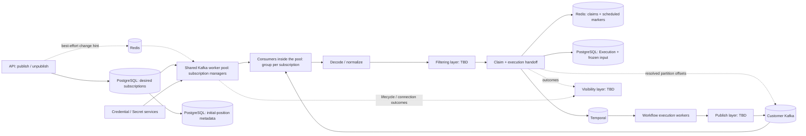
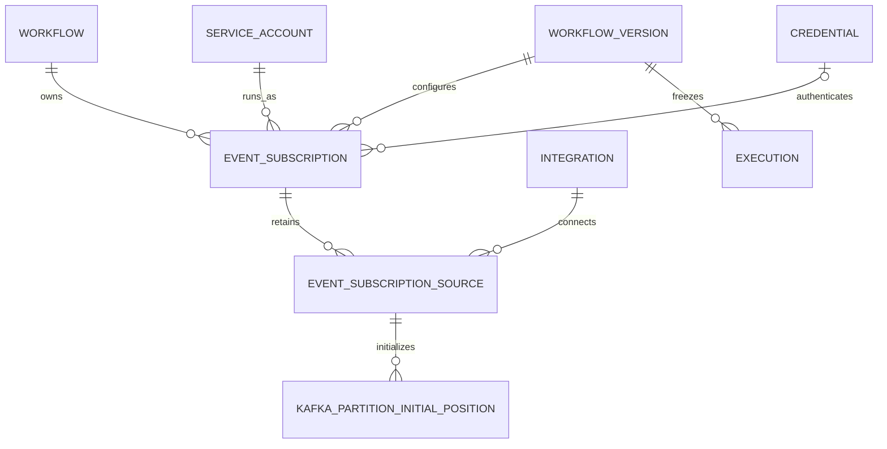
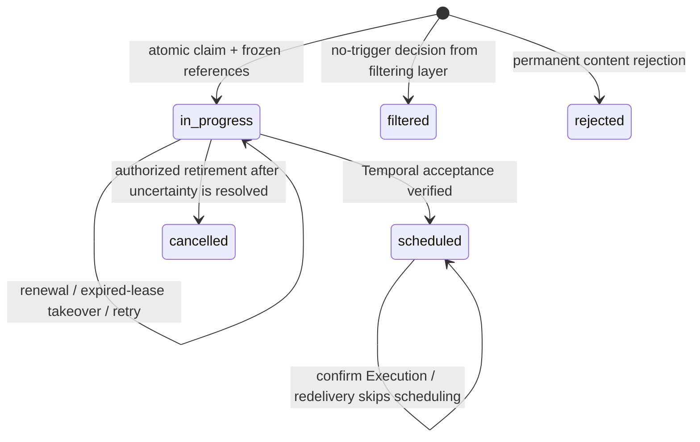
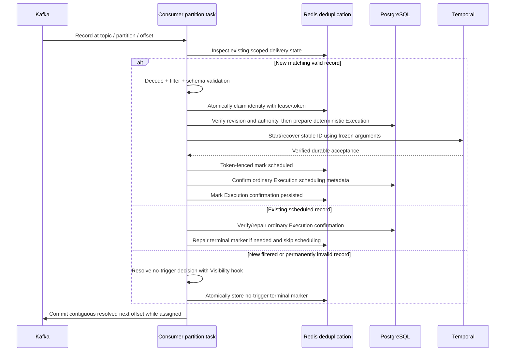

# Kafka Subscribe and Publish

> **Design proposal** - A managed Kafka trigger, a Kafka publish action, and a dedicated `aiokafka` consumer worker. This document defines the architecture, persistent models, runtime contracts and delivery behavior we plan to implement.

## Contents

- [Overview and design context](#overview)
- [Code architecture and service contracts](#architecture)
- [Integration, credentials, and authorization](#integration-credentials-and-authorization)
- [Persistent models and lifecycle](#subscription-persistence-and-lifecycle)
- [Step schemas and APIs](#step-schemas-and-api-surface)
- [Worker operation](#consumer-worker-operation)
- [Durable delivery and recovery](#delivery-and-durable-execution-handoff)
- [Message contract and filtering](#message-contract-decoding-and-size)
- [Publishing](#kafka-publish-action)
- [Visibility](#visibility) and [deployment](#deployment-and-configuration)
- [Verification and migration](#performance-and-verification-plan)
- [Implementation sequence and review decisions](#implementation-sequence-and-review-decisions)

## Overview

Kafka Subscribe starts a workflow for each valid eligible Kafka message. Filtering sits before workflow handoff, outbound Publish connects workflow actions to Kafka. Subscribe references a Kafka Integration and an optional **runtime credential override** (otherwise the integration management credential); consumer connections live outside the API process.

The consumer worker uses `AIOKafkaConsumer` directly. Kafka manages partition assignment and group membership. Syntara manages subscriptions, configuration reconciliation, execution handoff and recovery across Kafka, Redis, PostgreSQL, and Temporal.

Our delivery contract is **at-least-once handoff to durable workflow scheduling**, with idempotent admission for redelivery of the same Kafka record. A workflow does not have to start or finish before the record is committed. This contract applies within the supported message contract and recoverable Kafka history; it cannot recover records removed by customer retention or compaction.

The important decisions are:

| Concern | Design decision |
|---|---|
| Transport | `aiokafka`, in a shared worker pool; execution-plane deployment is out of scope   |
| Connection resource | `IntegrationType.KAFKA`; reuse Integration CRUD, visibility, validation, and Credentials |
| Consumption unit | One exact topic per logical subscription; one stable group per subscription |
| Worker pool | Long-running workers share subscription workloads; the infrastructure administrator sets the replica count through the operator CRD |
| Resolution | Commit only after a durable scheduled, filtered, or rejected outcome |
| Duplicate protection | Redis claims/markers keyed by Workflow ID + Subscription ID + TPO, scoped to connector/source; stable Temporal workflow ID |
| Initial position | PostgreSQL stores the first partition boundary; Kafka committed group offsets govern subsequent resumption |
| Execution identity | Project **service account** on the trigger; **enabling actor** on `EventSubscription.enabled_by` (see [Execution identity and permission gates](#execution-identity-and-permission-gates)) |

Filtering, Visibility, and Publish remain **TBD** for now (will revisit in Milestone 2) and appear only as layer boundaries below.

## Design context

This design builds on the existing Integration, Credential, workflow publication, execution, and audit domains. We are defining Kafka-specific consumption and recovery semantics while retaining reusable event decoding, filtering, and dispatch interfaces.

### Existing platform seams

- [Integration configuration](../src/syntara/integrations/models/integration_configuration.py) uses a discriminated SQLModel union. [Integration](../src/syntara/integrations/models/integration.py) stores its type in a PostgreSQL enum and separates `management_credential_id` from step runtime credentials. Adding Kafka requires a model, adapter registration, enum migration, and API contract updates.
- [WorkflowService](../src/syntara/workflows/services/workflow_service.py) locks a workflow on publish/unpublish. Webhook trigger rows are synced inside the transaction; Temporal schedules are synced after commit and reconciled separately. Kafka desired state belongs in the publication transaction; broker I/O belongs outside it.
- [ExecutionService](../src/syntara/workflows/services/execution_service.py) selects a version, validates trigger inputs, enforces the existing concurrency cap, starts Temporal, and then writes an Execution. It generates a fresh UUID and attempts cancellation after a database commit failure. Calling it unchanged on every Kafka retry would not deduplicate deliveries.
- [TemporalExecutionService](../src/syntara/workflows/workflow_engine/services/temporal_execution_service.py) accepts an execution ID but constructs the Temporal ID from the mutable workflow name. Kafka needs an explicit stable ID and duplicate-rejection policy.
- [Trigger activities](../src/syntara/workflows/workflow_engine/activities/webhook_trigger.py) pass input through the existing output-mapping mechanism. The Kafka consumer worker receives messages and supplies the event envelope to each workflow execution. The Kafka Subscribe trigger activity passes that envelope to downstream steps through the same output-mapping mechanism.
- [Credential resolution](../src/syntara/workflows/workflow_engine/activities/credential_resolution_activity.py) and [integration scope checks](../src/syntara/workflows/workflow_engine/activities/integration_scope_activity.py) provide useful patterns. Extract reusable service logic for the consumer process rather than invoking Temporal activities to maintain a subscription.

### Relationship to the event-bus SDP

We will keep the separate worker, database reconciliation, credential injection, and separation of desired state from runtime health. We will implement Subscribe transport access directly with aiokafka behind its consumer interface.

Each distinct Kafka Subscribe trigger configuration is a separate logical subscription, including trigger nodes/workflows that use the same integration and topic. Republishing the same logical trigger preserves its subscription identity under the lifecycle rules below; it does not create a new subscription for every configuration revision. Each subscription has its own stable consumer-group identity and reading position. Kafka can therefore deliver the same record independently to several subscriptions without an application-managed fan-out dispatcher.

We will treat fan-out as **available by construction but not committed**. Independent groups make this behavior possible, but fan-out is not a requirement for this delivery. Ordinary subscription, delivery-recovery, and worker-scaling tests remain required.

Consumer groups coordinate current partition ownership; they do not eliminate redelivery after a crash between workflow scheduling and offset commit. The durable admission path below closes that window.

## User flow and scope

1. An integration administrator creates a Kafka Integration, supplies bootstrap addresses and security settings, and tests it with a management credential.
2. A workflow designer adds a Kafka Subscribe trigger, selects the integration, **optional** runtime credential override (else connector management credential), **execution service account**, exact topic, and optional filter/input schema.
3. Publishing validates these references and records desired subscriptions atomically with the published version. The response can say activation is pending; broker readiness is asynchronous.
4. Each matching message starts one execution. Downstream steps can read `${trigger.payload}` and `${trigger.metadata}` through the selected trigger's normal namespace.
5. Visibility receives subscription and processing outcomes.
6. An outbound Publish layer connects workflow actions to Kafka.

The concrete consumer design includes Kafka JSON messages, CloudEvents structured and binary binding, Subscribe, scoped authorization, and a shared worker pool. Exact topics avoid accidental broad subscription and unbounded topic discovery. Fan-out is documented as an emergent effect of independent subscriptions and is not a committed requirement, topology, capacity promise, or separate SLO.

Excluded: Avro/Protobuf/schema registries, broker provisioning, Kafka transactions spanning workflow execution, exactly-once business effects, at-most-once consumption, historical-start controls, DLQ/replay, CEP, event aggregation, other message buses, live payload preview, fan-out-specific topology/test coverage, autoscaling, and execution-plane or per-subscription worker deployments. Customer brokers and their ACLs remain customer managed.

## Architecture



The Kafka worker pool holds persistent connections and runs application service code with short database sessions. Subscriptions are managed within those existing processes. Temporal receives finite workflow executions and its existing worker pool executes them asynchronously. Kafka ingestion workers and Temporal execution workers have separate deployments and replica controls.

### Subscription, consumer, and worker boundaries

| Term | Meaning |
|---|---|
| Subscription | Persisted configuration linking one trigger to its source, credential, and target workflow |
| Consumer | An aiokafka client and processing tasks managed inside a Kafka worker process |
| Kafka worker | A long-running process/pod in the operator-managed pool that serves subscription workloads |
| Workflow execution | A finite run submitted to Temporal and handled by existing Temporal workers |

Creating or activating a subscription creates configuration and consumer runtime state, not a new worker process or pod. Receiving a message creates a workflow execution after durable handoff; it does not create a Kafka or Temporal worker. A worker can host consumers for several subscriptions, and consumers serving the same subscription across workers use that subscription's group ID. The worker-pool size is independent of the number of subscriptions and events.

We will retain transport-neutral interfaces where they describe real common behavior: raw event, decoder, filter, handler result, and launcher. We will keep group management, offsets, partition ownership, and retention recovery in the Kafka adapter. Kafka security configuration is Kafka-specific even if carried by the existing `BrokerConnection` value object. Future adapters must define their own acknowledgement guarantees.

### Code organization

We will organize the implementation as follows. The new modules listed here are planned additions to the application. We will keep domain persistence/services separate from the transport client and avoid creating a second workflow execution engine.

```text
src/syntara/
  eventstreams/
    consumer_entrypoint.py          # dependency composition and process bootstrap
    consumer_lifecycle.py           # signals and bounded shutdown; visibility hooks TBD
    consumer_service.py             # worker manager and per-subscription supervision
    router.py                       # scoped subscription configuration/control APIs
    models/
      subscription.py               # transport-neutral EventSubscription
      source.py                     # EventSubscriptionSource + typed source configuration
      kafka/initial_position.py     # Kafka partition boundary and explicit gap recovery
      responses.py                  # SQLModel read/control/list response schemas
    services/
      subscription_service.py       # transactional desired-state reconciliation
      connection_provider.py        # Integration/Credential resolution and revisions
      admission_service.py          # Redis claim + idempotent Execution handoff
      deduplication_store.py         # atomic Redis claim/renew/takeover/mark scripts
      initial_position_service.py   # initial boundary, confirmation, gap metadata
      recovery_service.py           # recover prepared starts and acknowledge gaps
    core/
      connection.py                 # resolved connection and consumer configuration
      envelope.py                   # lossless raw event and versioned trigger envelope
      consumer.py                   # consumer lifecycle protocol
      handler.py                    # processing outcome and launcher interfaces
      deduplication.py              # typed Redis state and token-fenced claim values
      pipeline.py                   # size check, decode, filter, validate, resolve
      serialization.py              # strict JSON and CloudEvents normalization
      filter.py                     # filtering layer boundary; implementation TBD
      exceptions.py                 # content, dependency, and configuration errors
    visibility/                     # outcome/reporting layer; implementation TBD
    publish/                        # outbound Kafka layer; implementation TBD
    adapters/
      kafka.py                      # aiokafka fetch/commit, rebalance, partition task owner
    handlers/
      workflow_launcher.py          # bridge to shared workflow preparation/Temporal services
  integrations/
    models/integration_configuration.py  # KafkaConfiguration union member
    adapters/kafka.py                    # IntegrationAdapter validation/discovery
  workflows/
    services/workflow_service.py         # publication invokes subscription sync in transaction
    services/execution_service.py        # shared execution preparation and quota policy
    workflow_engine/
      activities/event_subscribe.py      # envelope pass-through/output mapping
      activities/registry.py             # registrations for main workflow worker
      models/workflow_definition.py      # trigger/action parameter and output types
      services/temporal_execution_service.py  # explicit stable ID and reuse/conflict policies
  core/tls/kafka.py                      # verified SSL context and private material cleanup
```

The `core` event modules do not import SQL persistence, FastAPI routers, workflow services, or aiokafka. Kafka adapters depend on these core contracts, not on WorkflowService. Application services compose repositories, authorization, and the workflow launcher. Integration validation reuses connection/TLS construction without depending on the running consumer manager.

Workflow publication depends on `subscription_service` only for desired-state synchronization. That service reads a supplied workflow definition and session; it does not import WorkflowService or start a consumer. `admission_service` calls shared execution preparation and a launcher without making subscription persistence part of the workflow engine. We will use explicit module imports and thin `__init__.py` exports to prevent a cycle through domain service packages.

### Ownership and interfaces

| Component | Owns | Does not own |
|---|---|---|
| `EventWorkerManager` | Desired-state snapshots, supervisor tasks, reconciliation, health aggregation, shutdown ordering | Kafka partition assignment or durable record outcomes |
| `SubscriptionSupervisor` | Local consumer runtime within an existing worker, applied revisions and restart/circuit policy | Creating a worker/pod per subscription, consumer-group leadership or workflow execution |
| `KafkaEventConsumer` | AIOKafkaConsumer, rebalance listener, bounded per-partition queues/tasks, explicit commit/seek/pause | Filter language, principals, database transaction policy |
| `EventProcessingPipeline` | Safe envelope construction, decode/filter/schema decisions, calls into durable resolution | Direct Kafka commits or transient failure deletion |
| `EventAdmissionService` | Redis claim orchestration, frozen Execution preparation, scheduling and ordinary Execution confirmation | Fetch positions or a PostgreSQL delivery ledger |
| `RedisDeduplicationStore` | Atomic scoped claims, lease renewal/takeover, terminal markers, retention | Kafka consumer assignment or full message storage |
| `KafkaInitialPositionService` | Persisted first boundary, initial-commit confirmation, explicit recovery-gap metadata | Ongoing Kafka checkpoints or delivery deduplication |
| `WorkflowLauncher` | Start/describe the stable Temporal workflow and classify acceptance/ambiguity | New execution identities on retry or offset acknowledgement |
| Filtering layer | Position between decoding and handoff; details TBD | Consumer commits |
| Visibility layer | Outcome reporting boundary; details TBD | Deduplication or Kafka checkpoints |
| Publish layer | Workflow-to-Kafka outbound boundary; details TBD | Subscribe consumer lifecycle |

Service methods will accept explicit identity/context objects. We will use the following contracts:

```python
# Types shown here are SQLModel value/API schemas; implementations are async services.
async def sync_from_published_definition(
    session: AsyncSession,
    workflow: Workflow,
    version: WorkflowVersion,
    actor: PrincipalContext,
    *,
    enabled: bool,
) -> SubscriptionChangeSet: ...

async def resolve_connection(
    snapshot: SubscriptionSnapshot,
) -> ResolvedKafkaConnection: ...

async def claim_delivery(
    snapshot: SubscriptionSnapshot,
    record: EventRecordIdentity,
) -> DeliveryClaim | ExistingTerminalMarker | ClaimBusy: ...

async def prepare_execution(
    snapshot: SubscriptionSnapshot,
    claim: DeliveryClaim,
    envelope: WorkflowEventEnvelope,
) -> PreparedExecution | RevisionChanged: ...

async def start_or_recover(
    execution: PreparedExecution,
    claim: DeliveryClaim,
) -> ConfirmedTemporalAcceptance | AmbiguousStart: ...

async def mark_scheduled(
    claim: DeliveryClaim,
    acceptance: ConfirmedTemporalAcceptance,
) -> ScheduledMarker | ClaimLost: ...

async def confirm_execution_record(
    execution: PreparedExecution,
    marker: ScheduledMarker,
) -> ResolvedDelivery: ...

async def resolve_without_execution(
    snapshot: SubscriptionSnapshot,
    record: EventRecordIdentity,
    outcome: Filtered | Rejected,
) -> ResolvedDelivery | RevisionChanged | ExistingClaim: ...
```

`EventRecordIdentity` combines common source/transport identity with a typed adapter-supplied record identity. Kafka supplies topic, partition and offset; future adapters define their own identity without inheriting those fields. `ResolvedDelivery` proves terminal resolution, Redis state and ordinary Execution confirmation, and carries that record identity. The Kafka adapter derives contiguous commit positions from its assignment-local completion queue and verifies current ownership/local epoch. `Retry` and `Blocked` never authorize advancement; the common result contract preserves resolution evidence and the blocked reason without prescribing another transport's acknowledgement operation.

`SubscriptionSnapshot` contains published version, source generation, configuration revision, trigger parameters, and principal references. It is immutable for a processing attempt. `ResolvedKafkaConnection` carries secret values only in protected memory and has a redacted representation. It must not be returned by a public API or placed in runtime observations. A separate non-secret connection revision hashes configuration/credential change identifiers, not secret contents.

### Dependency composition and database sessions

The entrypoint initializes settings, the encryption service, signed Temporal client, database session factory, Redis deduplication store, connection provider, and worker manager. We will inject these dependencies into services. The standalone process uses a factory derived from application database configuration; tests supply a test factory directly. Request handlers continue to use `get_db()` and its dependency overrides. We will not share an AsyncSession between concurrent partition tasks or hold a transaction across Kafka/Temporal network calls.

We will keep one Temporal client per process, a bounded database connection pool, and separately bounded preparation/finalization concurrency. Queue capacity is counted in bytes as well as records. The API validation adapter opens only short-lived clients.

Startup performs a database reconciliation before readiness. Recover prepared admissions before reading later records from their partitions. Shutdown first disables manager reconciliation, then closes admission, drains/stops consumers, settles ordinary Execution state, closes clients, and invokes the shutdown boundary. A supervisor crash restarts that subscription with its persisted retry state; only a manager invariant failure ends the process.

## Integration, credentials, and authorization

### Integration configuration

We will add `KafkaConfiguration` to the existing Integration union:

| Field | Meaning |
|---|---|
| `integration_type: "kafka"` | Discriminator |
| `bootstrap_servers: list[str]` | Validated non-empty `host:port` addresses, including supported IPv6 syntax |
| `security_protocol` | `PLAINTEXT`, `SSL`, or `SASL_SSL` under the support matrix below |
| `sasl_mechanism` | Optional PLAIN / SCRAM choice, required for SASL |
| `allow_plaintext: bool = false` | Explicit administrator opt-in for unauthenticated plaintext |

We will reject secret material in this configuration. Topics, group IDs, filters, and execution identity belong to subscriptions, not integrations. Allowing several bootstrap servers must not be modeled as an HTTP URL; Kafka also connects to metadata-advertised broker addresses. We will extend the platform's destination policy for both bootstrap and advertised endpoints, including validation and runtime DNS changes. Reusing only the existing HTTP URL check is insufficient.

### Supported security

| Transport/authentication | Milestone 1 |
|---|---|
| Unauthenticated PLAINTEXT | Explicit administrator opt-in; encrypted transport is the default expectation |
| SSL with server verification | Supported, using system trust or a credential CA bundle |
| SSL with mTLS | Supported, including system trust plus a client certificate |
| SASL_SSL + PLAIN | Supported |
| SASL_SSL + SCRAM-SHA-256 / SCRAM-SHA-512 | Supported |
| SASL_PLAINTEXT | Rejected (no transport encryption; SASL/PLAIN can expose credentials) |
| GSSAPI / OAUTHBEARER | Deferred pending customer demand and a credential/provider design |

We will seed a managed Kafka credential type with optional username/password, CA PEM, client certificate chain PEM, private key PEM, and key passphrase. We will validate the required combinations against the integration security mode. API key/secret pairs map to username/password where the customer's broker uses those mechanisms. All credential contents stay in the Credentials/SecretService path; logs, workflow definitions, and subscription rows contain only references.

The consumer resolves the selected **runtime** credential. Connector validation resolves `management_credential_id`; success with an administrative credential does not prove that a step credential can read a topic or join its group. We will add an authorized subscription test using the selected runtime credential to check topic metadata and group permissions without consuming or committing customer records. We will report permissions that cannot be checked without side effects as unverified.

We will create verified SSL contexts regardless of whether a custom CA exists. For mTLS, materialize private PEM files in a private temporary directory with restrictive permissions, load the certificate/key/passphrase, and clean up after use. We will not share the platform's internal service-to-service certificate as a customer Kafka identity. A connection revision includes credential changes; a disabled, revoked, or changed credential drains/restarts the affected clients and preserves offsets. A failed new credential blocks consumption until corrected.

The Kafka Integration adapter implements `validate()` with bounded metadata/connectivity I/O and `discover()` with a connection result and no resource creation. We will map failures to the existing health error types using sanitized codes. Topic errors belong to subscription health even when the overall connector is reachable.

### Effective runtime credential (broker listener)

Step parameters may omit `credential_id`. At publish/sync, resolve and persist the credential the consumer uses:

```text
effective_runtime_credential_id = parameters.credential_id ?? integration.management_credential_id
```

The **runtime credential** authenticates the Kafka consumer to the customer cluster. It is independent of the **execution service account** (workflow execution ownership). Connector `validate()` uses the management credential; subscription `/test` and consumption use the **effective** runtime credential.

### Execution identity and permission gates

#### Three identities (do not conflate)

| Identity | Role |
| --- | --- |
| **Broker / runtime credential** | Kafka SASL/TLS identity for the consumer (and future publisher) |
| **Execution service account** | Customer **machine principal** that owns each workflow execution — not a human login |
| **Enabling actor** | Principal who passed activation checks; stored as `EventSubscription.enabled_by` and in lifecycle audit |

The event-stream **worker process** uses an internal **service principal** (mTLS) to run consumers and call platform services. That identity is **not** the accountable owner of customer workflow executions.

We require `service_account_id` on Kafka Subscribe (active `ServiceAccount` in the workflow's project). No service-account bearer token is stored on the trigger or in Kafka messages; `prepare_execution` / admission loads the SA as the execution principal.

#### Enable-time authorization (publication transaction)

| Phase | Permission / validation |
| --- | --- |
| Edit workflow definition (draft), including Subscribe on draft | `workflow:update` (project); integration **visibility** in scope |
| **Activate** standing consumption (sync subscriptions on publish, `desired_enabled`, resume/retry) | **`subscription:enable` (project)** — *preferred, pending product confirmation* — or **`execution:run` (project)** as fallback |
| Execution SA | Exists, **active**, in workflow **project** (same class as webhook SA binding on publish) |
| `credential:use` for the **enabling principal** | Only when the trigger sets explicit `credential_id`; **not** required when the effective credential is the connector management credential only |

If publish succeeds but the principal lacks the **activation** permission, the workflow version may be published while **subscriptions remain inactive** (`desired_enabled` false) — no split-brain activation.

Optional scoped `service_account:bind-trigger` remains **under review**; default is project-scoped SA validation without a separate bind permission.

Extend trigger credential extraction so publish validation includes Subscribe parameters (today node extraction may exclude triggers).

#### Admission-time authorization (`prepare_execution` / revision lock)

Revalidate **runtime state** on each delivery attempt. **Do not** re-evaluate the enabling principal's `workflow:update`, `subscription:enable` / `execution:run`, or OPA **`credential:use`** on every record.

| Check | On failure |
| --- | --- |
| Subscription **`desired_enabled`**, not **`paused`** or **`retired`**; workflow **published**; workflow **`is_enabled`** per existing publish pointer | Hold / block; configuration failure (not invalid message content) |
| Execution SA **active**, in **project** | Hold; Visibility / optional sparse security audit |
| Integration in scope; **effective runtime credential** **enabled** and resolvable | Hold; subscription/integration health |
| **`configuration_revision`** frozen under publication lock (see [Configuration race boundary](#configuration-race-boundary)) | Re-evaluate or hold |
| **`max_concurrent_workflows`** during preparation | Backpressure / hold |

Account or credential revocation after enable **blocks new admissions** and holds offsets; already accepted Temporal runs follow ordinary execution policy.

#### Execution attribution, quotas, and logs

- `Execution.created_by`, `Execution.updated_by`, and `workflow_context.execution.created_by_user_id` → **execution service account** UUID (not the enabling human).
- Lifecycle: `WorkflowPublishEvent.actor_id`, `workflows.created_by`, `enabled_by`, Redis claim fields — **who enabled** standing consumption.
- **Quotas:** existing `max_concurrent_workflows` during preparation; no second quota model.
- **Logs:** message payloads and secrets never in Redis markers, diagnostic surfaces, or security audit ([audit.md](audit.md)). High-volume receipt/filter outcomes → **Trigger Activity Log** (Visibility — TBD). Security audit: subscription lifecycle, authorization denials, accountable firings via **`workflow_execution_started`** (extend with `trigger_type` / Kafka context). See [Visibility](#visibility).

**Known limitation:** execution SA attribution is defined here; **service-account-scoped authorization for every workflow step** at runtime is not fully enforced today (credential/integration activities remain largely project-scoped).

#### Design decisions (authorization)

- **Execution identity:** runs as the configured service account; the enabling human is recorded separately for audit — not the message publisher and not the platform worker principal alone.
- **Two-phase authorization:** enable-time RBAC vs admission-time runtime state checks — not full RBAC on every message.
- **Broker credential:** inherit the connector management credential by default; an explicit override requires `credential:use` for the enabler at enable time.

## Subscription persistence and lifecycle

### Data models

All tables and API schemas use SQLModel; schema changes use Alembic. We will add the persistent schemas and service contracts described below.

| Model | Essential fields and constraints |
|---|---|
| `EventSubscription` | Logical workflow/trigger identity, project, current published version/configuration, runtime credential/account, desired enabled state, active source generation, enabling actor |
| `EventSubscriptionSource` | Transport-neutral source generation: integration/source identity, transport discriminator, typed source configuration and creation/retirement boundary |
| `KafkaPartitionInitialPosition` | Unique `(source_id, partition)`; first reading boundary, initial-commit confirmation and administrative gap/recovery metadata |

`EventSubscription` and `EventSubscriptionSource` are shared event-domain resources. Workflow/trigger ownership, principal/credential references, desired state and source lifecycle do not depend on Kafka. Kafka topics, groups and offsets belong to the Kafka source configuration and adapter-specific initialization model. Only Kafka is delivered in the current scope; the neutral resource names do not imply support for additional transports.

We will use explicit table names `event_subscriptions` and `event_subscription_sources`. The Kafka initialization table remains `kafka_partition_initial_positions`, with its source FK pointing to the common source table. Existing workflow/account/credential and lifecycle constraints continue to apply to the neutral resources.

Redis holds the in-progress claim and frozen binding references. We will create or recover a deterministic pending Execution containing the frozen trigger input and scheduling metadata before calling Temporal. No separate PostgreSQL admission row is created. A prepared Execution is not reported as successfully scheduled; status synchronization defers uncertain starts to delivery recovery.

We will use a partial unique index for the current logical trigger `(workflow_id, trigger_node_id) WHERE retired = false` and explicit source generations rather than deriving identity from a version number or node position. Retired rows can coexist with a newly created subscription for the same trigger ID while historical recovery finishes. Removing a subscription must not delete its executions. Workflow deletion is different: the current service hard-deletes versions and executions after rejecting non-terminal executions. We will retain that policy and extend its guard to unresolved Kafka admission. Visibility integration for these internal operations is TBD.

A source generation changes when the selected transport, integration or transport-specific source identity changes. For Kafka, this includes the topic or verified topic/cluster incarnation. Topic deletion/recreation can reuse offsets, so TPO alone is not permanent identity. Detect identity changes where metadata exposes them; otherwise stop on suspected recreation and require an explicit source replacement. Other transports define their own source-change rules in their adapters.

### Entity relationships



`EventSubscription` is derived operational state for a stable workflow trigger. `EventSubscriptionSource` preserves each generation's transport/source identity and lifecycle. Transport-specific state references that common source: Kafka initial-position rows hold first reading boundaries, Kafka retains ongoing group offsets, and Redis retains delivery claims. Retiring a source stops new consumption while pending claims/Executions resolve. Replacing a Kafka source creates another source generation/group and never reuses another stream's positions.

### Subscription and source schemas

`EventSubscription` uses the existing BaseResource metadata and principal ownership conventions. It is not a NamedResource: the workflow and trigger node provide its name. Workflow definitions remain the source of trigger parameters; the operational row contains the published configuration projection needed by reconciliation.

| Column | Storage / nullability | Invariant |
|---|---|---|
| `id` | UUID PK | Persisted identity, independent of a workflow version |
| `workflow_id`, `project_id` | UUID FKs, required | Workflow belongs to this project; project is denormalized for scoped queries |
| `trigger_node_id` | Bounded text, required | Unique together with workflow ID among non-retired rows; removed/recreated triggers receive a new subscription ID |
| `published_version_id` | UUID FK, required | Last applied published configuration; retain it while unpublished rather than resolving a draft |
| `active_source_generation` | Integer, required | Positive; identifies the current source row when enabled |
| `configuration_revision` | BIGINT, required | Positive and monotonic; changes on published configuration or operational pause/resume |
| `runtime_credential_id` | UUID FK, nullable | Required combinations are validated by the selected transport's security configuration |
| `service_account_id` | UUID FK, required | Active project service account when admission is enabled |
| `input_schema` | Bounded JSONB, nullable | Validated published input schema; filter configuration/schema is TBD |
| `desired_enabled`, `paused`, `retired` | Boolean, required | Effective desire is published, not paused, and not retired |
| `enabled_by` | Principal UUID FK, nullable | Actor that last authorized activation; snapshot the actor ID in firing metadata |
| `created_by`, `updated_by`, timestamps | Existing resource fields | User-visible changes follow normal metadata rules |

We will use `RESTRICT` for account/credential/version references while needed by live or recoverable state. Account/credential disable is preferable to destructive removal while bound. When a terminal source is retained only for deduplication, resource deletion may detach its historical integration reference while preserving the immutable integration UUID in source identity. Database cascades will not delete live recovery state. Integration deletion must reject active or prepared references, or require an explicit retirement workflow first.

| `EventSubscriptionSource` column | Storage / nullability | Invariant |
|---|---|---|
| `id`, `subscription_id` | UUID PK and FK, required | Source ID is stable across reconnects |
| `deployment_id` | UUID value, required | Persisted deployment namespace used for group/record identity; never generated per worker or startup |
| `generation` | Integer, required | Unique per subscription; positive and monotonically allocated |
| `integration_id` | UUID FK, nullable after retired detachment | Required for an active source |
| `integration_identity` | UUID value, required | Immutable canonical identity even if the Integration is later deleted |
| `transport` | Bounded discriminator, required | Matches the Integration adapter and typed configuration; currently `kafka` |
| `configuration` | Discriminated SQLModel JSONB, required | Typed transport-specific source fields; no secrets or event payloads |
| `initialized_at`, `retired_at` | TIMESTAMPTZ, nullable | Initialization state is distinct from retirement |
| `created_at` | TIMESTAMPTZ, required | Source creation time; UTC |

Uniqueness/indexes: partial subscription `(workflow_id, trigger_node_id) WHERE retired = false`; source `(subscription_id, generation)`; desired-state scan `(desired_enabled, retired, id)`; project/workflow scoped lookup; integration-to-source lookup. Kafka adds a transport-specific unique expression index on `configuration.group_id` restricted to Kafka sources. The subscription service validates active-source membership and matching transport/configuration inside the publication transaction. We will measure additional indexes rather than indexing every status column.

### Typed transport-specific source configuration

We will use a discriminated SQLModel configuration instead of an unvalidated bag of provider keys. The example below illustrates this boundary. We will add validators, limits and the complete table mapping during implementation:

```python
class KafkaSourceConfiguration(SQLModel):
    transport: Literal["kafka"] = "kafka"
    topic: str
    group_id: str
    cluster_id: str | None = None
    topic_id: str | None = None
```

For Kafka, topic and generated group ID are fixed within a source generation. Cluster/topic identifiers can be populated once during verified initialization where supported; an identity change creates another generation. Subscription filters remain TBD and do not belong to the source-address configuration.

The common source's `transport` must match its configuration discriminator. We will persist configuration using the repository's typed/discriminated JSONB pattern. Future transports add their own SQLModel configuration variant and adapter validation; they do not gain Kafka fields on the common table. We will store no decrypted credentials in configuration.

We will keep `KafkaPartitionInitialPosition.source_id` linked to `event_subscription_sources.id`. Its service verifies that the referenced source is Kafka before initializing partitions. Initialization, acknowledgement and recovery use adapter-specific interfaces/state; other transports are not required to implement a Kafka partition/offset model. No universal persistent checkpoint table is selected by this proposal.

There is no subscriber-level CRUD API that lets callers directly alter group IDs, offsets, or projected parameters. Those fields come from publication and controlled recovery. `paused` is the user-controlled subscription pause; it does not rewrite the immutable workflow version.

### Partition initial-position schema

`KafkaPartitionInitialPosition` records where a new source partition begins reading. It is not an ongoing consumption checkpoint or deduplication ledger. Kafka's committed consumer-group offsets are authoritative for normal resumption.

| Column | Storage / nullability | Purpose |
|---|---|---|
| `source_id`, `partition` | UUID FK and integer; composite PK | One initialization record per source partition |
| `initial_next_offset` | BIGINT, required | First durably selected visible-end boundary |
| `initialized_at` | TIMESTAMPTZ, required | Boundary selection time |
| `initial_commit_confirmed_at` | TIMESTAMPTZ, nullable | Initial Kafka commit verified before consumption is permitted |
| `recovery_revision` | BIGINT, required | Monotonic revision for explicit administrative recovery |
| `recovery_boundary`, `recovery_confirmed_at` | BIGINT/TIMESTAMPTZ, nullable | Most recent acknowledged recovery boundary and confirmation |
| `gap_detected_at`, `gap_reason` | TIMESTAMPTZ and bounded code, nullable | Established subscription requires explicit recovery |

Offsets use non-negative signed 64-bit storage and decimal-string JSON serialization. We will preserve the initial boundary for the source's lifetime; normal consumption never updates it.

The core SQLModel mapping below will include the remaining metadata described above during implementation:

```python
class KafkaPartitionInitialPosition(SQLModel, table=True):
    __tablename__ = "kafka_partition_initial_positions"

    source_id: UUID = Field(
        foreign_key="event_subscription_sources.id", ondelete="CASCADE", primary_key=True
    )
    partition: int = Field(primary_key=True)
    initial_next_offset: int = Field(sa_type=BigInteger)
    recovery_revision: int = Field(default=0, sa_type=BigInteger)

    __table_args__ = (
        CheckConstraint("partition >= 0", name="ck_kafka_initial_partition"),
        CheckConstraint("initial_next_offset >= 0", name="ck_kafka_initial_offset"),
        CheckConstraint("recovery_revision >= 0", name="ck_kafka_initial_recovery"),
    )
```

We will choose the Kafka visible end outside a database transaction, then insert the initialization row under its unique key. A concurrent insert reloads the winning boundary instead of selecting a later one. We will check current Kafka assignment before seeking/committing, and persist initial-commit confirmation before permitting that partition to process messages. A restart with initialization incomplete and no group commit can safely finish using the saved boundary, because processing was not yet allowed. A valid Kafka group commit takes precedence over initialization metadata.

For an established partition, a missing/expired group commit is a recovery condition. We will not fall back to the original initialization offset: it can be far behind the deduplication retention window. We will store explicit gap/recovery acknowledgements in this metadata with a TBD visibility hook; no per-message checkpoint writes are added to PostgreSQL.

### Redis delivery identity and state

Redis owns delivery claims and terminal markers. PostgreSQL stores subscription/source configuration, initial-position metadata and the ordinary Execution's frozen input/version/scheduling data. Kafka stores ongoing committed group offsets. Visibility storage is TBD.

The transport-neutral deduplication identity is **Workflow ID + Subscription ID + transport record identity**, scoped by deployment, connector, source identity/generation and transport. The adapter supplies the record identity. For Kafka it is **TPO** (topic, partition, offset), preserving the agreed **Workflow ID + Subscription ID + TPO** behavior. Persisting source generation prevents a recreated topic or replaced cluster from reusing an old identity. Derive the Redis key, deterministic execution UUID and Temporal workflow ID from the same canonical representation.

```text
syntara:eventstreams:dedup:v1:{identity-digest}
identity = deployment + connector + source-id + source-generation + transport
           + workflow-id + subscription-id + adapter-record-identity
kafka-record-identity = topic + partition + offset
```

We will use an unambiguous canonical encoding before hashing. All mutations for one identity operate on the same Redis key, including Redis Cluster hash-slot placement. We will not deduplicate by message key or CloudEvents ID alone, and never share one marker across independent subscriptions.

| Redis field | Purpose |
|---|---|
| `state` | `in_progress`, `scheduled`, `filtered`, `rejected`, or `cancelled` |
| `claim_token`, `owner_worker_id`, `lease_until` | Token-fenced, expiring processing ownership |
| `workflow_version_id`, `configuration_revision`, `envelope_version` | Frozen processing version for the first authorized attempt |
| `service_account_id`, `enabled_by`, `received_at`, `prepared_at` | Frozen principal/actor/timing references; no credentials or message contents |
| `execution_id`, `temporal_workflow_id`, `temporal_run_id` | Stable execution linkage and confirmed run when known |
| `input_fingerprint` | Integrity digest verified against the frozen Execution input/context |
| `attempt_count`, `first_start_attempt_at`, `next_attempt_at`, `last_error_code` | Retry and ambiguous-start recovery state |
| `execution_persisted`, `resolved_at` | Whether ordinary Execution scheduling confirmation is safe and when resolution completed |

We will use atomic Lua scripts to acquire, renew, take over an expired claim, mark scheduled, and release ownership. Every ownership mutation compares the claim token. A plain GET followed by SET is insufficient. A lease expiry permits another worker to take over; it does not prove that the first Temporal RPC failed. We will preserve frozen fields when taking over a claim.

We will keep the short **claim lease** separate from the **deduplication record retention**. Expiring a lease must not delete the record's frozen binding or accepted-run evidence. We are proposing a 60-second lease with renewal at most every 20 seconds, subject to RPC/deployment validation. Pending records require renewal/recovery monitoring and must not expire silently while unresolved. Terminal markers have a configured retention covering the supported redelivery window, including delayed commits and outages; select its value from supported broker retention and Temporal/history policies independently of the TBD visibility retention policy.



A scheduled marker means Temporal acceptance has been verified. Before commit, confirm the ordinary Execution scheduling record; a missing confirmation is repaired on redelivery without scheduling again. No-trigger markers preserve the original terminal decision across commit failure or republishing; publish changes must not turn an already resolved filtered record into a new firing within the supported recovery window.

We will inspect existing Redis state before re-evaluating a redelivered record. For a new matching record, we will decode/filter/validate, then claim and verify the subscription revision under the publication lock before preparing its Execution. If the revision changed, we will re-evaluate before freezing a binding. No-trigger resolution likewise checks the revision before atomically recording its terminal marker and resolving the record. It must never overwrite an existing in-progress/scheduled claim.

Redis markers contain bounded references, timestamps, counters, and safe codes. We will store the full envelope once in `Execution.input_data`, with frozen context in `execution_metadata`; never copy event contents, private keys, or passwords into deduplication hashes. Pending Execution preparation remains idempotent under the deterministic primary key and Temporal ID, but it is not a second PostgreSQL deduplication table.

### Redis durability, capacity, and loss recovery

This Redis namespace is correctness state, not an evictable cache. We will require a suitable persistence/HA policy, `noeviction`, capacity alerts, and failure tests. If the application cache uses an eviction policy incompatible with delivery state, use a separately configured Redis deployment; a different logical database does not isolate instance-wide eviction. An out-of-memory write rejection blocks resolution rather than evicting deduplication markers. [Redis eviction](https://redis.io/docs/latest/develop/reference/eviction/)

Persistence and replication reduce state-loss risk but do not make Kafka/Redis/PostgreSQL/Temporal one transaction. We will configure and document the chosen Redis persistence recovery-point behavior, test failover, and use the stable Temporal ID to protect acceptance-before-marker-update. [Redis persistence](https://redis.io/docs/latest/operate/oss_and_stack/management/persistence/)

If Redis is unavailable, pause new scheduling and offset commits; preserve fetched unresolved messages and backpressure. Reconciliation can still read PostgreSQL, but consumption cannot bypass deduplication. On known Redis state loss, close activation and verify existing deterministic Executions/Temporal runs before reconstructing markers. We will not interpret a cleared namespace as evidence that all deliveries are new. If acceptance cannot be verified, we will block for operator recovery.

Neither Redis TTL nor Temporal duplicate rejection provides an indefinite deduplication guarantee. We will support only a documented redelivery window with retained markers or verifiable execution evidence. Missing evidence beyond that window requires explicit recovery; do not blindly reschedule old TPOs. At 500 records/s, retaining one terminal marker per record for 24 hours is 43.2 million markers before subscription fan-out; measure actual Redis bytes per marker and size the deployment accordingly. A memory cap must slow ingestion instead of shortening the promised deduplication window.

### Execution integration and deletion behavior

We will keep `ExecutionStatus.PENDING` for a prepared Kafka execution. We will store bounded Kafka scheduling metadata on the ordinary Execution: canonical identity/source/partition/offset, frozen version/revision/principal/timestamps, input fingerprint, stable Temporal ID, scheduling state, confirmed run ID, and safe recovery reason. We will not add a separate delivery table or use Execution metadata as an ongoing partition checkpoint.

Redis provides the primary deduplication lookup and processing claim. The deterministic Execution primary key and existing unique Temporal ID make preparation idempotent and supply recovery evidence if a Redis marker update fails. Recovery must reuse an existing Execution's input/context instead of generating a new creation time, changing the version, or reserving another quota slot. A missing Redis marker can be repaired from verified execution evidence; absence of a marker alone does not authorize a fresh ambiguous start.

The status-sync service recognizes pending Kafka scheduling metadata and defers uncertain missing-run handling to delivery recovery. It may ingest real running/completion history while Redis/local finalization is pending. Finalization confirms scheduling metadata without overwriting a newer execution status. Explicit cancelled-before-start disposition updates both Redis and the pending Execution; cancelling an accepted run uses ordinary execution cancellation.

Deletion closes activation under the lifecycle lock and refuses non-terminal executions or unresolved started attempts. We will coordinate worker drain and token-fenced Redis claims before deleting the subscription; check PostgreSQL pending Execution evidence as well, including when Redis is unavailable. Once retirement/drain is complete, remove initial-position/source rows and apply the existing workflow/version/execution cascade. We will retain terminal Redis markers until their required recovery window ends, or the old source is permanently inaccessible; do not delete live claims first and infer that their Temporal RPCs failed.

### Publication transactions

We will extend workflow trigger sync with a Kafka service sharing the publication session:

1. Lock the workflow and affected subscription rows in a consistent order.
2. We will validate decided Kafka parameters and **enable-time** authorization (workflow update, activation permission, SA binding, conditional `credential:use` — see [Execution identity and permission gates](#execution-identity-and-permission-gates)), without broker I/O inside the transaction.
3. Diff triggers in the target **published** definition. We will create, update, disable, or retire subscriptions and increment configuration revisions.
4. We will persist desired state atomically with publication; hand lifecycle outcomes to the visibility boundary.
5. After commit, send an optional Redis change hint. Workers reconcile even if this hint is lost.

Draft edits and restore do not modify live subscriptions. Broker unavailability delays activation, rather than rolling back a valid workflow publication. We will report published/activation-pending separately from running/healthy.

| User operation | Subscription and position behavior |
|---|---|
| First publish | Create identity/group; initialize positions before reporting active |
| Save/restore draft | No live change |
| Republish same trigger, integration, and topic | Keep identity/group/progress; new unadmitted messages use the new published configuration |
| Change filter/schema/credential/account | Increment configuration revision, preserve progress, drain/reconfigure clients as necessary |
| Disable subscription | Prevent new admission; stop its consumers; keep identity/progress |
| Unpublish workflow | Disable desired consumption; stop clients; retain progress for republish |
| Re-enable/republish | Resume retained backlog; never reset automatically to latest |
| Remove trigger/change source | Retire old source, close admissions, drain accepted work; new source gets fresh positions |
| Delete workflow | Reject while executions/claims are unresolved; close activation under the lifecycle lock, drain claims, then apply subscription and existing workflow/version/execution deletion; Visibility handling is TBD |

The platform currently derives workflow enabled state from the published-version pointer. Subscription pause/resume is a separate proposed control; it must not introduce an independent workflow enable flag.

### Configuration race boundary

Admission locks the same subscription/workflow rows used by publication and verifies the expected revision. If publication wins the lock, evaluate under the new configuration before preparing an execution. If admission wins, its version, inputs, identity, and filter outcome remain frozen through retry. We will not re-resolve the latest published version after an ambiguous Temporal start.

An unpublish/disable response closes **new admission**. Work already durably admitted may finish scheduling after the response, and scheduled executions may continue running. We will expose the draining state until that work resolves. Revocation is stricter: hold unscheduled admissions while authority is invalid. Deletion must acquire the same lifecycle lock and refuse unresolved admissions. An explicit authorized retirement operation can resolve unscheduled work as `cancelled_by_lifecycle`, after checking that an ambiguous Temporal start has not already been accepted; this deliberate cancellation is outside the valid-active-subscription guarantee. We will not delete the recovery rows first and hope that consumer shutdown has completed.

**Admission allowed** (evaluated under revision lock in `prepare_execution`, not per-message RBAC for the enabling principal):

```text
subscription.desired_enabled
  AND NOT subscription.paused
  AND NOT subscription.retired
  AND workflow has published version pointer
  AND workflow.is_enabled (existing publish-pointer semantics)
  AND execution service account active in project
  AND integration in scope with resolvable effective_runtime_credential_id
```

Failure is a **configuration/authorization hold**, not invalid message content; offsets remain uncommitted until resolved or terminal rejection applies.

## Step schemas and API surface

### Workflow parameter contracts

`EventSubscribeParameters` is the common base containing literal integration, optional credential and service-account references, and an optional input schema. `KafkaSubscribeParameters` extends it with `transport: Literal["kafka"]` and one exact `topic`. These are flat parameter fields; there is no nested `source` block in the step parameters. We will validate the transport against the selected Integration type. Subscription projection persists the published values; consumer timing/queue tuning is a deployment setting. Filtering attaches at the processing boundary and its contract remains TBD.

Illustrative SQLModel inheritance; validators and complete field constraints are implementation work:

```python
class EventSubscribeParameters(SQLModel):
    model_config = ConfigDict(extra="forbid")

    integration_id: UUID
    credential_id: UUID | None = None
    service_account_id: UUID
    input_schema: dict[str, Any] | None = None


class KafkaSubscribeParameters(EventSubscribeParameters):
    transport: Literal["kafka"] = "kafka"
    topic: str
```

Step/API boundaries validate against the concrete transport parameter variants, selected by the `transport` discriminator, rather than the base class alone. Currently only the Kafka subtype is supported; require an explicit transport in serialized requests. We will add future subclasses and a discriminated union when those transports are implemented. We will reject unknown fields and unsupported transports.

The step's flat parameter shape is independent of persistence. `EventSubscriptionSource` still holds typed transport-specific configuration. Its projector builds `KafkaSourceConfiguration` from the Kafka subtype and adds the generated group ID and verified source identity; callers cannot provide those system-managed fields. Other transports define their own addressing fields rather than inheriting `topic` from the common base.

Illustrative Subscribe configuration (`credential_id` omitted when the connector management credential is used):

```json
{
  "id": "incoming_alert",
  "type": "event_subscribe",
  "parameters": {
    "integration_id": "00000000-0000-4000-8000-000000000001",
    "service_account_id": "00000000-0000-4000-8000-000000000003",
    "transport": "kafka",
    "topic": "infra.alerts",
    "input_schema": {
      "type": "object",
      "required": ["severity"],
      "properties": {"severity": {"type": "string"}}
    }
  }
}
```

We will register `event_subscribe` and the concrete subclasses of `EventSubscribeParameters` in trigger/node validation, `dynamic_workflow.py`'s allowed-trigger set, credential/reference extraction, and the pass-through trigger boundary. Dispatch transport-specific setup from `parameters.transport` to the adapter. Adding an enum alone does not authorize or activate it. We will keep connection references literal because subscription setup precedes any execution context.

### Subscription configuration and control APIs

New routes follow existing `/api/v1` conventions and workflow/project authorization. Subscription identity belongs to the workflow. Resource APIs do not accept secret values, arbitrary group IDs, or direct offset mutation.

We will use `/workflows/{id}/event-subscriptions` as the shared collection. `/test` accepts flat transport-specific parameters, currently `KafkaSubscribeParameters`, through the shared validation boundary. Requests include top-level `transport: "kafka"`; persisted-source responses retain their typed configuration, and list requests may filter with `?transport=kafka`. Operations on an existing `/{sid}` derive transport from its stored source, so callers do not repeat a transport parameter for pause/resume/retry/retire.

Recovery dispatches to the stored transport's adapter. The Kafka recovery body contains its partition/boundary policy; future transports can add typed recovery variants without making Kafka offset fields mandatory on the shared route. We will validate any request discriminator against the stored source before dispatch.

| Proposed route | Purpose / authorization |
|---|---|
| `GET /workflows/{id}/event-subscriptions` | Published subscription configuration/source references; workflow read and project scope |
| `GET /workflows/{id}/event-subscriptions/{sid}` | Desired configuration and source/initialization metadata; workflow read |
| `POST /workflows/{id}/event-subscriptions/test` | Unsaved Subscribe connectivity/reference test; `workflow:update`, integration visibility, **effective** runtime credential resolution; `credential:use` only when body includes explicit `credential_id`; SA reference validation; no consumption |
| `POST /workflows/{id}/event-subscriptions/{sid}/pause` | Close new processing and drain; scoped workflow control authorization |
| `POST /workflows/{id}/event-subscriptions/{sid}/resume` | Clear pause while published; **`subscription:enable` or `execution:run` (project)** plus `workflow:update` where applicable; conditional `credential:use` if override cred; SA still active in project |
| `POST /workflows/{id}/event-subscriptions/{sid}/retry` | Re-open a blocked circuit after correction; same **activation** checks as resume (not a substitute for publish-time subscription sync) |
| `POST /workflows/{id}/event-subscriptions/{sid}/recover` | Acknowledge a known gap and chosen recovery boundary; recovery grant plus normal scope checks |
| `POST /workflows/{id}/event-subscriptions/{sid}/retire` | Retire source and drain/resolve prepared work; restricted lifecycle authorization and ambiguous-start checks |

Control bodies include expected configuration revision/source generation. We will verify workflow/subscription association and return a conflict on concurrent replacement. Recovery identifies affected partitions, the known recovery revision, boundary policy and acknowledgement reason. The server resolves effective offsets and checks conflicting claims; it does not accept arbitrary backward seeks as replay.

We will return committed desired state and pending/applied convergence information. Database success does not prove every consumer is already stopped/connected. An unpublished subscription cannot be resumed through a route bypassing publication. Retry does not reset offsets, create a source or replace frozen Execution inputs.

We will use existing list/SQLModel/RFC 9457 conventions for configuration/control resources. Diagnostic, audit, health, metric and other Visibility APIs/presentation are **TBD**. Filter and Publish contracts are **TBD**; no sample contract for either is implied by these Subscribe routes.

### Transaction and store boundaries

| Operation | PostgreSQL responsibility | Redis / Kafka responsibility |
|---|---|---|
| Publication | Workflow/version pointer, subscription/source desired state | Optional Redis hint; consumers reconcile later |
| Partition initialization | Unique initial boundary and activation confirmation | Seek/commit initial Kafka position while assigned |
| Prepare delivery | Revision lock, [admission allowed](#configuration-race-boundary) state checks, capacity; deterministic pending Execution with frozen input/context (execution principal = trigger SA) | Token-fenced Redis claim; no Temporal start before preparation commits |
| Finalize scheduling | Confirm ordinary Execution/run metadata without regressing execution status | Mark Redis scheduled after Temporal acceptance; resolve in memory and commit Kafka while assigned |
| No-trigger resolution | Configuration/revision validation; visibility integration is TBD | Record the terminal Redis decision, then advance eligible Kafka offsets |
| Gap recovery | Explicit acknowledged boundary and recovery revision | Drain conflicting claims and verify administrative Kafka commit |

Redis/PostgreSQL/Temporal/Kafka do not share a transaction. Each acceptance, marker update, Execution write, and commit window must have an idempotent repair path. We will not hold database locks across Redis/Kafka/Temporal network calls. We will validate publication revision and prepare the Execution under workflow/subscription locks; use token comparison for Redis ownership. Local assignment epochs protect seeks/commits after rebalance. Visibility hooks sit alongside these operations; their implementation and persistence barriers are **TBD**.

Source retirement drains durably prepared work using frozen state. Explicit cancellation is a separate authorized disposition after uncertain starts are resolved. Publication/source replacement cannot erase evidence of an accepted workflow.

## Consumer worker operation

We will use this process entrypoint:

```text
python -m syntara.eventstreams.consumer_entrypoint
```

We will use subscription managers within a pool of long-running Kafka workers. They reconcile persisted desired state into consumers running inside the existing pool. Startup reconciliation, best-effort change hints, and periodic full scans keep configuration applied after updates/restarts. We are proposing a 30-second interval with jitter; hints only shorten convergence. Supervise subscriptions independently so one connection failure does not cancel unrelated consumers.

The workers collectively share all active subscription workloads. Consumers serving the same subscription use its persisted group ID, for example `syntara.<deployment-id>.<subscription-id>.<source-generation>`, and Kafka divides assigned partitions among those group members. Different subscriptions use different IDs, even for the same integration/topic. Adding a worker does not create another logical subscription or reading window. We will not permit arbitrary group IDs that could collide with other applications.

The exact subscription-to-worker placement policy is an implementation detail to finalize within this shared-pool design. Our shared-pool design leaves the consumer placement policy open and does not require a dedicated pod per subscription. Budget the actual consumer/client/task count and per-worker memory/connections for the selected placement policy. Within a subscription, Kafka partition count limits useful group-member parallelism; additional members may be idle. Redis delivery claims deduplicate records and do not provision workers or assign Kafka partitions.

Build with auto commit disabled and `isolation_level="read_committed"`. We will configure reset as `none` in the managed runtime and implement new-subscription `latest` initialization explicitly; this prevents an established subscription silently resetting after offset expiry. We will bound fetch records, bytes, partition queues, scheduling concurrency, and process-wide database/Temporal calls. Fetch limits are not a hard defense against a broker returning an oversized batch; enforce record limits after receipt and plan memory accordingly. The client reference defines these controls and background membership behavior. [aiokafka API](https://aiokafka.readthedocs.io/en/stable/api.html)

### Partition processing, rebalance, and shutdown

We will start with **one in-flight record per assigned partition**, with bounded concurrency across partitions and subscriptions. This isolates slow partitions while avoiding out-of-order completion within a partition. If later measurements require multiple in-flight records within a partition, add a received-record completion queue before increasing that limit.

We will commit explicit maps such as `commit({tp: resolved_offset + 1})`; never commit the consumer's full fetched position. Advancement means all previously delivered records have durable outcomes. It does not mean every numeric offset exists: compaction and transaction markers can leave gaps. We will record 41 can be followed by 44; neither absence alone nor an arithmetic missing-offset check proves data loss. These offset and rebalance rules follow the [consumer documentation](https://aiokafka.readthedocs.io/en/stable/consumer.html).

We will register `ConsumerRebalanceListener`. On revocation, stop admitting work for revoked partitions, drain within a deadline, persist completed outcomes, and commit only their resolved positions while ownership permits. We will not hold a callback lock across `getmany()` or wait for the fetch loop from the callback. If ownership is lost, abandon the commit; the next owner recovers prepared/scheduled admissions. We will use an assignment epoch so callbacks from old tasks cannot seek or commit against a new assignment.

`aiokafka` maintains group membership in background tasks. We will keep the asyncio loop responsive during pause/backoff, and keep bounded fetch-loop iterations consistent with `max_poll_interval_ms`; Java `poll()` advice is not a literal implementation recipe for this worker. Pause full/blocked partitions and resume as capacity becomes available. [aiokafka consumer behavior](https://aiokafka.readthedocs.io/en/stable/consumer.html)

On SIGTERM/SIGINT, close admission, pause fetches, bound drain time, persist outcomes, attempt explicit commits, and stop every consumer in `finally`, including partially failed startup. After the deadline, cancel outstanding tasks without advancing unresolved positions. Kubernetes termination grace must exceed the drain deadline. Reconciliation cannot start replacements during shutdown.

## Delivery and durable execution handoff

### Store responsibilities

| Store | Responsibility | Lifetime |
|---|---|---|
| PostgreSQL subscription/source tables | Desired configuration, identity, publication and source generations | Logical subscription/source lifetime |
| PostgreSQL initial-position metadata | First partition reading boundary, activation confirmation, explicit recovery decisions | Source lifetime |
| Redis deduplication namespace | Workflow ID + Subscription ID + TPO claims, frozen binding references, scheduled/no-trigger markers | Unresolved lifetime or supported terminal redelivery window |
| Kafka consumer-group offsets | Ongoing committed next position for each partition | Customer broker offset-retention policy |
| Ordinary PostgreSQL Execution | Frozen input/version/context, stable execution identity, scheduling confirmation | Existing execution/workflow retention policy |

The stable Temporal ID closes the acceptance-before-Redis-update window. PostgreSQL does not maintain a second per-record admission table or rolling resolved-offset checkpoint.

### Record identity

We will define a common canonical identity from deployment, integration/source identity and generation, transport, Workflow ID, Subscription ID and the adapter's record identity. The Kafka variant supplies topic, partition and offset. We will hash a versioned, unambiguous serialization to derive the Redis key, deterministic execution UUID and name-independent Temporal ID such as `event-v1-<digest>`. We will keep identity encoding stable across reconnects and recovery. We will not substitute the CloudEvents ID, Kafka key, workflow version, worker ID or workflow name. Independent subscriptions intentionally schedule separate executions for the same source record.

### Processing sequence



For a new valid matching record, we will decode/filter/validate before acquiring its claim. We will check existing delivery state first so redelivery respects a frozen prior binding or terminal decision. While holding the publication lock, we will verify configuration revision, desired state, principal, and capacity, then prepare the deterministic pending Execution. No Temporal RPC occurs before preparation is committed. A tentative claim with no prepared Execution/start attempt can be released token-safely if publication changed. We will re-evaluate under the new revision. Existing prepared work keeps its frozen binding through takeover/retry.

We will refactor ExecutionService's reusable preparation, metadata, quota, and reference checks into an idempotent Kafka entry point. We will keep ordinary manual execution behavior unless separately changed. Redis remains the delivery claim store; deterministic Execution uniqueness prevents duplicate preparation and supplies the normal run record. An existing prepared Execution does not reserve another quota slot. We will preserve the current concurrency gate and treat refusal as backpressure; stronger atomic global quota reservations must be shared with other execution paths before being advertised.

We will start Temporal with the existing signed client/queue rules, an explicit stable ID, duplicate-rejecting reuse policy and fail-on-running-ID-conflict policy. We will verify the installed SDK APIs during implementation. For an already-started response or ambiguous timeout, we will recover the run and compare its execution identity/fingerprint with frozen Execution metadata. We will not resolve an arbitrary ID collision as success. [Temporal Python client](https://python.temporal.io/temporalio.client.Client.html#start_workflow), [Temporal workflow IDs](https://docs.temporal.io/workflow-execution/workflowid-runid)

We will mark Redis `scheduled` only after verified durable acceptance. If marking fails or its claim token was superseded, we will hold the Kafka offset and let recovery verify the same Temporal ID/Execution before repairing the marker. We will not start another workflow identity. We will persist ordinary Execution scheduling confirmation in PostgreSQL, then confirm `execution_persisted` in Redis. Only a resolved record with verified acceptance and ordinary Execution confirmation permits offset advancement.

A finalization transaction locks the existing Execution and checks its scheduling-confirmation metadata. Repeating it repairs Redis without creating another Execution or scheduling another workflow. We will preserve a running/completed Execution state when adding scheduling confirmation. Redis and PostgreSQL updates are not atomic together, so every ordering window has an idempotent repair path.

If local persistence fails after Temporal acceptance, retry repair using the same identity; **do not cancel the workflow as compensation**. Cancellation can follow side effects and does not make redelivery safe. Recovery uses Redis claims and pending Execution scheduling metadata; it can run while a subscription is paused/retired to settle already prepared work, subject to authority checks. Redis loss requires explicit evidence reconciliation, not blind recreation of all claims.

For no-match decisions from the filtering layer or permanently invalid records, validate the publication revision and store the Redis terminal marker before committing. A failed Redis write keeps the record unresolved. Redelivery preserves the terminal decision. Visibility receives the outcome. Missing configured handlers, authorization/configuration failures and unexpected exceptions fail closed; they are not content rejections merely to keep the consumer moving.

### Commits and deduplication retention

We will maintain a bounded assignment-local completion queue. We will advance only through delivered records with terminal resolution and commit an explicit next-offset map for the owned partitions. With one in-flight record per partition, this is the last resolved delivered offset plus one. Numeric gaps from compaction or transaction markers do not require invented records. Kafka stores the ongoing checkpoint; local completion state can disappear on restart because Kafka redelivers unresolved/uncommitted records and Redis recognizes resolved ones.

After a commit failure or rebalance, the next owner resumes from Kafka's committed offset, checks Redis markers, repairs scheduling/Execution confirmation if needed, and commits the resolved range while assigned. A local assignment epoch rejects late commit/seek callbacks after ownership changes. It is not a PostgreSQL ownership lease or partition assignor.

We will keep deduplication markers for the supported redelivery window and unresolved bindings until resolved. Visibility retention must not shorten Redis deduplication retention. Temporal duplicate rejection is bounded by history retention; ordinary Execution evidence also follows its own retention/deletion rules. If neither Redis state nor verified execution/Temporal evidence can establish the outcome of an old record, we will stop for explicit recovery. We will not promise indefinite duplicate suppression after deleting or expiring all evidence.

### Failure behavior

| Failure | Action | Offset |
|---|---|---|
| Filtering layer returns no match | Redis no-trigger marker; Visibility boundary | Advance after terminal resolution |
| Invalid JSON, unsupported encoding, tombstone, size/schema violation | Redis rejection marker; Visibility boundary | Advance after terminal resolution |
| Configuration or unexpected implementation error | Block affected subscription/partition; Visibility boundary  | Hold |
| Redis unavailable, memory write rejected, or claim busy | Pause/retry; never bypass the claim | Hold |
| Broker/DB/Temporal timeout or outage | Bounded attempts/backoff; recover ambiguous starts | Hold |
| Workflow concurrency capacity exhausted | Pause and retry capacity check without another reservation | Hold |
| Credential/account disabled, integration out of scope | Block until corrected | Hold |
| Temporal accepted, Redis scheduled update failed | Verify same stable ID; repair claim/marker | Hold |
| Scheduled marker exists, Execution confirmation failed | Skip scheduling and repair ordinary Execution metadata | Hold |
| Redis terminal marker update fails | Preserve existing processing evidence and repair marker | Hold |
| Kafka commit failure/rebalance after resolution | Redelivery reads Redis and preserves the original decision | Retry commit when owned |
| Execution workers unavailable | Temporal retains scheduled run; execution monitoring reports queue delay | Advance after complete handoff resolution |
| Workflow fails after scheduling | Ordinary execution error handling | Already resolved |
| Known Redis state loss or evidence expired | Close activation and reconcile evidence/operator recovery | Hold |

We are proposing five immediate attempts with exponential backoff/jitter capped at 30 seconds, then a blocked circuit. We will persist scheduling retry state in the Redis binding and pending Execution metadata so supervision does not endlessly reset it. Probe transient dependencies initially every 60 seconds; configuration/revocation errors require correction. Other healthy partitions continue for partition-specific failures. No failure path discards unresolved records.

Kafka Subscribe provides no public ordering guarantee for workflow scheduling, start, completion, or effects, including records sharing a key/partition. Serial partition processing is a commit-correctness simplification, not a workflow effect-ordering contract.

## Initial positions, backlog, and recovery gaps

For a brand-new assigned partition, resolve its visible end under `read_committed` and persist that boundary in `KafkaPartitionInitialPosition`. Seek/commit the chosen initial offset while assigned, then persist initial-commit confirmation before consuming or reporting active. An open producer transaction can make the visible end the last stable offset. Concurrent initialization reuses the first stored boundary; a crash before activation must not choose a newer end and skip intervening arrivals.

The boundary is **partition initialization**, not the publish HTTP request. Display starting/partially active until all known partitions initialize. New partitions receive independent saved boundaries using the same policy. There is no user start-position control in milestone 1.

On restart, re-enable or republish, we will resume the same group's valid committed offsets, including retained backlog. PostgreSQL initial-position metadata is used only to finish incomplete first activation or to explain an explicitly acknowledged recovery boundary. It is not a fallback for a lost established group checkpoint, and Redis delivery markers do not themselves establish a contiguous Kafka consumption position.

If an established group's offset is missing, expired, below the stored first boundary, or outside available topic bounds, enter `blocked: recovery_gap`. We will not silently invoke latest/earliest or replay from the original PostgreSQL initialization offset. We will use `auto_offset_reset="none"` after managed initialization so Kafka cannot mask this condition.

An authorized recovery action acknowledges affected partitions and chooses retained beginning or current end. We will record the choice, effective boundary and recovery revision in PostgreSQL; Visibility integration is TBD. We will drain conflicting claims, resolve ambiguous starts, fence local tasks, and commit/verify that administrative boundary in Kafka before resuming. If retained-beginning recovery falls outside the supported deduplication window, require explicit acknowledgement of duplicate-trigger risk or block until evidence can be reconciled. This is administrative gap handling, not a general replay feature.

Compaction can remove individual records within offset bounds, and retention can remove pending history. Bounds cannot prove every originally produced record remains available. We will document customer retention/compaction and group-offset-retention prerequisites; unavailable broker history, source recreation, and missing deduplication evidence are explicit recovery boundaries.

## Message contract, decoding, and size

### Versioned trigger envelope

All accepted messages produce a JSON-safe envelope. Kafka offset is a decimal string to preserve precision in browsers. The original byte contract distinguishes null values from empty bytes and preserves duplicate header names.

```json
{
  "envelope_version": 1,
  "payload": {"severity": "critical", "host": "node-1"},
  "original": {
    "value_base64": "eyJzZXZlcml0eSI6ImNyaXRpY2FsIiwiaG9zdCI6Im5vZGUtMSJ9",
    "key_base64": "bm9kZS0x",
    "headers": [
      {"name": "event_type", "value_base64": "aW5mcmEuYWxlcnQ="},
      {"name": "traceparent", "value_base64": null}
    ]
  },
  "cloudevents": null,
  "metadata": {
    "integration_id": "<uuid>",
    "subscription_id": "<uuid>",
    "source_generation": 1,
    "topic": "infra.alerts",
    "partition": 2,
    "offset": "1042",
    "timestamp_ms": 1791840000000,
    "timestamp_type": "create_time",
    "received_at": "2026-10-13T00:00:00Z"
  }
}
```

`payload` is the complete decoded JSON value, including arrays and scalar values. Structured CloudEvents retain the complete event object as payload; normalized attributes also appear under `cloudevents`. Binary-mode events retain their decoded data as payload. The native `ConsumerRecord` never enters workflow input or a database JSON field. Internal typed source metadata replaces dependence on `raw: Any` for correctness.

If a trigger defines an optional input schema, we will validate **payload**, not the metadata wrapper. We will keep the original payload/bytes unchanged. If schema defaults are desired, we can expose their result separately as `validated_payload`, while preserving the source event. Without a schema, any supported JSON value is eligible. Validation failure is a durable message rejection. We will adapt ExecutionService's existing generic schema validation so it does not apply the payload schema to the whole envelope a second time.

The Kafka Subscribe activity passes this envelope through ordinary output mapping. Suppression limits downstream node output; it does not erase the original input already stored in Execution or Temporal history. Message contents are customer data and execution access/retention apply to them. They are excluded from diagnostic, audit, and operational logs.

### JSON and CloudEvents

Decode strict UTF-8 JSON. We will reject invalid JSON, non-finite numeric values, excessive nesting, duplicate JSON member names, explicit unsupported content types, and known schema-registry binary framing. Unmarked bytes that form valid JSON are interpreted as JSON; the platform cannot reliably identify every arbitrary binary encoding. A null Kafka value is a tombstone and is rejected under this JSON-only trigger contract; empty bytes are invalid JSON; the bytes `null` are valid JSON null.

We will recognize CloudEvents structured content type `application/cloudevents+json` and binary `ce_` headers according to the [CloudEvents Kafka binding](https://raw.githubusercontent.com/cloudevents/spec/v1.0.2/cloudevents/bindings/kafka-protocol-binding.md). We will validate required attributes, header encoding, and conflicting/duplicate reserved attributes. We will not assume an arbitrary `event_type` header is CloudEvents. We will normalize attributes consistently across binding modes. We will accept `data_base64` only when its declared data type and decoded content satisfy the JSON payload contract; preserve the structured envelope either way. Ordinary arbitrary Kafka headers remain supported even when binary or null.

## Filtering

**TBD.** A filtering layer sits after decoding/normalization and before workflow handoff. Its expression language, configuration schema, evaluation behavior, and implementation are yet to be decided.

## Kafka Publish action

**TBD.** An outbound publishing layer connects workflow actions to the Kafka integration boundary. Client choice, execution mechanism, serialization, acknowledgement/retry behavior, pooling, and step contracts are yet to be decided.

## Visibility

**TBD** for full product presentation, APIs, and retention. Split high-volume diagnostics from security audit:

| Stream | Content | Notes |
| --- | --- | --- |
| **Trigger Activity Log** (M1 minimum) | High-volume per-message outcomes — received, filtered, rejected, scheduled, held | No message payloads or secrets; subscription/partition/offset identity only |
| **Security audit** ([audit.md](audit.md)) | Subscription lifecycle (enable/disable/retire), authorization denials at enable, accountable workflow starts | Extend **`workflow_execution_started`** with `trigger_type` / Kafka subscription context; **not** one audit row per Kafka record |

A visibility layer still receives connection health, circuit/blocked reasons, and operator-facing subscription status from the consumer flow. Diagnostic APIs, metrics dashboards, and activity-log retention remain **TBD**.

## Deployment and configuration

We will add Kafka ingestion as a **new operator-managed operand**, alongside the existing API and Temporal worker components. Its deployment uses the backend image and consumer entrypoint and runs a pool of long-lived workers in the worker plane. These workers share the active subscription workload; creating subscriptions or receiving events does not create a deployment, pod, or worker.

The Kafka pool requires PostgreSQL, secret-decryption configuration, Redis for deduplication and optional change hints, a signed/TLS Temporal client, and egress to customer bootstrap and advertised Kafka brokers. Redis failure pauses new scheduling and commits; the PostgreSQL reconciliation scan remains available.

Operator work adds deployment lifecycle and resource/replica bounds. Probe, metric and customer health presentation designs integrate through the Visibility layer. Individual connection failures must not restart unrelated consumers.

We will keep `APP_EVENTSTREAM_ENABLED` as an explicit feature/deployment switch with a documented disabled-by-default rollout. When enabled with no subscriptions, the worker is healthy and idle. Our process settings will cover reconciliation interval, fetch/queue byte bounds, concurrency, retry/circuit delays, drain deadline, and Redis lease/retention/capacity controls. Visibility tuning is TBD. We will put fixed safety limits in the constants domain and configurable tuning in Settings. Customer connection details will remain in managed Integration/Credential resources. Defaults in code, deployment manifests, examples, and documentation must agree.

Local development uses the unified root `podman-compose.yml` through `uv run podman-compose`, with a disposable test Kafka profile and seeded test Integration/Credential resources. We will keep authentication/TLS fixtures separate from the plaintext quick-start broker. CI must provision a reachable disposable broker; where downstream pipelines host it is an explicit delivery dependency.

Per-subscription consumption parallelism is bounded by its topic's partition count; adding replicas cannot fix a failing dependency or saturated execution quota. We will establish connection/memory budgets for the selected consumer placement policy.

## Performance and verification plan

We will validate the decided consumer/deduplication behavior under real Kafka, Redis, PostgreSQL and Temporal operation:

| Target | Measurement and acceptance |
|---|---|
| 500 messages/s per connector | Sustained valid eligible input without lost handoffs within the retained reading window; verify record/execution identities |
| Under 200 ms p95 message-to-workflow | Controlled broker arrival to Temporal acceptance; separately report receipt-to-acceptance and final Execution/Redis resolution/commit |
| At least 100 active subscriptions | Whole-fleet connection/memory load, independent subscription processing and reconciliation |
| Horizontal scaling | Administrator adds/removes Kafka worker replicas under load without skipped unresolved records or duplicate workflow starts |

We will define broker timestamp mode, clocks, payload/partition/subscription profile, Redis retention/durability configuration and Temporal/database capacity. We will separate backlog catch-up from live latency. At 500/s and 200 ms mean handoff duration, Little's Law suggests roughly 100 concurrent handoffs; p95 alone is not a sizing estimate. Per-partition concurrency and bounded process-wide work must be measured rather than inferred from the async client.

Verification includes:

- JSON/envelope/schema validation, binary/null/duplicate headers, scoped Workflow ID + Subscription ID + TPO identity, explicit commit maps and mTLS with system trust.
- PostgreSQL publication rollback, initial-boundary uniqueness/activation confirmation, frozen deterministic Execution preparation, quota handling and project/account/credential authorization.
- Redis atomic claim/renew/takeover/mark behavior, stale-token rejection, lease-versus-retention separation, no-eviction memory rejection, outage, failover and known state-loss recovery.
- Crashes after claiming, after Execution preparation, after Temporal acceptance before Redis marking, after Redis scheduling before Execution confirmation, and before Kafka commit. We will verify recovery without cancellation or another execution identity.
- Rebalance and scale-down during work, local assignment epoch checks, offset gaps, missing/expired/out-of-range group commits, source recreation and no silent fallback to the PostgreSQL initial boundary.
- Publish/unpublish/pause/retire/delete and credential/account revocation races, including accepted attempts that have not finished local finalization.
- Redis capacity at the supported deduplication window and 100-subscription topology. Benchmark real Temporal acceptance and ordinary Execution persistence together.

Fan-out is documented as available by construction. No dedicated fan-out topology matrix, multi-subscriber fan-out capacity test, or fan-out-specific SLO acceptance suite is required for this delivery. This does not remove ordinary subscription delivery, deduplication, recovery, and shared-worker scale tests.

No application/schema implementation is included by this document. Subsequent schema/API implementation follows repository migration, contract generation and component parity checks.

## Migration, rollout, and compatibility

### Database and contract changes

1. We will extend Integration configuration/type and the PostgreSQL Integration enum with Kafka. We will seed the managed CredentialType and scoped binding/recovery permissions without secret values.
2. We will add **three PostgreSQL tables**: transport-neutral `EventSubscription` and `EventSubscriptionSource`, plus adapter-specific `KafkaPartitionInitialPosition`. We will register typed source configuration, common FKs/checks/indexes and Kafka-only group uniqueness/initialization constraints with SQLModel/Alembic. We will generate migrations under existing standards; new transports later add configuration variants and adapter-specific state as needed.
3. We will add ordinary Execution scheduling metadata/read support for deterministic Kafka preparation and recovery. Delivery claims/terminal markers remain in Redis; normal ongoing positions remain in Kafka consumer-group offsets.
4. We will update Subscribe/Integration schemas, error contracts, allowed-trigger and activity registries, credential/reference extraction and generated frontend types. Imported references must validate in the destination before activation.
5. We will test version/project/source associations, cross-project credentials/accounts, initial-position bounds, referenced-resource deletion, and deterministic Execution uniqueness. A FK to an existing UUID does not itself prove correct scope.

We will retain source/deployment/group identity across upgrades. Redis binding schema versions and frozen envelope/Execution metadata require compatible readers before new writers are enabled. Recovery reuses the frozen version/context rather than reinterpreting prepared work under a newer publication.

### Rollout and rollback

We will apply additive migrations and credentials/permissions, deploy compatible API/workflow workers, then consumer workers with activation disabled. We will validate Redis persistence/no-eviction/capacity, Kafka/Temporal connectivity and initialization before enabling selected subscriptions. Filtering, Visibility and Publish integration is TBD and must be separately agreed before those capabilities are enabled.

We will close activation before maintenance/rollback, drain claims and prepared Executions, stop consumers and retain configuration, initial boundaries, Redis markers and Kafka groups. We will not drop unresolved claims or reset groups to latest. We will keep compatible recovery/execution workers when rolling back code that cannot understand Kafka definitions; destructive down-migration is not a data recovery strategy.

### Backup and operational recovery

PostgreSQL backups include subscription/source/initialization state and ordinary workflow versions/Executions. Redis persistence/restore has a separate recovery point, and Kafka group commits can also be newer or older than restored state. We will reconcile all stores and verify deterministic Temporal/Execution identities before reopening activation. A cleared/older Redis namespace or PostgreSQL snapshot must not silently turn old deliveries into new starts. We will persist the deployment namespace, independently of pod names.

We will document broker history/group-offset-retention prerequisites, supported security and ACLs, advertised-broker reachability, initialization boundaries, Redis retention/durability, unordered workflow effects, credential rotation, claim recovery, gap acknowledgement and graceful scale-down. Filtering, Visibility and Publish customer documentation remains TBD.

## Implementation sequence and review decisions

### Requirement coverage

| Source problem | Design coverage |
|---|---|
| P1: resources/security/identity | Integration/Credential models, effective runtime credential, execution service account, enable-time activation gates, admission state checks, transactional subscription configuration |
| P2: consumption/lifecycle | Redis scoped claims, stable Temporal ID, Kafka committed offsets, PostgreSQL initial metadata, backlog/gap policy and frozen Execution recovery |
| P3: decoding | JSON/envelope contract and consumer resolution boundary; Visibility reporting is TBD |
| P4: long-lived workers | Independent aiokafka worker, reconciliation, group replicas, partition ownership and bounded shutdown |
| P5: filtering | Filtering layer after decoding and before handoff; **TBD** |
| P6: publishing | Outbound workflow-to-Kafka layer; **TBD** |
| P7: diagnosis/audit | Activity log vs security audit; lifecycle + accountable starts in audit; per-message telemetry in activity log; presentation/retention **TBD** |
| P8: consumer scale/latency | Persistence-enabled consumer/deduplication tests and whole-fleet benchmarks; other layer profiles TBD |

### Delivery sequence

1. **Resources:** Kafka Integration/configuration/CredentialType, three PostgreSQL tables, Subscribe contracts, authorization and generated types.
2. **Subscribe handoff:** publication sync, initialization metadata, Redis claim store, deterministic Execution preparation, stable Temporal start/recovery and commit resolution.
3. **Worker operation:** shared-pool reconciliation/supervision, bounded partition processing/rebalance/retry/drain, disposable CI Kafka/Redis services, a new operator operand and administrator-controlled CRD scaling; no autoscaling or per-subscription pod creation.
4. **Deferred layer designs:** Filtering, Visibility and outbound Publish are **TBD**, retained only as architecture/flow integration points.
5. **Validation:** crash/rebalance/state-loss matrix, permission compliance, deduplication retention/capacity, 100 subscriptions and customer broker prerequisites.

The following consumer decisions and validation items will guide implementation:

| Decision | Design / validation |
|---|---|
| Deduplication identity | Workflow ID + Subscription ID + TPO, scoped by deployment/connector/source generation; one canonical digest for Redis/Execution/Temporal |
| Store ownership | Redis claims/markers; PostgreSQL configuration/initial metadata and ordinary Executions; Kafka ongoing committed offsets |
| Claim lease and retention | Separate short renewable ownership from retained terminal evidence; validate lease timing and supported redelivery window |
| Message limit | 256 KiB value and 1 MiB inline envelope under consideration, subject to full encoded workflow argument validation |
| Execution identity | Runs as trigger **service account**; enabling actor on `enabled_by` + audit; enable-time activation permission + conditional `credential:use`; admission = runtime state checks only |
| Worker topology | Shared control-plane worker pool; finalize consumer placement and validate memory/connections without a pod-per-subscription assumption |
| Scaling and fan-out scope | Administrator-controlled CRD replicas; autoscaling excluded; fan-out documented as emergent without committed topologies/tests/SLOs |
| Deployment/recovery | Redis durable/no-eviction capacity plus consistent cross-store recovery; operator/CI provisioning must ship with the consumer |

## Related documentation

- [Integrations](integrations.md) and [Credentials](credential.md)
- [Workflow versioning](workflow-versioning.md) and [Execution runtime](execution-runtime.md)
- [Trigger system](workflow-engine/triggers/overview.md), [Expression system](workflow-engine/expression-system.md), and [Node settings](workflow-engine/node-settings.md)
- [Audit framework](audit.md), [Service accounts](service-accounts.md), and [S2S authentication](s2s-cert-authentication.md)
- [Access control](standards/access-control.md), [Observability](standards/observability.md), and [OpenAPI management](standards/openapi-spec-management.md)
