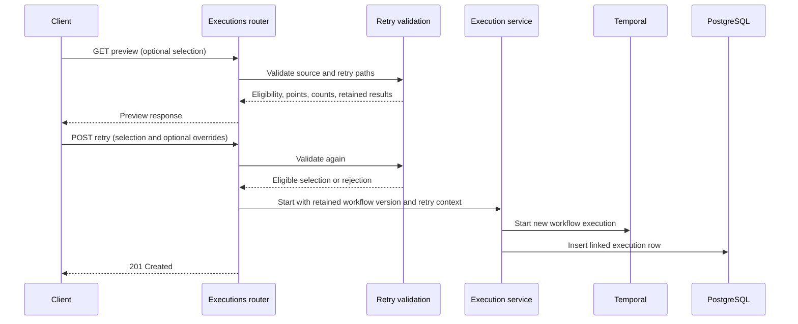

# Retry From Failure

## Purpose

Retry from failure creates a new workflow execution that starts at selected
failed nodes. It reuses eligible source-run results upstream and re-executes the
selected nodes and their downstream paths. This differs from [full execution
retry](execution-lifecycle.md#retry-execution), which starts the retained
workflow version from its trigger with the original inputs.

This guide describes the backend flow and the invariants that changes to retry
validation, execution creation, or workflow scheduling need to preserve.

## Request lifecycle

The API has a read-only preview and a create operation:

| Operation | Route | Behavior |
|-----------|-------|----------|
| Preview | `GET /executions/{id}/retry_from_failure_preview` | Validates the default or requested failure points and reports what would run. Does not change state. |
| Retry | `POST /executions/{id}/retry_from_failure` | Repeats validation, starts a new Temporal workflow, and creates a linked execution. |

The request body accepts `retry_point_ids` and optional
`input_parameter_overrides`. An empty retry-point list means all current failed
nodes. A non-empty list selects those points; it can select a subset when
multiple branches failed. The preview reports `eligible_point_ids`, which may
differ from the request when sanitized upstream nodes must be replayed. The
preview accepts an optional repeated `retry_point_ids` query parameter and
does not take overrides; overrides are validated by the create operation.

The preview is informational, not a reservation. The create operation always
runs validation again, including checks for the exact point selection and
overrides. Callers must handle a retry rejection even after an eligible preview.

The create route requires execution run permission. When non-empty override
values are supplied, it also requires update permission on the source workflow.
The overrides apply only to the new run and do not modify the workflow
definition.

As with other executions, Temporal is started before the execution row is
committed. If persistence fails after Temporal accepts the workflow, the shared
execution-start path attempts to cancel the orphaned run.

## Eligibility and preview calculations

`validate_retry_from_failure` in `workflows/services/retry_validation.py` is
shared by preview and creation. It is a pure read/validation path. The main
guards are:

1. The source execution must be `FAILED` or `COMPLETED_WITH_ERRORS`.
2. A selected point must be a currently failed activity in the source run, or a
   supported sanitized replacement, and must exist in the source execution's
   retained workflow version. Empty selection defaults to all current failures.
3. A selected failure is rejected if its nearest downstream converge node has
   already completed. That means the workflow passed the branch; a failed
   converge can still be retried from its failed branches.
4. The retry uses the exact `WorkflowVersion` recorded on the source execution.
   Edits made to the current workflow after the source run do not change retry
   behavior.
5. Stored outputs are credential-scrubbed. If a node that will be reused has a
   redacted field referenced by the retry path, the retry must replay that node
   to regenerate its output. Validation checks references and field paths so
   unreferenced redactions do not block the retry. It expands sanitized
   dependencies transitively and reports replacements and auto-included nodes.
6. Overrides may target only an existing parameter on a failed node included in
   the re-run closure. An override for an excluded failure or an auto-included
   sanitized node is rejected. At dispatch time, a valid override replaces the
   node's resolved parameter after upstream output injection.

The preview response also reports a step count per eligible point, a
deduplicated total across the selected paths, and the count of completed
activity results retained outside those paths. These counts come from graph
reachability in the retained definition; they describe workflow nodes, not
Temporal activity attempts.

Activity IDs for loop iterations are normalized to their base node IDs during
validation. Callers select a node, not an individual iteration. The workflow
engine later matches source activity state using the full Temporal activity ID
for the applicable loop iteration.

## Workflow replay and scheduling

The execution service puts retry context in workflow metadata:

- `retry_from_execution_id` identifies the source execution.
- `eligible_point_ids` is the validated selection that will actually execute.
- `input_parameter_overrides` contains validated run-scoped overrides.

The new `Execution` row uses the same `retried_from_execution_id` lineage field
as a full retry. It records the eligible points in `execution_metadata`; the
overrides are passed to Temporal and are not persisted as workflow changes.

During workflow startup, `WorkflowRetryMixin._prepare_retry` fetches source
activity statuses, source timestamps, and recorded control-node routes. It then
classifies the graph before normal traversal:

- Selected points and their downstream nodes execute in the new run.
- Eligible upstream nodes with restorable source records replay their recorded
  input, output, status, and timestamps into the new workflow namespace.
- Completed, failed, and skipped outcomes on unselected branches are retained;
  an unselected failure remains failed. Exclusive descendants that never ran
  are skipped. Shared descendants of selected points remain in the re-run path.
- The trigger executes again to establish the new run's trigger namespace. Its
  source timestamps may be shown for continuity, but its source output is not
  restored.

Only source `COMPLETED`, `SKIPPED`, and `FAILED` activity records are
restorable. In-flight and cancelled records do not represent reusable results.
When a source record is missing, ordinary nodes fall through to execution if
they cannot be restored. If an exact record disappears after a replay decision,
the retry fails visibly rather than recording a synthetic result as if the
node had run.

Control-flow nodes need special handling because replaying output alone could
choose the wrong branch. Recorded condition and switch routes are reused when
available; otherwise their branch must be inferable from restored state. A
converge is restored only when its source gate and predecessor state still
match. Otherwise the converge runs again against the mixed set of retained and
new branch outcomes.

Loops retain iteration-specific state. The retry engine probes source loop
records and replays the relevant iteration path before entering live execution
at the selected failure. Keep the Temporal iteration ID helpers and activity
sync's activity-name mapping aligned when changing loop retry behavior.

## Input overrides

Overrides are keyed by node ID and then parameter name. Validation checks the
retained workflow definition and the final re-run closure; the engine applies
the values in `WorkflowRetryMixin._apply_input_overrides` after resolving
normal node parameters. This order lets an override replace the value that
would otherwise be supplied by upstream outputs.

The endpoint checks workflow update authorization only when at least one
override is supplied. Keep the authorization check and the validation rules in
sync: the API controls who may change workflow inputs for a run, while the
service remains responsible for rejecting malformed or stale targets.

## Persistence, synchronization, and observability

Replay activities run under the canonical activity ID of the restored node.
This lets the regular activity-sync path persist replayed state as that node's
state. For replayed nodes, sync restores source timestamps and statuses so the
new execution view does not present a replay as newly completed work. A normal
retry node keeps timestamps from the new run. The sync monitor asks the
workflow whether it is a failure retry before requesting replay timestamps, so
ordinary executions and full retries do not incur replay-specific workflow
updates.

Retry request metrics use `retry_kind` (`standard` or `from_failure`) and
outcome labels. Terminal retry completion metrics include retry kind and
status. An accepted retry also emits the shared retry-request audit event,
which the telemetry handler forwards as `workflow_retry_requested`; telemetry
failure is non-fatal to execution creation.

## Code map

| Area | Source |
|------|--------|
| HTTP routes and override authorization | `backend/src/syntara/workflows/executions_router.py` |
| Eligibility, graph closure, redaction checks, and counts | `backend/src/syntara/workflows/services/retry_validation.py` |
| Retained-version lookup, retry metadata, execution creation, metrics, audit dispatch | `backend/src/syntara/workflows/services/execution_service.py` |
| Request and preview response models; retry kind | `backend/src/syntara/workflows/models/execution.py` |
| Source state reads and per-node replay records | `backend/src/syntara/workflows/workflow_engine/activities/retry_node_replay_activity.py` |
| Retry graph classification, state restoration, and input overrides | `backend/src/syntara/workflows/workflow_engine/retry_mixin.py` |
| Workflow initialization and retry-specific routing | `backend/src/syntara/workflows/workflow_engine/dynamic_workflow.py` and `converge_mixin.py` |
| Replayed activity status and timestamp synchronization | `backend/src/syntara/workflows/workflow_engine/services/activity_execution_sync.py` and `activity_sync_monitor.py` |
| Loop identity normalization | `backend/src/syntara/workflows/utils/loop_iteration_names.py` and `backend/src/syntara/workflows/workflow_engine/utils/loop_iteration_ids.py` |
| Retry request metrics | `backend/src/syntara/metrics/recorder.py` and `prometheus.py` |
| Retry request audit and telemetry | `backend/src/syntara/workflows/audit/retry_requested.py` and `backend/src/syntara/telemetry/handlers/workflow_retry_requested.py` |

The main regression coverage is in
`backend/tests/e2e/workflows/test_retry_from_failure.py`,
`backend/tests/unit/workflows/services/test_retry_validation.py`, and the
`retry_*` workflow-engine unit tests.
