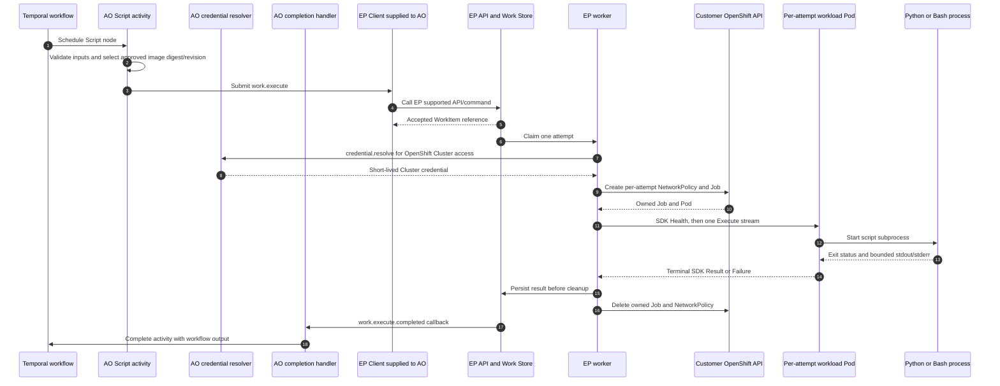
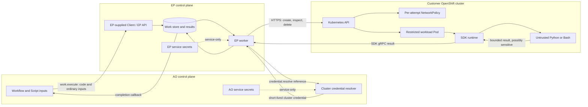

# Script step security review

- **Review status:** Proposed for Product Security review; not approved.
- **Scope:** User-supplied Python and Bash executed as a Syntara workflow Script step through the Execution Plane (EP).
- **Related design:** EP [architecture overview](https://github.com/syntara-orchestration/syntara-execution-plane/pull/169), AO integration AAP-98873, execution epic ANSTRAT-1803, SDK contracts ANSTRAT-2422.

## Review request

This document describes the Script execution path and its security controls as input to Product Security review. It is focused on the Script step rather than the full AO or EP architecture.

## Script execution flow

The EP Client is a library supplied by EP for AO to call EP. It is not an additional runtime service and does not execute the script. Its integration is covered by AAP-98873.

## Work item lifecycle

The work item is EP's durable record of a requested execution. A retry before the SDK `Execute` call may return the item to `pending`; after execution may have started, an uncertain outcome requires reconciliation instead of automatic replay.

```mermaid
stateDiagram-v2
    [*] --> pending
    pending --> claimed: worker claims item
    claimed --> dispatched: target selected and resources requested
    dispatched --> running: SDK Execute submitted
    claimed --> pending: retryable failure before Execute
    dispatched --> pending: confirmed failure before Execute
    pending --> failed: no eligible target or retry budget exhausted
    running --> completed: successful terminal result
    running --> failed: terminal execution failure
    running --> cancelled: cancellation confirmed
    running --> reconciliation_required: Execute may have started; result unavailable
    completed --> [*]
    failed --> [*]
    cancelled --> [*]
    reconciliation_required --> [*]
```

## Execution lifecycle

Each work item attempt gets one fresh Job/Pod and one SDK `Execute` invocation. EP records the terminal result before deleting its owned Kubernetes resources; cleanup status does not replace the execution result.

## Trust boundaries

The Script process is untrusted and shares its Pod's identity, filesystem, and network namespace with the SDK runtime. The OpenShift cluster credential authorizes EP to create and manage the Pod; it is not a Script input. Control-plane secrets remain in AO or EP secret stores. Script output returns through EP and AO and may contain sensitive data.

The first Script iteration has no Syntara-managed workload credential binding. EP's OpenShift credential is used only to manage the Job and Pod; it is not sent to the Script process. Script code and `environment` are ordinary inputs: the platform does not detect or block secret material in them, and arbitrary code can transmit any values it receives over permitted egress. This is a residual risk, not a security control.

## Security boundary

The script source and its inputs are untrusted. The intended isolation boundary is one EP-created Kubernetes Job and Pod per work-item attempt. The SDK runtime receives the invocation and starts Python or Bash as a child process inside that Pod.

The child process shares the Pod's container identity, filesystem, and network namespace with the SDK runtime. It is not a separate OS security principal or a general-purpose sandbox. The documented Pod controls are the proposed isolation boundary; this document does not claim that they provide a general-purpose sandbox.

### Controls in the EP workload design

| Area | Current EP design evidence |
|---|---|
| Workload lifecycle | One Job completion and one parallel Pod per attempt; `backoffLimit: 0`; deterministic attempt identity; bounded active deadline; one-hour Job TTL as cleanup backstop. |
| Pod privileges | `runAsNonRoot: true`, RuntimeDefault seccomp, no service-account token, `allowPrivilegeEscalation: false`, all Linux capabilities dropped, and a read-only root filesystem. `allowPrivilegeEscalation: false` prevents a process from gaining additional privileges through mechanisms such as setuid binaries or file capabilities; it does not remove permissions the process already has or make the Pod a general-purpose sandbox. |
| Compute and temporary storage | CPU request 100m and limit 1 CPU; memory request 128 MiB and limit 512 MiB; memory-backed `/tmp` capped at 64 MiB. These values are fixed in the current EP-generated Pod spec, not Script settings. Customer cluster policy may constrain or reject the workload. |
| Network | Per-attempt NetworkPolicy denies ingress and allows DNS plus configured egress ranges, excluding forbidden ranges. Customer CNI enforcement must be validated. |
| Workload transport | EP uses the Kubernetes API port-forward to the owned Pod. The SDK gRPC channel must authenticate peers and protect confidentiality; production mTLS wiring must be verified for the target deployment. |
| Image provenance | EP accepts the caller-supplied image reference and does not independently enforce registry policy or digest pinning. |
| Result handling | EP persists a terminal result before cleanup. Cleanup status is tracked separately. An uncertain result after Execute submission is reconciled, not automatically replayed. |

These are controls in EP's implementation/design evidence, not a claim that every customer cluster enforces them. The target cluster's CNI, admission policies, quotas, registry access, and supported OpenShift versions require deployment validation.

## Inputs, credentials, and outputs

| Data | Handling and boundary |
|---|---|
| Script code and `environment` | Ordinary, untrusted workflow input sent to the SDK Execute request and then to the child process. The platform does not detect or block secret material supplied here; arbitrary code may expose any values it receives. |
| OpenShift Cluster credential | AO resolves an opaque reference for EP. EP uses the short-lived value to access the customer Kubernetes API. The raw credential value must not enter the WorkItem payload, workload Pod spec or environment, Script process, result, or logs. |
| Workload credential | Separate from the OpenShift Cluster credential. Although the SDK defines credential callback support, the current Script path does not bind credentials to user code; the first iteration has no Syntara-managed workload credential binding. |
| AO/EP control-plane secrets | Service JWTs, callback mTLS material, database credentials/encryption keys, and EP TLS material stay in AO/EP service secret stores. They are never workload inputs. |
| Script output | On success, the plugin returns `return_code`, captured `stdout` and `stderr`, and (for Python) `stdout_json` when stdout parses as JSON. These fields may contain sensitive data. A nonzero exit, timeout, or cancellation produces a failure result; the current Script wrapper does not include partial stdout/stderr in that failure result. |

### Logs and result persistence

Script output streams and operational logs are separate paths:

| Data path | Current behavior |
|---|---|
| Script `stdout` and `stderr` | Captured from the subprocess and returned as result data on successful execution. They are not sent through the SDK logging callback. The current Script wrapper does not expose a logging callback to user-authored Python or Bash. |
| SDK structured log events | The SDK provides an invocation-scoped `ExecutionContext.toolbox.log(...)` API for plugin implementations and batches events over the workload protocol. EP's current adaptor ignores `ContainerLogBatch`; forwarding these events to a configured OTEL collector is in progress and is not live in the current path. |
| EP service logs | EP can export its own service logs to OTLP when configured. This is separate from SDK log events and Script output streams. |
| Result storage | EP persists the terminal result in the WorkItem before cleanup, and AO returns it as workflow activity output. AO stores activity `output_data` in its `ActivityExecution` record. The result's retention and access policy are not specified here and require confirmation. Treat persisted output as potentially sensitive. |

## Script-specific limits and failure behavior

| Concern | Current step/runtime contract | Security requirement for review |
|---|---|---|
| Output | Successful results include the declared output fields; per-stream capture defaults to 276,480 bytes (270 KiB) and can be configured up to 1 MiB. Excess stream data is drained and truncated. The combined serialized SDK result is capped at 1 MiB. A nonzero exit, timeout, or cancellation returns failure metadata without partial stdout/stderr in the result. | Confirm AO, EP, and Temporal payload limits are compatible and document the output fields exposed for each outcome. |
| Memory and CPU | Pod limit is 512 MiB and 1 CPU; the Script launcher attempts an address-space cap derived from the cgroup. Resource values are fixed by EP in the current implementation; the Script node has no customer override. | Assess whether CPU-time, process-count, ephemeral-storage, or file-size controls are also needed. |
| Timeout | Invocation timeout is sent to the SDK; Pod active deadline covers startup, execution, and termination grace. Cleanup has its own bounded period. | Confirm maximum duration and that AO activity deadlines include EP startup, callback, and cleanup slack. |
| Cancellation | EP sends SDK Cancel, waits a bounded grace period, then deletes the owned Job. Script cleanup sends TERM then KILL to the child process group. | Test ignored cancellation and descendants; distinguish cancellation before Execute from cancellation after it may have started. |
| Retry | EP submits Execute once per attempt. Before submission, confirmed infrastructure failures may be retried. After possible submission, a missing result is uncertain and must not cause automatic replay. | Arbitrary scripts can have external side effects; confirm AO does not silently retry uncertain or non-idempotent executions. |
| Cleanup | EP deletes the owned Job, then its policy; TTL is a backstop and does not clean policies. A reconciler removes orphan policies only after confirming the Job/Pods are absent. | Confirm cleanup failure remains visible, retryable, and operationally actionable without overwriting a committed result. |

## Review record

| Field | Status |
|---|---|
| Product Security intake route/reviewer | Not yet identified |
| Submission/disposition | Not submitted; no approval implied |
| Required actions | Record after review with severity, owner, delivery impact, and release-blocking status |

## References

- [EP architecture overview and security control inventory (PR #169)](https://github.com/syntara-orchestration/syntara-execution-plane/pull/169)
- [EP cold-start Job lifecycle](https://github.com/syntara-orchestration/syntara-execution-plane/blob/7c50410ac8a61478fe54ba6bfb245cb9018f1474/docs/kubernetes-jobs-followup.md)
- [EP SDK workload protocol](https://github.com/syntara-orchestration/syntara-execution-plane/blob/7c50410ac8a61478fe54ba6bfb245cb9018f1474/docs/workload-protocol.md)
- [Script Python input and output schema](https://github.com/syntara-orchestration/syntara-step-types/blob/982175a44ddd415f44dc2ab6e851bd3406fcb1dc/script-python/manifest.yaml)
- [EP-generated workload Pod security and resource settings](https://github.com/syntara-orchestration/syntara-execution-plane/blob/7c50410ac8a61478fe54ba6bfb245cb9018f1474/src/execution_plane/worker_manager/vanilla_k8s/transport.py)
- [EP SDK workload adaptor](https://github.com/syntara-orchestration/syntara-execution-plane/blob/7c50410ac8a61478fe54ba6bfb245cb9018f1474/src/execution_plane/worker_manager/vanilla_k8s/sdk_adaptor.py)
- [SDK credential callback ADR 0011](https://github.com/syntara-orchestration/syntara-plugin-sdk/blob/448de6d8f7ad6cba2d5250c31cd82a1dd57f9812/.sdlc/adrs/0011-credential-callback.md)
- [AAP-98873 AO/EP integration design](https://redhat.atlassian.net/browse/AAP-98873)
- [AAP-95467 SDK architecture](https://redhat.atlassian.net/browse/AAP-95467)
- [AAP-97389 packaging and lifecycle](https://redhat.atlassian.net/browse/AAP-97389)
