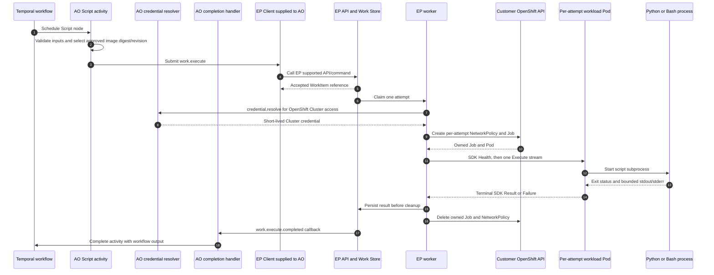

# Script step security review

- **Review status:** Proposed for Product Security review; not approved.
- **Scope:** User-supplied Python and Bash executed as a Syntara workflow Script step through the Execution Plane (EP).
- **Related design:** EP [architecture overview](https://github.com/syntara-orchestration/syntara-execution-plane/pull/169), AO integration AAP-98873, execution epic ANSTRAT-1803, SDK contracts ANSTRAT-2422.

## Review request

Please assess whether the isolation and controls below are sufficient for running user-supplied scripts in customer OpenShift clusters. In particular, decide whether a restricted Kubernetes Pod is an acceptable security boundary for arbitrary code, whether the network and credential boundaries are adequate, and which mitigations must block release. Record findings by severity, delivery impact, owner, and release-blocking status.

This document is intentionally limited to Script execution. It does not restate the full AO or EP architecture.

## Review at a glance

**Security question:** Are the proposed controls sufficient to run customer-provided Python and Bash in a per-attempt OpenShift Pod?

Product Security is asked to decide:

- Whether the restricted Pod is an adequate isolation boundary for arbitrary scripts, or stronger isolation is required.
- Whether customer-cluster egress controls and CNI validation provide an acceptable network boundary.
- Whether the separation of cluster credentials, workload credentials, service secrets, and script output is sufficient.
- Which image provenance, gRPC transport, resource, cancellation, retry, and cleanup controls must block release.

## Script execution flow

The EP Client is a library supplied by EP for AO to call EP. It is not an additional runtime service and does not execute the script. Its package/version, exact API, authentication, and retry contract must be recorded in AAP-98873.

## Security boundary

The script source and its inputs are untrusted. The intended isolation boundary is one EP-created Kubernetes Job and Pod per work-item attempt. The SDK runtime receives the invocation and starts Python or Bash as a child process inside that Pod.

The child process shares the Pod's container identity, filesystem, and network namespace with the SDK runtime. It is not a separate OS security principal or a general-purpose sandbox. Product Security must decide whether the Pod controls listed below are sufficient for the supported threat model or whether stronger isolation is required.

### Controls in the EP workload design

| Area | Current EP design evidence |
|---|---|
| Workload lifecycle | One Job completion and one parallel Pod per attempt; `backoffLimit: 0`; deterministic attempt identity; bounded active deadline; one-hour Job TTL as cleanup backstop. |
| Pod privileges | Non-root execution, RuntimeDefault seccomp, no service-account token, no privilege escalation, all Linux capabilities dropped, read-only root filesystem. |
| Compute and temporary storage | CPU request 100m and limit 1 CPU; memory request 128 MiB and limit 512 MiB; memory-backed `/tmp` capped at 64 MiB. |
| Network | Per-attempt NetworkPolicy denies ingress and allows DNS plus configured egress ranges, excluding forbidden ranges. Customer CNI enforcement must be validated. |
| Workload transport | EP uses the Kubernetes API port-forward to the owned Pod. The SDK gRPC channel must authenticate peers and protect confidentiality; production mTLS wiring must be verified for the target deployment. |
| Result handling | EP persists a terminal result before cleanup. Cleanup status is tracked separately. An uncertain result after Execute submission is reconciled, not automatically replayed. |

These are controls in EP's implementation/design evidence, not a claim that every customer cluster enforces them. The target cluster's CNI, admission policies, quotas, registry access, and supported OpenShift versions require deployment validation.

## Inputs, credentials, and outputs

| Data | Handling and boundary |
|---|---|
| Script code and `environment` | Ordinary, untrusted workflow input sent to the SDK Execute request and then to the child process. Environment values are not a secret-delivery mechanism. Avoid putting secrets here. |
| OpenShift Cluster credential | AO resolves an opaque reference for EP. EP uses the short-lived value to access the customer Kubernetes API. It must not enter the WorkItem payload, workload Pod spec/environment, script process, result, or logs. |
| Workload credential | Separate from the Cluster credential. The SDK supports invocation-scoped credential callbacks, but current EP evidence says bound workload credentials are unavailable. Script manifests do not currently declare credential recipes. Do not claim Script credential delivery is available. |
| AO/EP control-plane secrets | Service JWTs, callback mTLS material, database credentials/encryption keys, and EP TLS material stay in AO/EP service secret stores. They are never workload inputs. |
| Script output | `return_code`, `stdout`, `stderr`, and Python `stdout_json` may contain arbitrary or sensitive data. Treat as untrusted; enforce limits and access controls; do not log full output. EP stores the result and AO maps it to workflow output. |

## Script-specific limits and failure behavior

| Concern | Current step/runtime contract | Security requirement for review |
|---|---|---|
| Output | Default capture is 276,480 bytes (270 KiB) per stream; configurable up to 1 MiB per stream. Combined serialized SDK result is capped at 1 MiB. Excess stream data is drained and truncated; a result that still exceeds the SDK limit fails. | Confirm truncation/failure semantics and ensure AO, EP, and Temporal payload limits are compatible. |
| Memory and CPU | Pod limit is 512 MiB and 1 CPU. The script launcher attempts an address-space cap derived from the cgroup. | Confirm these defaults and identify any additional CPU-time, process-count, ephemeral-storage, or file-size controls required. |
| Timeout | Invocation timeout is sent to the SDK; Pod active deadline covers startup, execution, and termination grace. Cleanup has its own bounded period. | Confirm maximum duration and that AO activity deadlines include EP startup, callback, and cleanup slack. |
| Cancellation | EP sends SDK Cancel, waits a bounded grace period, then deletes the owned Job. Script cleanup sends TERM then KILL to the child process group. | Test ignored cancellation and descendants; distinguish cancellation before Execute from cancellation after it may have started. |
| Retry | EP submits Execute once per attempt. Before submission, confirmed infrastructure failures may be retried. After possible submission, a missing result is uncertain and must not cause automatic replay. | Arbitrary scripts can have external side effects; confirm AO does not silently retry uncertain or non-idempotent executions. |
| Cleanup | EP deletes the owned Job, then its policy; TTL is a backstop and does not clean policies. A reconciler removes orphan policies only after confirming the Job/Pods are absent. | Confirm cleanup failure remains visible, retryable, and operationally actionable without overwriting a committed result. |

## Current implementation gap

The Syntara `feat/ANSTRAT-2523` base includes a direct AO-worker-to-OpenShift Script path. The target flow in this review uses the EP-provided Client and EP-managed workload lifecycle. The AO-to-EP Client integration and a shared-cluster AO→EP→Script trace are not demonstrated by this document. AAP-98873 must link that implementation and end-to-end evidence before the target flow is treated as shipped.

EP selects the image supplied by the caller; EP's current design does not independently enforce image provenance. AO/packaging must provide a release-approved immutable image digest and prevent workflow authors from selecting arbitrary images or target namespaces. The client/API contract and trusted image mapping remain open integration decisions.

## Decisions requested from Product Security

1. Is the per-attempt Pod, with the listed restrictions, an adequate boundary for arbitrary Python/Bash code? If not, specify the required stronger isolation mechanism and release gate.
2. Are the customer-controlled egress policy and CNI validation sufficient? Specify the required default-deny behavior and evidence for supported clusters.
3. Are the credential separation and output handling acceptable? Confirm that Script receives no protected workload credentials and that outputs/errors are treated as potentially sensitive.
4. Which controls must be verified before release for image provenance, SDK gRPC TLS/mTLS, resource limits, cancellation, uncertain outcomes, and cleanup?

## Review record

| Field | Status |
|---|---|
| Product Security intake route/reviewer | Not yet identified |
| Submission/disposition | Not submitted; no approval implied |
| Required actions | Record after review with severity, owner, delivery impact, and release-blocking status |

## References

- [EP architecture overview and security control inventory (PR #169)](https://github.com/syntara-orchestration/syntara-execution-plane/pull/169)
- [EP cold-start Job lifecycle](https://github.com/syntara-orchestration/syntara-execution-plane/blob/7c50410ac8a61478fe54ba6bfb245cb9018f1474/docs/kubernetes-jobs-followup.md)
- [EP SDK workload protocol](https://github.com/syntara-orchestration/syntara-execution-plane/blob/7c50410ac8a61478fe54ba6bfb245cb9018f1474/docs/workload-protocol.md)
- [SDK credential callback ADR 0011](https://github.com/syntara-orchestration/syntara-plugin-sdk/blob/448de6d8f7ad6cba2d5250c31cd82a1dd57f9812/.sdlc/adrs/0011-credential-callback.md)
- [AAP-98873 AO/EP integration design](https://redhat.atlassian.net/browse/AAP-98873)
- [AAP-95467 SDK architecture](https://redhat.atlassian.net/browse/AAP-95467)
- [AAP-97389 packaging and lifecycle](https://redhat.atlassian.net/browse/AAP-97389)
