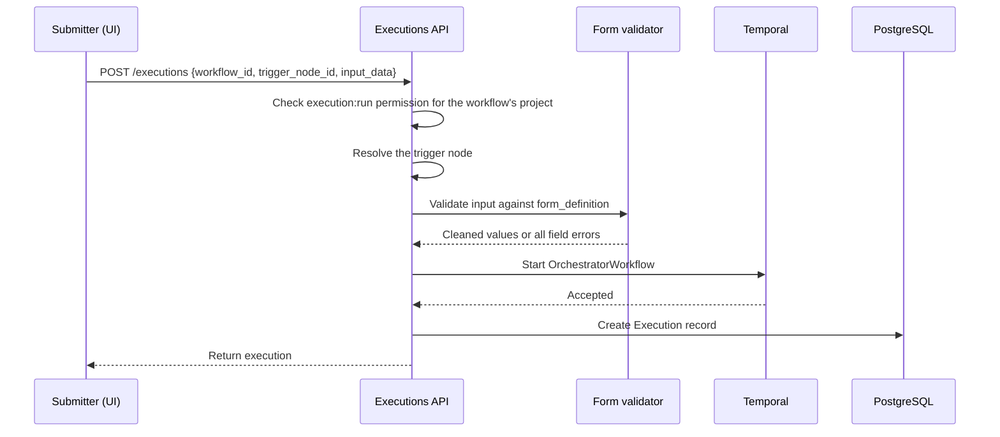

# Form Trigger

A form trigger lets a user start a workflow by filling out and submitting a form. Downstream
nodes can reference the submitted values. Form triggers share their form definitions, field
models, and common parameters with the [form prompt step](../../forms/form-prompt-overview.md).

For the shared trigger architecture, including output mapping, namespace registration, and how the
workflow selects a trigger activity from its node type, see [Trigger System Overview](overview.md).

## Architecture

The form is presented before a workflow execution begins. The user submits it through the existing
`POST /api/v1/executions` endpoint; form triggers have no separate submit endpoint. The API
validates the answers and starts exactly one execution, with the form-trigger activity as its
entry node. It does not create a pending form record or pause a workflow while it waits for input.

The form definition lives in the workflow version, and the UI renders it from there. There is no
dedicated form-trigger table, service, or read endpoint.
The execution stores the cleaned submission in `input_data`; the trigger activity stores its
mapped output under `response_data`.

## Form Definitions, Fields, and Parameters

Form definitions list the fields a user can fill in and use a defined set of supported field
types. Form parameters configure the form itself. Most field, option, and validation rules are
shared by form prompts and form triggers. See [Form Definitions](../../forms/form-definitions.md) for
the full guide, including where the two differ.

## Submitting a Form

The forms domain owns the field models and shared submission validator; the workflows domain
owns the trigger and execution path. Before starting a workflow,
`ExecutionService.create_execution()` calls `validate_form_trigger_submission()` in
`workflows/form_trigger.py`. That function checks the trigger's form definition, then
calls `validate_form_submission()` in `forms/validators/submission.py` to validate and normalize the answers.

An invalid submission returns `422` with all field errors and creates no execution record. For a
valid submission, validation normalizes values according to their field definitions.

The API checks the cleaned payload's size after normalization because applying field defaults can
make it larger than the JSONB limit.

### Reading Submitted Values

The trigger output places submitted values under `response_data`. Fields can be referenced by downstream nodes at
`${<trigger_node_id>.response_data.<value_name>}` or
`${trigger.response_data.<value_name>}`. The trigger output does not include submitter or
response-time metadata. The execution context provides the execution's creator and creation time
through `workflow_context.execution.created_by` and `workflow_context.execution.created_at`.

### Retrying an Execution

A retry reuses the original form `input_data` and workflow version, keeping the submission tied to the
form definition from the original run. The submitter does not have to fill out the form again.

## Authorization

Submitting a form starts an execution, so the user needs `execution:run` permission in the
workflow's project. Form triggers have no responder list or additional authorization check.

## Observability

The submission path emits an audit event and a latency metric. Both are best-effort: failures are
logged and swallowed so they do not prevent a submission.

- **`form_trigger_submitted` audit event:** An INFO workflow event keyed by workflow URN. It
  records the execution, trigger node, submitter, field count, and sorted field types; labels and
  submitted values are omitted.
- **Submission latency:** Measures the full create-execution interval with a monotonic clock in
  one process.

## Extending the Feature

### Adding a New Field Type or Parameter

For steps to add a field type or form parameter, see
[Extending Forms](../../forms/form-definitions.md#extending-forms).

### Adding a Trigger Type

The form trigger is an example of a trigger that needs its own config and validation, but no
service or database table. See [Adding a New Trigger Type](overview.md#adding-a-new-trigger-type).

## Related Documentation

- [Form Definitions](../../forms/form-definitions.md) — field types, validation and parameters shared
  by form prompts and form triggers
- [Trigger System Overview](overview.md) — shared trigger behavior, output flow, and multi-trigger resolution  
- [Form Prompt Overview](../../forms/form-prompt-overview.md) — the sibling collection
  point that pauses a running workflow
- [Manual Trigger](manual-trigger.md) — another trigger with no external state
- [Workflow Engine Architecture](../workflow-engine-overview.md) — graph execution and dispatch
