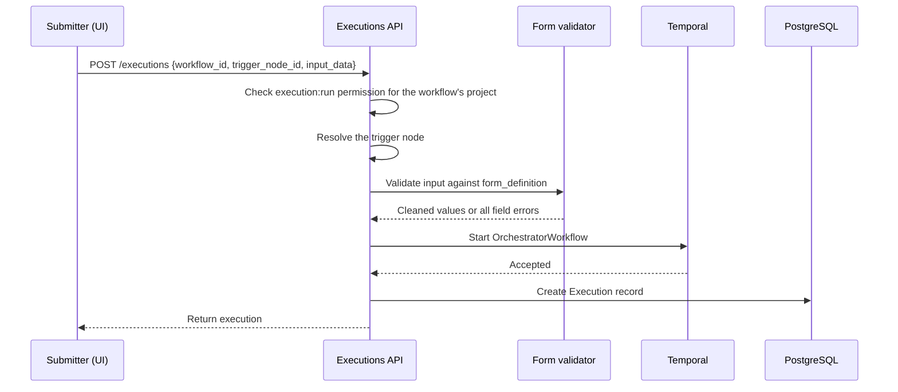

# Form Trigger

A form trigger is a workflow entry point that collects structured input from a user. Submitting
the form starts the workflow, and downstream nodes can use the submitted values.

For the shared trigger architecture, including output mapping, namespace registration, and how the
workflow selects a trigger activity from its node type, see [Trigger System Overview](overview.md).

## System Architecture

Form triggers collect input before the workflow starts. There is no pending response or deadline,
and the workflow does not pause while waiting for input.

- **Submission path:** The user submits the form through `POST /api/v1/executions`, the same
  endpoint used by manual triggers. The API validates the answers and starts one execution, with
  the form-trigger activity as its entry node.
- **Form storage:** The definition stays in the workflow version. There is no dedicated
  form-trigger table, service, or read endpoint.
- **Domain ownership:** The forms domain provides the shared form field models and validator; the
  workflows domain owns the form-trigger node and execution path.
- **Execution data:** The form definition determines the validated values stored in `input_data`.
  The trigger activity applies output mapping and returns the result under `response_data` for
  downstream nodes. The API schemas are generic: `ExecutionCreate.input_data` accepts an object,
  and `resultSchema.response_data` allows arbitrary properties. The form builder can generate a
  Draft-07 schema for preview and import/export, but the execution API does not use it as its
  request or response contract. This work is still in progress. 

## Form Definitions, Fields, and Parameters

Form definitions list the fields a user will fill in. Authors choose each field's type from the
supported set and configure its label, required status, and other settings. Form parameters
configure the form itself. Most field, option, and validation rules are
shared by [form prompts](../../forms/form-prompt-overview.md) and form triggers. See [Form Definitions](../../forms/form-definitions.md) for
the full guide, including where the two differ.

## Submitting a Form

Before starting the workflow, the executions API validates the answers against the form definition
and normalizes them for downstream steps.

An invalid submission returns `422` with all field errors and creates no execution record. For a
valid submission, validation normalizes values according to their field definitions.

The API checks the cleaned payload's size after normalization because applying field defaults can
make it larger than the JSONB limit.

### Reading Submitted Values

The trigger output places submitted values under `response_data`. Fields can be referenced by downstream nodes at
`${<trigger_node_id>.response_data.<value_name>}` or
`${trigger.response_data.<value_name>}`. The trigger output does not include submitter or
response-time metadata. The execution context provides the execution's creator and creation time
through `workflow_context.execution.created_by` and `workflow_context.execution.created_at`.

### Retrying an Execution

A retry reuses the original form `input_data` and workflow version, keeping the submission tied to the
form definition from the original run. The submitter does not have to fill out the form again.

## Authorization

Submitting a form starts an execution, so the user needs `execution:run` permission in the
workflow's project. Form triggers have no responder list or additional authorization check.

## Observability

The submission path emits an audit event and a latency metric. Both are best-effort: failures are
logged and swallowed so they do not prevent a submission.

- **`form_trigger_submitted` audit event:** An INFO workflow event keyed by workflow URN. It
  records the execution, trigger node, submitter, field count, and sorted field types; labels and
  submitted values are omitted.
- **Submission latency:** Measures the full create-execution interval with a monotonic clock in
  one process.

## Extending the Feature

### Adding a New Field Type or Parameter

For steps to add a field type or form parameter, see
[Extending Forms](../../forms/form-definitions.md#extending-forms).

## Related Documentation

- [Form Definitions](../../forms/form-definitions.md) — field types, validation and parameters shared
  by form prompts and form triggers
- [Trigger System Overview](overview.md) — shared trigger behavior, output flow, and multi-trigger resolution  
- [Form Prompt Overview](../../forms/form-prompt-overview.md) — the sibling collection
  point that pauses a running workflow
- [Manual Trigger](manual-trigger.md) — another trigger with no external state
