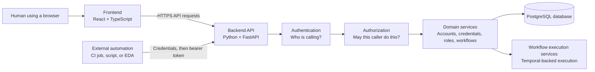
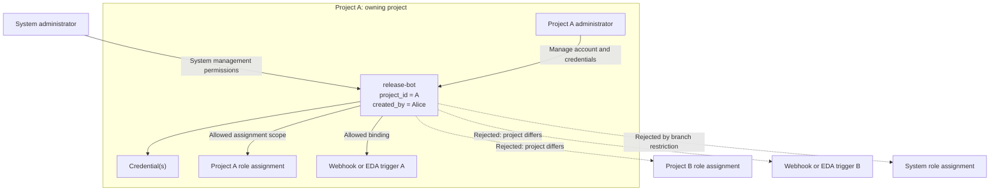
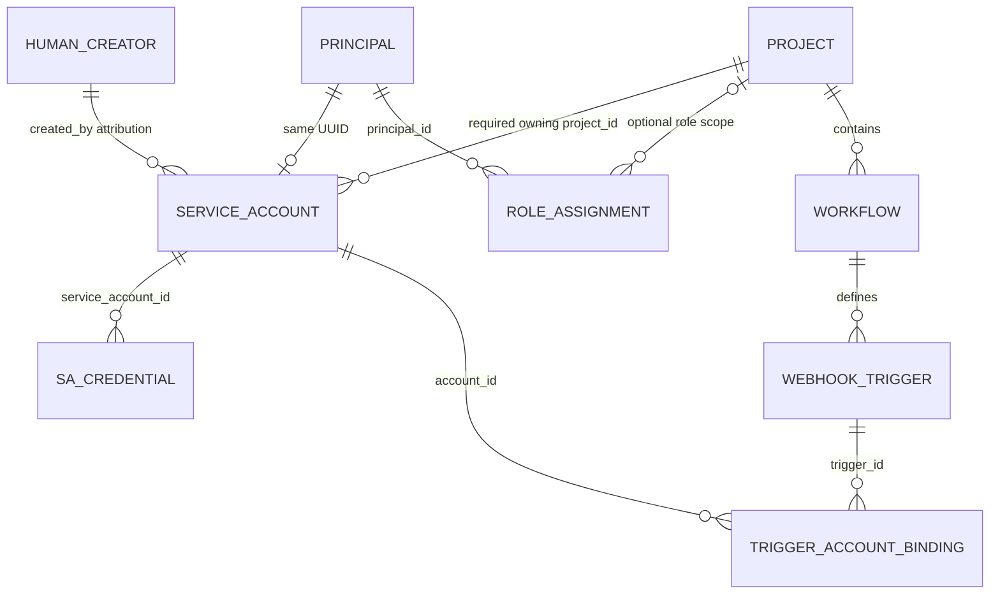
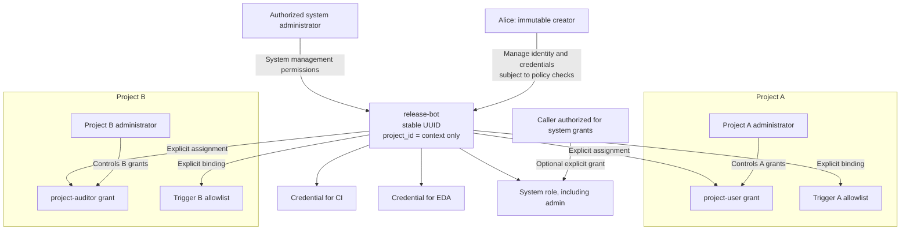
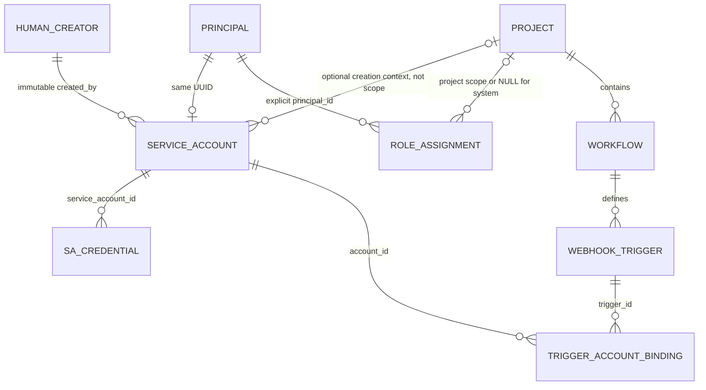
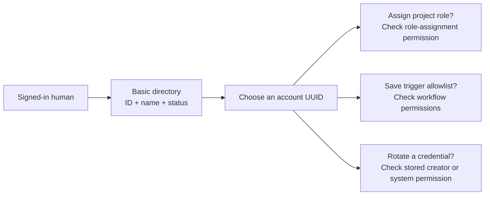
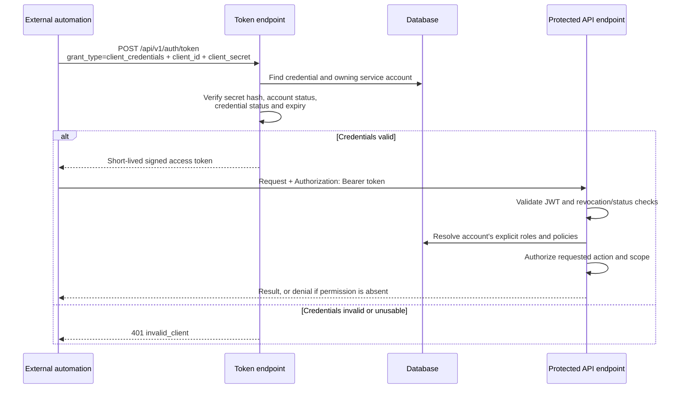
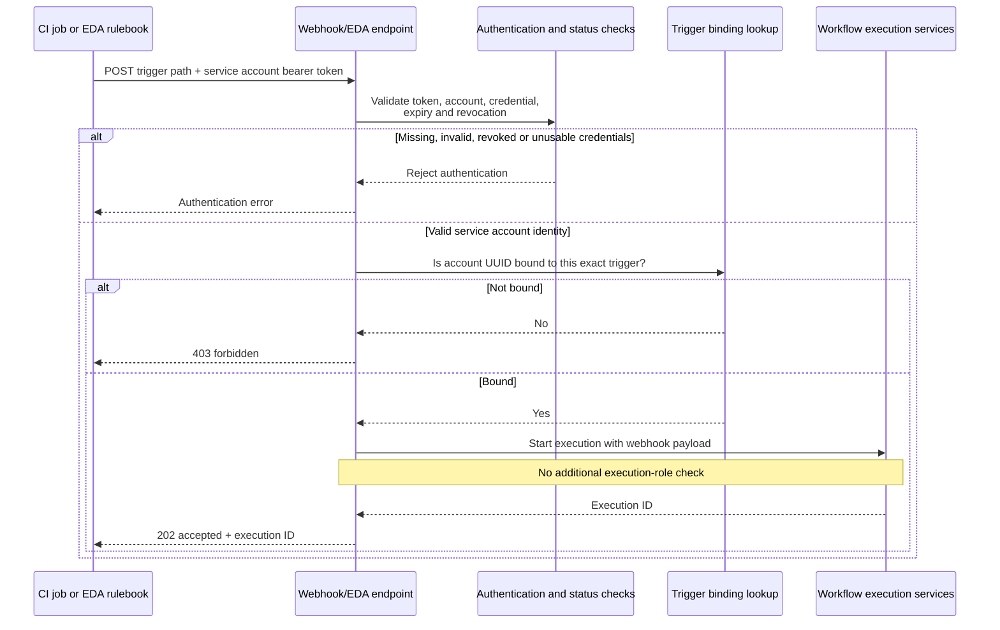
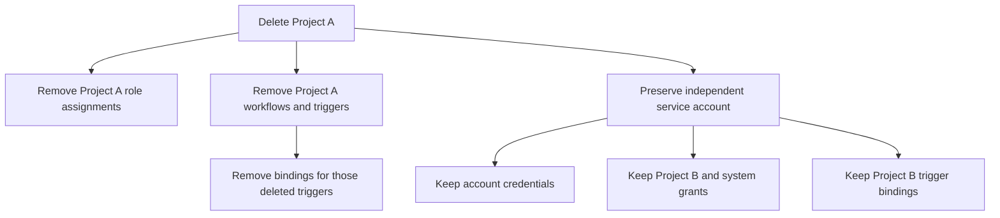

# Service account identities: before and after project independence

Service accounts let software identify itself to Syntara without borrowing a human user's login. This change makes each service account an independent identity: it has a creator, credentials, and explicit permissions, but no owning project. Its optional `project_id` records creation context and does not limit access. The same identity can receive different roles in several projects and can be authorized for selected webhook or EDA triggers across those projects.

The most important distinction is between **managing an identity** and **granting that identity access**. A creator manages the account and its credentials. A project administrator grants access within a project. Those are separate responsibilities, even when the same person happens to perform both.

> **Reading context:** “Before” means the project-owned implementation at commit `f82d8f3ef`, including this branch's restriction on role assignment. “After” means the independent-identity design and the implementation being developed in the current working tree. This guide describes behavior and source structure; it is not a claim that every deployment already runs this upgrade or that every validation check has passed. Implementation and test results may continue to change before merge.

## 1. Start with the office-building analogy

Imagine Syntara as an organization with several buildings.

| Syntara concept | Analogy | What it means in practice |
| --- | --- | --- |
| Project | A building | A boundary around workflows and project permissions. |
| Service account | A contractor's identity record | A stable identity for automation, such as `release-bot`. |
| Account UUID | The contractor's permanent personnel number | The identifier used by permissions and trigger bindings, even if the name changes. |
| Account creator | The person who registered the contractor | The human who can maintain the identity and issue its credentials. |
| Credential | A badge number and secret used to obtain a visitor pass | A `client_id` and `client_secret` pair. |
| Access token | A short-lived signed visitor pass | A JWT presented with API requests after successful authentication. |
| Role assignment | An access permit | A role plus its scope, such as read-only access to Building A. |
| Trigger binding | A guest list for one specific entrance | Permission for this identity to invoke one webhook or EDA trigger. |
| Policy | A rule the security desk evaluates | A rule allowing or denying an action on a resource. |

Previously, the contractor's identity record belonged to one building. That building's administrators managed it, and the branch required its role assignments and trigger bindings to stay inside that building.

After this change, the contractor's identity exists independently. Building A can issue an A-specific permit, and Building B can issue a B-specific permit. Neither permit makes either building administrator the owner of the contractor's identity record or credentials.

The analogy has limits. Credentials are not restricted to one of the account's permits: whoever controls a usable credential can act with **all permissions assigned to that identity**. Creating separate credentials for two tools improves rotation and revocation, but does not isolate the tools' permissions from one another.

## 2. The parts of the system

You do not need to know the full technology stack to follow this change.



The frontend displays forms and enables permitted actions. The backend remains responsible for enforcing permissions, including when a caller bypasses the browser and sends an API request directly. The database stores identities, relationships, credential hashes, and audit metadata.

Syntara uses **principals** as a common identity foundation. Both a human user and a service account have a principal UUID, so the existing role-assignment machinery can grant a role to either type. A service account is still a distinct type; it is not a human user with a special display name.

### Plain-language glossary

| Term | Meaning |
| --- | --- |
| Frontend | The application running in the browser. React builds the screens, and TypeScript checks the types used by that code. |
| Backend | The server application. Python contains the application logic; FastAPI maps HTTP requests to that logic. |
| API endpoint | A server operation identified by an HTTP method and path, such as `POST /api/v1/service_accounts`. |
| Database / table / row | Persistent storage; a table holds one kind of record, and a row is one record. |
| SQLModel / SQLAlchemy | Python tools that map application objects and queries to database tables and SQL. |
| UUID | A globally unique identifier. It identifies a record without relying on its human-readable name. |
| Principal | Something that can act in the system, such as a human user or service account. |
| Credential | Proof used to authenticate. Here, a client identifier and secret associated with one service account. |
| Hashing | Transforming a secret into a value suitable for verification. The server compares a submitted secret against its stored Argon2id hash; it does not retrieve the original secret from that hash. |
| JWT | JSON Web Token: a signed token containing claims such as the identity, expiration, and issuing credential. Signing protects integrity; it does not make the payload confidential. |
| Bearer token | A token sent in `Authorization: Bearer ...`. Possession is enough to present it, so it must be protected like a secret. |
| Role | A named collection of permissions, such as `project-auditor` or `admin`. |
| Role assignment / grant | A link from a principal to a role, with a project scope or system scope. |
| Scope | Where a permission applies. A project grant applies to one project; a system grant applies according to the system role's policies. |
| Policy / Rego | A machine-readable permission rule; Syntara evaluates authorization policies using Rego. Matching explicit deny rules take precedence over allow rules. |
| Migration / Alembic | A versioned database-schema change and the tool that applies it. Removing a field from Python alone does not remove its database column. |
| OpenAPI / generated contracts | The API's machine-readable description and code/types generated from it so frontend and client callers agree with the backend. |
| Webhook | An HTTP call an external system sends when an event occurs. |
| EDA | Event-Driven Ansible. Its integration can invoke a Syntara EDA trigger using a service account token. |
| Temporal | The workflow orchestration infrastructure used to run and coordinate executions. |

## 3. Four questions that must stay separate

| Question | Name | Example |
| --- | --- | --- |
| Who is making this request? | Authentication | “The client secret proves this caller is `release-bot`.” |
| May that identity perform this action? | Authorization | “`release-bot` has `project-user` in Project A.” |
| Who may maintain the account and its credentials? | Identity management | “Alice created `release-bot`, so she can rotate its credential unless a deny policy blocks her.” |
| Who may change its permissions? | Grant management | “Project A's administrator may assign or revoke roles within Project A.” |

A successful login answers only the first question. Creating an account does not grant it a project role. Owning the account does not give the creator authority to assign roles. Selecting an account from a directory does not establish any of those permissions.

There are two authorization paths to remember. Ordinary protected API operations use role and policy checks. Webhook and EDA invocation use valid service account authentication plus membership in that specific trigger's allowlist; they do not additionally require an execution role.

## 4. Before: a project owned the identity

### Architecture and boundaries



The account stored a required `project_id` foreign key, meaning the database linked it to exactly one project. Create requests had to provide that project. Read responses included the project's ID and enriched display name, and list visibility used project permissions.

The creator's UUID was already stored in `created_by`, but it did not replace project permissions as the account-management rule. Built-in `project-admin` permissions covered account creation, updates, deletion, credential rotation, and enable/disable within the owning project. `project-auditor` provided project-scoped read access. System administrators and auditors had their corresponding system-level permissions.

### Why a second project could not simply grant access

The role-assignment data model was already generic: it linked a principal to a role with an optional project. However, the branch's service-account validation added a narrower rule:

```text
requested role assignment's project_id must equal service account's project_id
```

A request for Project B failed when the account belonged to Project A. A system assignment also failed: system scope uses `project_id = null`, which could not equal the account's required owning-project UUID. The restriction was application validation, not a limitation of the principal/role database relationship.

Similarly, workflow save validated that bound accounts belonged to the workflow's project. Import sanitization removed service-account references outside the destination project. Reusing the identity in another project therefore conflicted with the ownership model.

### Old data relationships



These diagrams simplify the schema by omitting unrelated fields and other principal types. `HUMAN_CREATOR` represents the human principal referenced by `created_by`, rather than a table with that literal name. The key relationship being removed is **Project → Service account**, not Project → Role assignment or Project → Workflow.

### Project deletion and default permissions

Project cleanup explicitly deleted credentials and service-account rows belonging to that project. That was consistent with project-owned identities, but unsuitable for an identity shared by several projects.

Creation did not insert a direct role assignment for the account. There was a separate issue in the shared resolver: it added the implicit `authenticated` group without first requiring a real human `User` row. A service account could consequently inherit policies from that group. The independent-identity implementation adds that human-user check; the new behavior must not be described as merely preserving the old implicit defaults.

## 5. After: an independent identity with separate access grants

### Architecture and responsibilities



There is no default project or hidden replacement ownership project. Accounts remain identified by UUID, and existing display-name behavior is retained. This change adds neither ownership transfer nor service-account membership in human groups.

### Creator and system management

Any signed-in human receives the built-in ability to create an account, subject to applicable deny policies. The backend sets `created_by` from the authenticated caller. The client does not choose or update that value, and later edits do not transfer creator access.

The creator receives account-specific management through `self` policies. Those policies compare the caller's UUID with the account's stored `created_by`. Authorized system permissions provide another management path. Being an administrator of a project that grants a role to the service account provides neither account ownership nor credential control.

Matching explicit deny policies still win. Creator access is part of the normal policy evaluation, not a bypass placed before authorization. The backend loads ownership from the database for both real operations and permission introspection; a caller cannot claim ownership by sending fake `created_by` metadata.

### Permission reference

The following describes built-in behavior. Additional explicit grants and deny policies can change an individual caller's effective permissions.

| Caller | Basic directory | Full account/credential metadata | Account and credential mutations | Assign/revoke account roles |
| --- | --- | --- | --- | --- |
| Signed-in human, unrelated to the account | Yes | No, absent an applicable system read grant | No | Only with separate grant-management permission for the target scope |
| Account's human creator | Yes | Yes for that account | Yes for that account | Creator ownership alone grants none |
| System `admin` | Yes | Yes | Yes | System and project grants, subject to normal policy checks |
| System `auditor`, unrelated to the account | Yes | Yes | No | No mutation permission from the auditor role |
| Project administrator, unrelated to the account | Yes as a signed-in human | No merely because of the project role | No merely because of the project role | Within projects they are authorized to administer |
| Service account | No implicit human directory access | Only if an explicitly assigned role permits it | Only if an explicitly assigned role permits it | Only if an explicitly assigned role permits it |

An auditor who also created an account has the separate creator permissions for that account, unless denied. The auditor role itself remains read-only. “Credential metadata” never means a previously issued plaintext secret or a stored secret hash in the API response.

### Roles remain explicit and scoped

The ordinary role-assignment validation still checks the target principal, role, and project, and the caller still needs permission to assign or revoke in the requested scope. Removing the owning-project comparison does not remove those checks.

| Assignment | `principal_id` | `role_name` | Assignment `project_id` | Meaning |
| --- | --- | --- | --- | --- |
| Project A access | Account UUID | `project-user` | Project A UUID | Permissions from that role within A. |
| Project B read access | Same account UUID | `project-auditor` | Project B UUID | Read permissions from that role within B. |
| System administrator | Same account UUID | `admin` | `null` | System administrator policies; requires an authorized caller to grant it. |

The table illustrates possible grants; creation does not insert these rows. Built-in system roles cannot be assigned as project roles, and built-in project roles require a project. Revoking the Project A assignment removes that grant without deleting the identity, the Project B grant, or an unrelated system grant.

Service accounts no longer inherit the implicit human `authenticated` group. Their ordinary API permissions come from explicit role assignments. A trigger allowlist is a separate, explicit authorization relationship described below.

### New data relationships



Compare this with the old relationship diagram: the account still has a creator, credentials, grants, and bindings. The owning-project relationship is gone; an optional creation-context link may remain. Projects remain attached to individual grants and workflows, where project scope is actually needed.

## 6. Directory discovery is different from management access

The UI needs to let a project administrator find an identity to grant access to, even when that administrator does not own the identity. It also needs to let a workflow editor select an account for a trigger without exposing its full details or credentials.

The API therefore provides two different lists:

| Endpoint | Purpose | Data and authorization |
| --- | --- | --- |
| `GET /api/v1/service_accounts` | Account management | Full account metadata for readable accounts: the caller's own accounts plus accounts allowed by applicable system policies; explicit denies remain effective. |
| `GET /api/v1/service_accounts/directory` | Identity discovery for selectors | Paginated, searchable entries containing only `id`, `name`, and `status`; pagination metadata describes the result pages. |



Seeing an entry proves only that the identity is available for discovery. It does not prove the caller may read the full account, manage a credential, assign a role, edit a workflow, or invoke a trigger. Every sensitive operation still has its own backend checks.

The directory route is registered before `/{service_account_id}` so the router interprets `directory` as the named endpoint rather than attempting to parse it as an account UUID. Clients must follow pagination; a dropdown containing only the first page is incomplete.

The frontend uses the directory in global/project role dialogs and webhook/EDA selectors. The workflow selector no longer filters identities by the workflow's project. The current builder helper follows all result pages; role-dialog lookup supports server-side name search. These are discovery behaviors, not a new authorization mechanism.

## 7. Credentials and tokens: how software proves its identity

An account and its credentials are separate records. The account is the enduring identity; a credential is replaceable proof used by a tool. Multiple credentials can belong to one account, which lets an operator rotate or revoke one tool's credential without replacing the account UUID.



The token identifies the account with `sub`, identifies the issuing credential with `cred_id`, and carries the account token version as `token_ver`. It also carries an expiration. These claims support identity and revocation checks; the token is not a separate project-specific identity.

Plaintext secrets are returned when a credential is created or rotated. The server stores hashes, and ordinary read/list operations do not reveal the secret again. Store the revealed value securely before closing the UI; losing it means creating or rotating a credential rather than reading it back.

Rotation preserves a configurable grace period during which the old secret can still authenticate. That window lets a tool switch to the new value without an immediate outage. Rotation does not change the account UUID or role assignments, and ordinary secret rotation should not be confused with revoking already issued tokens.

Disabling an account increments its token version, so tokens issued before the change remain stale even after re-enabling it. Credential status and expiry checks allow tokens from one disabled, deleted, or expired credential to be rejected while other credentials remain usable. Account and credential status checks use short in-process caches, currently five seconds; do not assume a zero-delay propagation guarantee across server processes.

> **Security implication:** An account's credentials share its authority. If `release-bot` has Project A, Project B, and system `admin` grants, a usable credential for `release-bot` can exercise those grants. Separate credential records do not provide per-credential role scopes. Use separate identities when tools require different permission boundaries.

## 8. Webhook and EDA triggers: the allowlist is sufficient authorization

A webhook/EDA binding says “this identity may invoke this particular trigger.” It is stored in the trigger-to-service-account association table. It does not grant general access to the project or permission to invoke every workflow in it.



Authentication and trigger validation remain mandatory. A disabled account, invalid token, expired credential, missing binding, disabled/unusable trigger, or invalid referenced account is not made valid by the removal of project ownership. Other workflow and infrastructure requirements can still prevent execution; sufficient *authorization* does not promise that every authorized request succeeds operationally.

The change removes project-equality checks when saving bindings and sanitizing workflow imports. Saving still validates that referenced account IDs exist. Import sanitization still removes missing IDs. A reference is no longer invalid merely because the workflow belongs to another project.

### Example: one account, two projects, no execution roles

Alice creates `incident-events` and obtains a credential for an EDA integration. An authorized workflow editor in Project A binds its UUID to an EDA trigger. An authorized workflow editor in Project B binds that same UUID to a webhook trigger.

The integration obtains a token and can invoke both bound triggers, even with no project execution role assigned to `incident-events`. Calling a third, unbound trigger returns a forbidden response. This does not grant `incident-events` permission to list Project A's workflows or call a separate execution API; those operations retain their own permissions.

Removing a role assignment does not remove an independent trigger binding. To stop access through a trigger, remove the binding; to stop the identity across all its uses, disable the account. This separation is intentional and matters during incident response.

## 9. Frontend behavior and permission checks

The Access Management section is available to ordinary signed-in humans for account creation and management of their own identities. Both the main create dialog and the inline workflow-builder dialog collect account details without an owning-project selector. Lists and detail views no longer show an owning-project column, field, or filter.

Account actions use account-specific permission checks. The UI sends the account UUID to permission introspection, and the backend loads the true creator and relevant labels from storage. Credential actions use the account's permissions too; the creator of an individual credential does not become a separate credential owner with independent access rules.

The Assignments tab shows scope, and service-account role dialogs offer both System and Project scopes. A user can assign roles across multiple projects only where their grant permissions permit. Creating or owning an account does not expand assignment visibility or the authority to grant or revoke roles.

Account creation and initial credential creation are separate API calls. A dialog can successfully create the identity and then fail to create its first credential. That leaves an existing account requiring follow-up credential creation; it must not be presented as if nothing was saved. One-time reveal, expiry, rotation, and partial-failure handling remain part of the UI behavior.

## 10. What happens when a project or account is deleted



After this change, project cleanup no longer deletes service-account credentials or account rows. Deleting Project A removes A's grants and workflows, while the shared identity can continue operating in Project B. The account's creator stays the same, and surviving grants do not move into a different scope.

Deleting the **account itself** is a different operation: it removes the service account and cleans up its credentials and applicable role assignments. Its trigger associations disappear with the account relationship. The principal identity record is retained for historical references such as audit attribution; retaining that record does not keep the deleted service account usable.

## 11. Upgrade and API compatibility

### Database preservation

Migration `17f894482da7` keeps `service_accounts.project_id`, makes it nullable, and changes its foreign key to `ON DELETE SET NULL`. It does not recreate account records or translate them into new UUIDs.

| Data | Upgrade behavior |
| --- | --- |
| Account UUIDs, names, and status | Preserved. |
| Creator and other audit fields | Preserved; `created_by` becomes the basis of creator access. |
| Credential records and secret hashes | Preserved, including previous-secret hash/grace information. |
| Account token versions | Preserved; the migration does not rotate credentials or deliberately revoke tokens. |
| Existing project role assignments | Preserved, even if historical data contains assignments outside the old owning project. |
| Existing system role assignments | Preserved; no system grants are invented or removed by this migration. |
| Trigger bindings | Preserved. |
| Optional creation-context relationship on the account | Preserved; it becomes null when its project is deleted. |
| New automatic grants | None. |

The migration preserves stored grants even though the immediate pre-change branch rejected some new assignments through its API. Historical database contents and the branch's current create-time validation are different concerns.

### Client changes

This update is delivered with backend, frontend, migration, and generated clients/contracts together.

- `project_id` is optional on create and read responses. It is immutable after creation and may become null after project deletion.
- Do not use `project_id` to filter account visibility or authorize account management.
- The Access Management creation flow omits `project_id`; the workflow builder may send its active project as creation context.
- Use the limited directory for identity discovery and the management list/details for authorized account metadata.
- Keep `project_id` on **role assignments** and workflows where it still defines their scope; those fields are not being removed.
- Regenerate the OpenAPI bundles, Python client, and frontend contracts, including `make gen-contracts`.

Minimal projectless account creation:

```http
POST /api/v1/service_accounts
Content-Type: application/json
Authorization: Bearer <human-access-token>

{"name": "release-bot"}
```

The optional account description can be supplied separately from any grant:

```json
{
  "name": "release-bot",
  "description": "Receives explicit access for release automation"
}
```

Neither request supplies a creator, project, credential, or role. The server sets the creator, while credential and role operations remain separate.

### Rollback limitation

The migration keeps existing project links as optional creation context. Downgrade is blocked if any service account has a null `project_id`; project links cleared by project deletion cannot be reconstructed. Restore a pre-deletion backup before downgrading in that case.

If every account still references an existing project, the migration can restore the required `project_id` schema. Rolling back the application and database together remains necessary.

## 12. Worked example: who can do what

Suppose Alice is an ordinary signed-in human, Bob administers Project A, Carol administers Project B, and Dana has the system auditor role.

1. Alice creates `release-bot` without choosing a project. Syntara records Alice as its creator and inserts no automatic role grant for the account.
2. Alice creates a credential and saves the one-time secret. She can edit or disable the identity, subject to policies, because she is its creator.
3. Bob finds `release-bot` in the basic directory and grants `project-user` within Project A. Bob's project-administrator status does not let him rotate the account's secret.
4. Carol grants `project-auditor` within Project B. That leaves the Project A grant intact.
5. Alice does not gain Bob's or Carol's grant-management permissions merely by creating the identity. The API still rejects assignment attempts outside her authority.
6. Dana can inspect account and credential metadata through auditor permissions. She cannot recover a plaintext secret or create, rotate, disable, or delete credentials from that role alone.
7. A separately authorized system administrator can explicitly grant `admin` to `release-bot`. That is a high-impact choice: Alice controls the account's credentials and can therefore exercise that account's administrator authority.
8. Removing Project A leaves the identity, its credentials, Project B's grant, and any system grant intact. Removing the account itself would affect every project relying on it.

The last two points are consequences of independence. Grant administrators must trust the people who control the target account's credentials, and operators must consider every project using an identity before disabling or deleting it.

## 13. Source map and validation evidence

These links point to current source files. To inspect the “before” behavior, view the same paths at commit `f82d8f3ef`. Tests describe expected behavior; the presence of a test is not evidence that a particular test run passed.

| Area | Source |
| --- | --- |
| Existing service-account reference | [Backend service-account documentation](../../backend/docs/service-accounts.md) |
| Account fields and immutable creator foundation | [Account model](../../backend/src/syntara/service_accounts/models/service_account.py), [user-owned base fields](../../backend/src/syntara/core/models/base/user_owned.py) |
| Account contracts, CRUD, and directory | [Schemas](../../backend/src/syntara/service_accounts/schemas.py), [router](../../backend/src/syntara/service_accounts/router.py), [service](../../backend/src/syntara/service_accounts/services/service_account_service.py) |
| Credential routes, secret storage, and rotation | [Credential router](../../backend/src/syntara/service_accounts/credential_router.py), [credential model](../../backend/src/syntara/service_accounts/models/service_account_credential.py), [credential service](../../backend/src/syntara/service_accounts/services/credential_service.py) |
| Built-in creator/admin/auditor policies | [Role conventions](../../backend/src/syntara/authz/role_conventions.py) |
| Creator scope and deny precedence | [Rego policy](../../backend/src/syntara/authz/rego/authz.rego) |
| Human-only implicit authenticated group | [Policy resolver](../../backend/src/syntara/authz/resolver.py) |
| Account-list visibility and introspection | [Authorization engine](../../backend/src/syntara/authz/engine.py), [authorization router](../../backend/src/syntara/authz/router.py) |
| Normal role scopes and caller authorization | [Assignment model](../../backend/src/syntara/authz/models/assignments.py), [assignment service](../../backend/src/syntara/authz/services/role_assignment_service.py), [assignment router](../../backend/src/syntara/authz/role_assignment_router.py) |
| Token authentication and cached status checks | [Authentication router](../../backend/src/syntara/auth/router.py), [token service](../../backend/src/syntara/auth/services/token_service.py), [middleware](../../backend/src/syntara/auth/middleware.py) |
| Trigger invocation, binding, and import | [Webhook router](../../backend/src/syntara/workflows/webhook_router.py), [trigger service](../../backend/src/syntara/workflows/services/webhook_trigger_service.py), [import validation](../../backend/src/syntara/workflows/validators/workflow_integrations.py) |
| Project-deletion cleanup | [Project service](../../backend/src/syntara/projects/service.py) |
| Ownership-column removal and downgrade guard | [Migration](../../backend/src/syntara/core/database/migrations/versions/17f894482da7_make_service_accounts_independent_.py) |
| Frontend account creation and actions | [Create dialog](../../frontend/packages/syntara-ui/src/routes/access-management/service-accounts/CreateServiceAccountModal.tsx), [account permission hook](../../frontend/packages/syntara-ui/src/routes/access-management/service-accounts/useServiceAccountPermissions.ts) |
| Frontend discovery and scope selection | [Role lookup queries](../../frontend/packages/syntara-ui/src/routes/access/useAssignRoleFormQueries.ts), [assignment dialog](../../frontend/packages/syntara-ui/src/routes/access-management/AssignRoleModal.tsx), [builder directory pagination](../../frontend/packages/syntara-ui/src/routes/builder/node-forms/useAllServiceAccounts.ts) |
| API identity, denial, directory, and cross-project cases | [Independent-identity integration tests](../../backend/tests/integration/api/test_service_account_identities.py) |
| Upgrade preservation and blocked projectless downgrade | [Migration integration test](../../backend/tests/integration/core/database/test_service_account_independence_migration.py) |
| Creator/admin/auditor rules and explicit denial | [Service-account Rego tests](../../backend/tests/unit/authz/test_rego_service_account.py) |

Before release, verification should cover creation without a project or automatic roles; creator/admin management and unrelated-user denial; auditor read-only behavior; restricted directory fields and pagination; grants in two projects plus explicit system roles; unauthorized grant rejection and revocation; bound and unbound webhook/EDA calls with valid and invalid credentials; project deletion; migration preservation; and frontend keyboard operation, account-specific action gating, partial creation, expiry, rotation, and one-time secret reveal.

This guide does not introduce ownership transfer, service-account group membership, per-credential role restrictions, or a compatibility layer for old account contracts. The central operational risk is shared authority: anyone who controls an identity's usable credentials can exercise every permission granted to it, and disabling that identity affects every integration and project using it.
