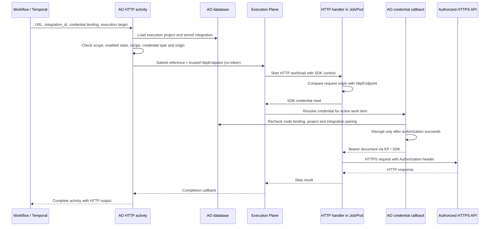

# Credentialed HTTP execution plan

The HTTP workload already consumes a declared bearer credential through the SDK callback. This change connects AO's stored integration settings and credential authorization to that invocation.

1. Add a stored HTTP integration with a validated HTTPS origin and a selected HTTP Bearer Token credential. Use the existing integration API, project visibility, credential checks, and Alembic migration mechanism.
2. Add an optional integration reference to the HTTP workflow node. Resolve its stored origin and authorized credential in the HTTP activity using the execution's persisted project. Require the invocation binding to match the integration's selected credential.
3. Pass only the credential reference and a server-derived `httpEndpoint` into EP. Skip early secret resolution for EP HTTP activities. Keep correlation fields owned by shared dispatch.
4. At credential callback time, recheck the workflow binding, project, enabled state, integration selection, and credential pairing. Return the bearer document expected by the HTTP SDK handler.
5. Add regression coverage for origin mismatch, disabled and out-of-scope integrations, mismatched credentials, reference-only dispatch, callback authorization, and existing uncredentialed dispatch.
6. Regenerate affected API contracts, run repository checks, and open a separate draft PR targeting the HTTP dispatch branch. Record live acceptance separately from local test results.

The AAP PRs provide design context for server-derived runtime context and SDK callback resolution. Implementation changes are authored on this HTTP branch.

## Execution flow

Workflow → Temporal HTTP activity → AO authorizes integration, origin and credential reference → EP → OpenShift Job/Pod → HTTP handler validates origin → SDK credential callback → AO reauthorizes and decrypts → handler sends HTTPS bearer request → EP completion → AO completes Temporal activity → workflow continues.

## Implementation map

| Layer | Implementation | Purpose |
| --- | --- | --- |
| Integration API | `HTTPConfiguration`, HTTP enum migration, service credential restrictions, connection adapter | Store an administrator-selected HTTPS origin and bearer credential using existing integration permissions. |
| Workflow model | `APIExecutorParameters.integration_id`, integration-reference validator | Link the HTTP node to an HTTP integration and retain normal project scope checks. |
| Dispatch authorization | `execution_plane/http_credentials.py`, `ep/http_dispatch.py` | Require one explicit binding matching `management_credential_id`; compare scheme, host and effective port before submission. |
| Temporal | `http-ep-bearer-credentials-v1` patch | Avoid eager secret resolution for EP HTTP while preserving existing workflow history behavior. |
| EP envelope | `_dispatch_to_ep(http_endpoint=...)` | Add the server-derived origin to runtime context alongside shared correlation fields. |
| Credential callback | `CredentialResolveWorkloadCommandHandler` | Reauthorize the persisted node and binding, then convert the bearer injector result into the handler's `token` document. |
| Contracts | Bundled OpenAPI, Python client, TypeScript contracts | Expose the same HTTP integration and node fields to API clients. |

## Scope and acceptance

The implementation uses the existing HTTP bearer handler contract from step-types PR #38. It does not need a change to that handler or to the AAP PRs. Configuration is available through the API; a dedicated HTTP integration picker in the workflow UI is outside this change.

The initial binding must match the integration's selected management credential. Arbitrary credentials from the same project are not accepted. The destination uses HTTPS with system certificate verification; basic authentication, custom CA configuration, private destinations and output selection are outside this first HTTP EP contract.

The new PR is stacked on AO HTTP dispatch PR #1450. Loop activity credential correlation is shared work tracked by AO PR #1439 and is not copied into this branch. Credentialed loop execution needs that dependency integrated and tested. Live credentialed execution on an EP/OpenShift deployment remains an acceptance requirement before promotion from draft.

## Local verification

- 144 focused tests passed, covering authorization, credential callback, reference-only dispatch, Temporal credential handling, workflow reference validation, native HTTP regression and connection-check redirect behavior.
- Backend strict type checking passed for 2,681 source/test files and 23 SDK files. Generated frontend contracts passed TypeScript checking.
- OpenAPI drift check passed. Alembic generated the expected enum-upgrade SQL; this is not a live database migration result.
- The repository-wide `make -C backend test-all` command failed during collection because the existing unit and integration conftest files define `pytest_plugins` below the top-level test directory. This is distinct from the focused test results.
- Live HTTP bearer execution and credentialed loop acceptance remain unverified. No production-readiness percentage is inferred from local test coverage.
